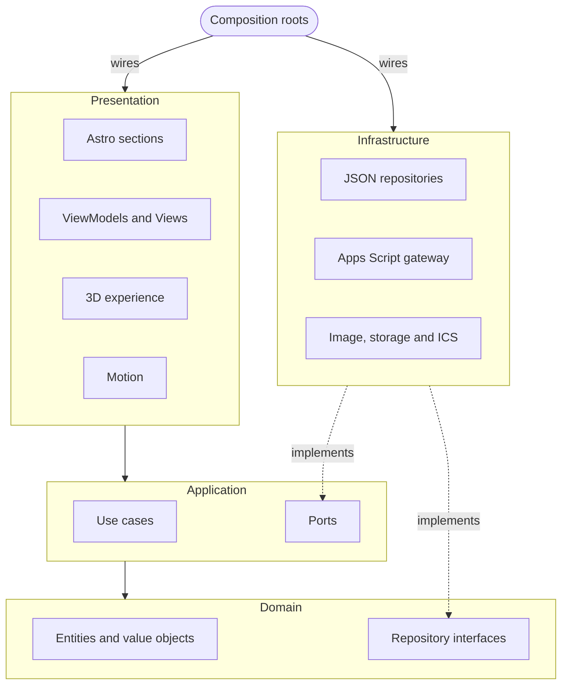
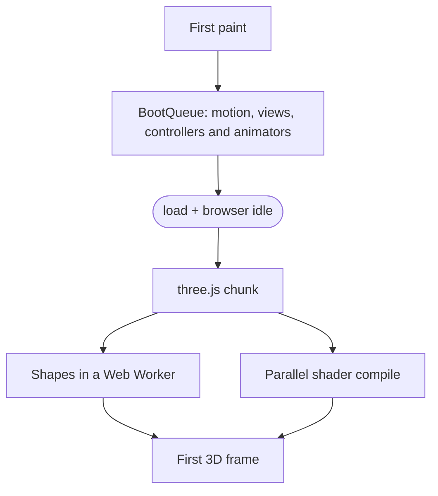

<div align="center">

<sub>[Português](README.md) · **English**</sub>

<picture>
  <source media="(prefers-reduced-motion: reduce)" srcset="https://raw.githubusercontent.com/Marcos-Codfy/lp-hackarun/main/docs/media/scroll-preview-poster.jpg" />
  
</picture>

# HackaRun · Overdrive

**Desvende. Programe. Conquiste.** <sub>(Uncover. Code. Conquer.)</sub>

The landing page for Unicatólica's Software Engineering and AI hackathon, which tells the event's story as you scroll:
a single WebGL particle field turns into a different 3D object for each section, and registrations land straight in a
Google Sheet.

<sub>**Overdrive** is the codename of this page's cinematic v2: like the turbo boost in racing games, it speeds up from
scene to scene and, at registration, the globe charges up and bursts with energy.</sub>

[](https://github.com/Marcos-Codfy/lp-hackarun/actions/workflows/ci.yml)


[](#performance)

<!-- DEMO: the badge and link for the official site (Cloudflare Pages) go here once it is live. -->

[Project guide (pt-BR)](docs/GUIA_DO_PROJETO.md) · [Decisions (ADRs)](docs/adr) · [Changelog](CHANGELOG.md) ·
[Design spec](docs/design/design-spec.md) · [Contributing](CONTRIBUTING.md)

</div>

---

**For reviewers:** [In 30 seconds](#in-30-seconds) · [Visuals](#visuals) · [Behind the scenes](#behind-the-scenes) ·
[Challenges I solved](#challenges-i-solved) · [Stack](#stack) · [Architecture](#architecture) ·
[Performance](#performance) · [Accessibility](#accessibility)<br />
**For developers:** [Getting started](#getting-started) · [Scripts](#scripts) ·
[Registration](#content-and-registration) · [Deploy](#deploy) · [Roadmap](#roadmap)

## In 30 seconds

- **My role:** solo project. I designed the page on top of the event's brand manual and built the 3D and shaders, the
  front end, the Apps Script registration API, the tests, the CI and the docs.
- **What it is:** the official site of HackaRun 2026, the hackathon run by Unicatólica's Software Engineering and
  Artificial Intelligence courses in partnership with Capim Dourado Shopping, a local mall. It is a 4-day event,
  November 11 to 14, 2026, in Palmas, Tocantins, Brazil. The page covers the schedule, 8 missions, mentors, prizes, a
  hunt for 3 hidden tokens, registration and a page of its own for the confirmed teams, with each team's photo or
  logo, live. All site content is in Brazilian Portuguese.
- **What sets it apart:** 8 procedural 3D objects (globe, stopwatch, "?", holographic map, synthwave terrain, stage,
  trophy and galaxy) made of 9,000 to 42,000 particles, with no 3D models and no video, plus cinematic
  post-processing and a choreographed camera for every transition.
- **Fast:** Lighthouse mobile Performance **95** (up from 66), 18 ms TBT and 0.048 CLS. Accessibility, Best practices
  and SEO at **100**.
- **Accessible:** all content shows up without JavaScript and without WebGL (only submitting the registration needs
  JavaScript, and the page says so), `prefers-reduced-motion` is respected and there is a pause animations button
  (WCAG 2.2.2).
- **Zero-cost backend:** form → Google Apps Script → Google Sheets, with the team photo in Google Drive, idempotent
  retries, rate limits, a concurrency lock and versioned LGPD (Brazil's data protection law) consent.
- **Engineering:** Clean Architecture + DDD + MVVM with the dependency rule enforced by ESLint, 411 tests, CI on
  GitHub Actions, Conventional Commits and 7 ADRs.

## Visuals

<p align="center">
  
  <br /><sub>Nine sections, nine moments of the same particle field. In the hero, the official logo is the H1 and the LCP element.</sub>
</p>

<p align="center">
  
  <br /><sub>On a phone (390 px), at the same quality tier a recent device gets.</sub>
</p>

## Behind the scenes

The brief was cinema-level impact with an e-sports feel. There was a ready-made video for the hero background, but it
weighed 2.4 MB, looked blurry on large screens, cropped the logo on a phone held upright and carried misspelled text.
I swapped it for particles generated in code: zero bytes of media for the main effect and a different object for each
part of the event's story. The decision is in [ADR 0005](docs/adr/0005-procedural-particles-over-video.md).

The cost showed up on Lighthouse mobile: a Performance score of 66, and on a weak phone the page could freeze for
about 4 seconds. Instead of cutting effects, I changed the order of things
([challenge 1](#1-breaking-up-the-boot-from-66-to-95-on-lighthouse-mobile)).

My favorite detail is the tilde. Orbitron is the brand's official font, but in large headings "NÃO" (Portuguese for
"no") looked like "NÀO". Switching fonts would mean walking away from the identity, so I redrew the tilde in Python
with fontTools, across weights 400 to 900. Almost nobody will notice, but I would have seen that "NÀO" every time I
opened the page.

I also decided early that the 3D would be an extra: if it fails, the page is still whole. All content shows up without
JavaScript and without WebGL (only registration needs JavaScript), and anyone can pause the animations. What's left is
bringing LCP from 2.6 s to under 2.5 s and the initial JS under 70 KB. Both are on the roadmap.

After v2 was approved, the organizers sent a list of tweaks, and most of it asked for less, not more. I removed sound
entirely (the toggle, the synthesis and the files), made the registration climax shorter and calmer, with no white
flash and no camera shake, and gave the teams a page of their own, with the photo or logo each team uploads when it
registers ([challenge 9](#9-team-photos-without-an-image-server)).

## Challenges I solved

### 1. Breaking up the boot: from 66 to 95 on Lighthouse mobile

- **Problem:** with all the setup running at once on load, the Lighthouse mobile Performance score was 66.
- **Solution:** `App.boot()` waits for the first paint and runs a [`BootQueue`](src/presentation/app/BootQueue.ts):
  each step in its own task, yielding with `scheduler.yield()` and marked as `boot:<name>` in DevTools User Timing. A
  section's animations are only set up when it gets close to the viewport, and the three.js chunk (155 KB gzip) is
  only imported after `load`, once the browser is idle.
- **Result:** Performance 95 and 18 ms TBT (down from 1,600 ms), median of 3 runs, without dropping a single effect.

### 2. A particle morph that flows instead of scrambling

- **Problem:** if particle k lands anywhere in each of the 8 shapes, the transition turns into noise.
- **Solution:** every shape is sorted by a 2D Morton code (Z-order, bits interleaved with `spread10`) and gets the
  same Fisher-Yates permutation (seed `20261114`), in [`sampling.ts`](src/presentation/experience/shapes/sampling.ts).
  The key is code × 2ⁿ + index, so the native `Float64Array.sort()` runs without a comparator.
- **Result:** particle k sits in the "same relative place" in every shape, and trimming particles with `drawRange`
  still shows the whole shape. Mid-flight, the [vertex shader](src/presentation/experience/shaders/particles.vert.glsl)
  advects particles through a divergence-free ABC flow field, so scene changes become swirling filaments.

<details>
<summary><b>4 more rendering challenges: worker, shaders, GPU tiers and SplitText</b></summary>

### 3. Eight point clouds generated off the main thread

- **Problem:** generating the shapes and particle seeds on the main thread competes with scrolling and input.
- **Solution:** a module Web Worker ([`shapes.worker.ts`](src/presentation/experience/shapes/shapes.worker.ts))
  returns the buffers as transferables. Without a worker, the same generator job
  ([`ParticleJob.ts`](src/presentation/experience/shapes/ParticleJob.ts)) runs on the main thread in slices with
  identical output (same code, same seeds), and the work can be canceled if the tier guess turns out wrong.
- **Result:** the worker weighs 7.7 KB gzip and the page stays responsive while the shapes are built.

### 4. Shaders that compile without a hitch

- **Problem:** a shader holding 8 shapes is large, and compiling a WebGL program blocks the frame.
- **Solution:** one GLSL file per object, and
  [`ParticleMaterial`](src/presentation/experience/particles/ParticleMaterial.ts) only declares `HAS_<KEY>` and
  `IDX_<KEY>` for the scenes that are present, so the compiler drops the whole branch of a missing scene, and palette
  indices are constants. [`StageCompiler`](src/presentation/experience/post/StageCompiler.ts) precompiles programs in
  slices with `KHR_parallel_shader_compile`, and [`GpuContext`](src/presentation/experience/GpuContext.ts)
  pre-answers `getParameter` queries after a GPU fence so the three.js constructor doesn't block.
- **Result:** shaders, render targets and buffers are primed step by step before the canvas shows up.

### 5. The same site on a gaming laptop and on a budget phone

- **Problem:** 42,000 particles with full-screen bloom don't fit every GPU.
- **Solution:** [`QualityDetector`](src/presentation/experience/quality/QualityDetector.ts) picks a tier from the GPU
  name, cores, memory, screen and pointer type: 9,000, 22,000 or 42,000 particles. If FPS stays below 45 for about
  2 s, [`AdaptiveQuality`](src/presentation/experience/quality/AdaptiveQuality.ts) cuts bloom (full, half, off), then
  the resolution, then the tier, and never goes back up.
- **Result:** without WebGL2, with `save-data` on, if the chunk fails to load or a shader fails to link, the 3D steps
  aside and the CSS glow stays. The page never depends on the 3D.

### 6. Animated headings without the cost of SplitText

- **Problem:** GSAP SplitText builds an `Intl.Segmenter` on load: about 40 ms on desktop and roughly 4 times that on
  a phone.
- **Solution:** a custom [`LineSplit`](src/presentation/motion/animators/heading/LineSplit.ts) splits headings into
  masked lines with a single layout read, and `revert()` restores the original nodes. One shared observer
  ([`ApproachWatcher`](src/presentation/motion/core/ApproachWatcher.ts)) runs one setup per task.
- **Result:** SplitText is gone from the project, and no section pays for its setup before it gets near the viewport.

</details>

### 7. The brand font turned "NÃO" into "NÀO"

- **Problem:** Orbitron is the brand font, but its tilde looked like a grave accent in large headings.
- **Solution:** a Python script using fontTools ([`patch_orbitron_tilde.py`](scripts/fonts/patch_orbitron_tilde.py))
  redraws a stepped geometric tilde for Ã, Õ, ã, õ, Ñ and ñ, with variation deltas covering weights 400 to 900.
- **Result:** an 11,728-byte woff2 where "NÃO" reads right, with the decision recorded in
  [ADR 0006](docs/adr/0006-cinematic-v2-and-official-identity.md).

### 8. Reliable registration without a server

- **Problem:** a Google Sheet is free and the organizers already use it, but it has to cope with retries, spam and
  simultaneous submissions.
- **Solution:** the [Apps Script](apps-script/) takes a `LockService` lock, and each form session sends a UUID v4
  key: a retry gets the same protocol code back, from the cache or from the key stored in the row. There are 10
  attempts per e-mail every 10 min, counted by the e-mail's SHA-256 hash, before the global limit of 120 per minute.
  Deadline and capacity come from Script Properties, and a malformed value closes registration. A cell starting with
  `= + - @` gets an apostrophe against formula injection, and requests are a plain `text/plain` "simple request" with
  no CORS preflight.
- **Result:** the real `.gs` files run in the tests inside a Node `vm` sandbox with fake Sheet, Cache and Lock
  services ([`sandbox.ts`](tests/helpers/apps-script/sandbox.ts)), and a test checks that `TEAM_SIZE`,
  `MIN_ELAPSED_MS` and `CONSENT_VERSION` stay in sync with the TypeScript side.

### 9. Team photos without an image server

- **Problem:** each team uploads a photo or logo when it registers, but the site is static, Apps Script only receives a
  text body and phone photos weigh several MB. Nothing could go live before the organizers had looked at it.
- **Solution:** the browser does the heavy lifting.
  [`PrepareTeamImage`](src/application/use-cases/PrepareTeamImage.ts) opens the image with `createImageBitmap`
  (respecting EXIF), scales it to 800 px on the long side and tries WebP, then JPEG, lowering the quality and then the
  size until it fits in ~300 KB. A logo with a transparent background gets a contrasting fill. The bytes travel as
  base64 in the same `POST`, and a retry sends the same bytes with the same key. On the server,
  [`Images.gs`](apps-script/Images.gs) checks the format by its leading bytes, writes to Drive only after the duplicate
  checks, names the file after the protocol code, and the public list only exposes the photo id of confirmed teams.
- **Result:** zero cost, moderation is the same `confirmado` the organizers were already setting, and the CSP allows a
  single image host (`lh3.googleusercontent.com`). A Drive outage or a blocked public link never takes the
  registration down: the card shows the team's initials. The decision is in
  [ADR 0007](docs/adr/0007-team-photos-google-drive.md).

<details>
<summary><b>Other details I'm proud of</b></summary>

- **Custom post-processing:** `RenderPass` → bloom at its own resolution, tinted per scene →
  [cinematic pass](src/presentation/experience/shaders/cinematic.frag.glsl) with light shockwave refraction,
  hyperspace zoom blur, edge-only chromatic aberration, exposure with a soft shoulder, vignette and 24 fps grain.
- **Registration climax:** when `#inscricao` enters the viewport,
  [`SceneHoldWatcher`](src/presentation/motion/core/SceneHoldWatcher.ts) counts 0.9 s (the scroll is never locked).
  The CTA meter fills over the same time as the charge and, at the end, a single event releases the globe's pulse and
  lights up the button. What the charge adds to the glow is capped (`MAX_CHARGE_BLOOM`), so the heading and the CTA
  never lose contrast.
- **A light page for the teams:** `/equipes` boots on its own ([`LightApp`](src/presentation/app/LightApp.ts)), which
  only wires the header, menu, pause toggle and live list. No three.js, GSAP or Lenis module is downloaded.
- **Resilience:** `EventBus`, `Observable` and `Ticker` isolate a handler that throws, and if GSAP or Lenis fail the
  page falls back to native scrolling.
- **`content-visibility` without broken anchors:** far sections render on demand, with `contain-intrinsic-size`
  measured at 390 and 1440 px (the latter applies from 1024 px up). On arrival, the scroll re-checks the target and
  makes a second 0.45 s pass if it drifted more than 6 px ([`anchorcheck.mjs`](scripts/qa/anchorcheck.mjs) verifies
  it).
- **Generated docs:** `npm run docs:pdf` builds 2 PDFs with pdfkit and a custom Markdown renderer.

</details>

## The race in 8 scenes

Each section declares `data-scene`. Scrolling blends the shapes on the GPU continuously and reversibly, and
[`FlightPath`](src/presentation/experience/camera/FlightPath.ts) has camera choreography for every transition, from
flying through the globe shell to the final pull-back.

| Section                     | Scene     | Object                                                                  |
| --------------------------- | --------- | ----------------------------------------------------------------------- |
| Hero (`#inicio`)            | `core`    | Energy globe made of particle ribbons, its silhouette lit by fresnel    |
| About (`#sobre`)            | `orbit`   | Stopwatch-gyroscope: dial, sweep hand and gimbal rings                  |
| NPCs (`#npcs`)              | `enigma`  | Extruded question mark with a dashed clue band and a HUD halo           |
| Missions (`#missoes`)       | `map`     | Holographic map: round platform, spiral route and 8 energized beacons   |
| Schedule and mentors        | `terrain` | Synthwave floor: scrolling grid, mountains and a striped sun            |
| Grand final (`#final`)      | `stage`   | Show stage: 16:9 LED wall, truss, 8 light cannons and a bouncing crowd  |
| Prizes (`#premios`)         | `trophy`  | Lathe-profile cup drawn in lines, tube handles and a star on top        |
| Teams and FAQ               | `dust`    | A distant, calm galaxy with 2 spiral arms: a quiet backdrop for reading |
| Registration (`#inscricao`) | `core`    | The globe returns, charges for 0.9 s and releases a pulse (the climax)  |

## Stack

| Layer    | Technologies                                                                                                    |
| -------- | --------------------------------------------------------------------------------------------------------------- |
| Base     | [Astro 7](https://astro.build) (SSG), TypeScript 6 (strictest), Vite                                            |
| 3D       | [Three.js](https://threejs.org) r186 + custom GLSL, EffectComposer, UnrealBloomPass and a custom cinematic pass |
| Motion   | [GSAP](https://gsap.com) 3.15 (ScrollTrigger), [Lenis](https://lenis.darkroom.engineering) 1.3, `LineSplit`     |
| Styling  | Modern CSS (custom properties, `@property`, cascade layers, `clamp()`, `content-visibility`), design tokens     |
| Fonts    | Orbitron (with the fixed tilde), Montserrat and JetBrains Mono, self-hosted via Fontsource, latin subset only   |
| Images   | `createImageBitmap` + canvas in the browser (WebP or JPEG), Google's image CDN for the team photos              |
| Backend  | Google Apps Script (V8) + Google Sheets + Google Drive (photos), serverless                                     |
| Quality  | Vitest + happy-dom, ESLint 10 + typescript-eslint, Prettier, Astro Check, Playwright + Lighthouse               |
| Workflow | Husky, lint-staged, commitlint (Conventional Commits), GitHub Actions                                           |
| Hosting  | Cloudflare Pages ([ADR 0003](docs/adr/0003-cloudflare-pages-hosting.md))                                        |

Full list of libraries, patterns and concepts (pt-BR):
[`docs/pdf/HackaRun_LP_Stack_e_Padroes.pdf`](docs/pdf/HackaRun_LP_Stack_e_Padroes.pdf).

## Architecture

Clean Architecture with DDD and MVVM. Dependencies point toward the domain, and ESLint (`no-restricted-imports` in
[`eslint.config.js`](eslint.config.js)) rejects any aliased import (`@application/*`, `@infrastructure/*`…) that breaks
the rule.



- **Domain:** imports no other layer and no framework (`three`, `gsap`, `lenis`, `astro`).
- **Application:** depends on the domain, never on infrastructure, presentation or a framework.
- **Presentation:** never imports `@infrastructure`; adapters are wired in `src/composition` and arrive ready to use.
- **Shared** (`EventBus`, `Observable`, `Ticker`): used by the other layers and imports none of them.

**DDD building blocks:** `Entity` and `ValueObject` base types, `Result<T, E>` with `ok` and `fail`, two aggregate
roots (`HackathonEvent` and `TeamRegistration`), value objects such as `Email`, `Phone`, `TeamName`, `TeamImage`,
`Countdown` and `ScoringRule`, the `RegistrationPolicy` domain service (soon, open, closing, closed) and 13 use cases.
Invalid JSON content fails the build.

**MVVM:** 6 DOM-free ViewModels holding state in `Observable` (countdown, HUD, pause, NPC hunt, form and teams), and
Views that only bind the DOM. Modules talk through a typed `EventBus`
([`AppEvents.ts`](src/presentation/app/AppEvents.ts)): `scene:enter`, `experience:charged`, `motion:paused`,
`npc:found` and more.

**In the browser**, in priority order and without holding back the first paint:



**Every 3D frame:** scroll → `SceneDirector` (continuous scene index) → `SceneMixer` (weights) → vertex shader (morph
between targets) → `RenderPass` → bloom → cinematic pass → opaque canvas blended over the CSS aurora.

<details>
<summary><b>Design patterns and where they live</b></summary>

| Pattern              | Where                                                                                                                                                                                                                                           |
| -------------------- | ----------------------------------------------------------------------------------------------------------------------------------------------------------------------------------------------------------------------------------------------- |
| Strategy             | [`ShapeStrategy`](src/presentation/experience/shapes/ShapeStrategy.ts) (8 objects), [`RenderPipeline`](src/presentation/experience/post/RenderPipeline.ts), `QualityProfile`, `ScrollDriver`                                                    |
| Factory + registry   | [`ShapeFactory`](src/presentation/experience/shapes/ShapeFactory.ts), [`BoltFactory`](src/presentation/motion/animators/hero/lightning/BoltFactory.ts)                                                                                          |
| Registry             | [`AnimatorRegistry`](src/presentation/motion/animators/AnimatorRegistry.ts)                                                                                                                                                                     |
| Template Method      | [`SectionAnimator`](src/presentation/motion/animators/SectionAnimator.ts)                                                                                                                                                                       |
| Adapter              | [`SmoothScroll`](src/presentation/motion/core/SmoothScroll.ts) (Lenis), [`AppsScriptRegistrationGateway`](src/infrastructure/registration/AppsScriptRegistrationGateway.ts), [`CanvasImageCodec`](src/infrastructure/image/CanvasImageCodec.ts) |
| Decorator            | [`RetryingRegistrationGateway`](src/infrastructure/registration/RetryingRegistrationGateway.ts): 3 attempts, exponential backoff with jitter                                                                                                    |
| Fallback proxy       | [`FallbackTeamRepository`](src/infrastructure/repositories/FallbackTeamRepository.ts): live sheet first, build-time list as backup                                                                                                              |
| Null Object          | [`UnavailableRegistrationGateway`](src/infrastructure/registration/UnavailableRegistrationGateway.ts): in production with no endpoint, every submission answers "closed"                                                                        |
| Observer             | [`Observable`](src/shared/core/Observable.ts), [`EventBus`](src/shared/core/EventBus.ts)                                                                                                                                                        |
| Singleton            | [`Ticker.shared`](src/shared/core/Ticker.ts) (one rAF for the whole site), [`serverContainer()`](src/composition/server.ts)                                                                                                                     |
| Facade               | [`GetLandingPage`](src/application/use-cases/GetLandingPage.ts), [`ExperienceStage`](src/presentation/experience/ExperienceStage.ts)                                                                                                            |
| Composite            | [`strokes.ts`](src/presentation/experience/shapes/strokes.ts): a shape is a list of weighted strokes                                                                                                                                            |
| Builder              | [`PointBrush`](src/presentation/experience/shapes/PointBrush.ts), [`BoltBuilder`](src/presentation/motion/animators/hero/lightning/BoltBuilder.ts), [`StageBuilder`](src/presentation/experience/StageBuilder.ts)                               |
| Repository + Mapper  | [`StaticListRepository`](src/infrastructure/repositories/StaticListRepository.ts), [`EventMapper`](src/infrastructure/mappers/EventMapper.ts)                                                                                                   |
| Cooperative job      | [`ParticleJob`](src/presentation/experience/shapes/ParticleJob.ts): a generator that yields the thread                                                                                                                                          |
| Dependency inversion | [`BootSteps`](src/presentation/app/BootQueue.ts), the interface the boot sees                                                                                                                                                                   |

</details>

More in the [project guide (pt-BR)](docs/GUIA_DO_PROJETO.md#6-arquitetura) and the [ADRs](docs/adr).

## Performance

Lighthouse mobile on the production build, Brave headless, median of 3 runs on 2026-10-11:

| Metric                                | Project target | Before   | Now       |
| ------------------------------------- | -------------- | -------- | --------- |
| Performance                           | ≥ 90           | 66       | **95**    |
| Total Blocking Time                   | –              | 1,600 ms | **18 ms** |
| Largest Contentful Paint              | < 2.5 s        | 2.9 s    | 2.6 s     |
| First Contentful Paint                | –              | –        | 2.0 s     |
| Speed Index                           | –              | –        | 2.5 s     |
| Cumulative Layout Shift               | < 0.05         | –        | **0.048** |
| Accessibility, Best practices and SEO | 100            | 100      | **100**   |
| Initial JS (entry chunk, gzip)        | < 70 KB        | –        | 76.9 KB   |

<sub>Before: the score from the last report prior to the performance work. Dash: no target of its own or no earlier
record.</sub>

LCP and initial JS are still slightly above the targets I set myself, and both are on the [roadmap](#roadmap). What
keeps the rest in shape:

- Static HTML with the hero ready at build time. The official logo is the H1 and the LCP element, with high priority,
  and the small CSS is inlined.
- Self-hosted fonts, latin subset only, two preloaded, `font-display: swap`.
- three.js in its own chunk (606 KB, 155 KB gzip), imported after `load` and once the browser is idle.
- 3D rendering pauses when the tab is hidden, and the logo lightning only runs while the hero is visible.
- `/equipes` has no 3D, GSAP or Lenis. Photos come at 600 px from Google's CDN with `loading="lazy"`,
  `decoding="async"` and a fixed width and height (no layout shift); on upload, the browser already brings each photo
  down to ~300 KB.
- Immutable caching for one year on `/_astro/*` and HTML always revalidated ([`public/_headers`](public/_headers)).

<sub>The measurements above are from 2026-10-11, before the 2026-10-12 tweaks (sound removed, calmer climax and the
teams page). The `/equipes` page has not been measured on a production build yet.</sub>

## Accessibility

The target is **WCAG 2.2 AA**, and Lighthouse scores accessibility at 100:

- A "Pular para o conteúdo" skip link and visible focus (`:focus-visible`, never `outline: none`), including Windows
  high contrast (`forced-colors: active`).
- `prefers-reduced-motion`: instant native scrolling, whole-scene swaps, 3D drawn on demand only and no entrance
  animations.
- A **pause animations** button (WCAG 2.2.2) in the header and the mobile menu: it freezes the 3D clock, the
  lightning and the CSS loops, and the choice is saved. Its tooltip closes with Esc (WCAG 1.4.13).
- Mobile menu with the rest of the page `inert`, a focus trap, Esc to close and focus returned to the toggle. Anchor
  links move focus to the target section.
- Form with an accessible error summary, `aria-invalid` and `aria-describedby`, live regions for status and
  screen-reader copies of the "typed" or "decoded" text. The photo field has a preview, a replace button, drag and
  drop and an announced status.
- The `/equipes` page has a breadcrumb (`aria-current="page"`), a labeled search, a count announced in a live region
  and "Foto ou logo da equipe X" alt text on every card. Lighthouse (measured in dev) scores its accessibility at 100.
- Full content without JavaScript and without WebGL: the HTML is complete at build time, and the form says so when
  JavaScript is off.

## Security and privacy (LGPD)

- **Strict CSP** in [`public/_headers`](public/_headers): `script-src 'self'` with no inline script, `connect-src`
  limited to the site's own origin and Apps Script, `img-src` limited to the site's own origin and
  `lh3.googleusercontent.com` (the team photos), `object-src 'none'` and `frame-ancestors 'none'`, plus `nosniff`,
  `X-Frame-Options: DENY`, COOP, Permissions-Policy and Referrer-Policy.
- **Minimal public data:** the teams page shows only the team name, course, member count and photo or logo (never
  people's names, e-mails or phone numbers), and only after the organizers confirm the registration. Cards are built
  from a `<template>` using `textContent` (nothing from the sheet becomes HTML), and the photo URL is only built from
  an id in the Drive id format.
- **Uploads checked on the server:** the photo is validated by its leading bytes (JPEG, PNG or WebP), the declared
  type has to match and the cap is 400 KB. The file is named after the protocol code, never after anything typed.
- **Anti-spam:** a honeypot field, a 3 s minimum fill time, and per-e-mail (the counter keys on the e-mail's SHA-256
  hash only) and global limits.
- **Protected sheet:** formula injection (`= + - @`) is neutralized and `LockService` prevents concurrent writes.
- **LGPD:** a privacy notice at [`/privacidade`](src/pages/privacidade.astro) in 10 sections, from who handles the
  data to in-browser storage, including the team photo and how sensitive accessibility data is treated. Each
  registration stores the accepted notice version and the consent time (`CONSENT_VERSION`), and the server rejects
  submissions without them or with an old version. For team registrations, consent includes permission to publish the
  photo and a statement that everyone in it agreed.

## Quality

| Item       | Status                                                                                                           |
| ---------- | ---------------------------------------------------------------------------------------------------------------- |
| Tests      | **411 tests in 56 files** (Vitest + happy-dom), split by layer, including 5 suites that run the real Apps Script |
| Lint       | ESLint with no errors or warnings: layer rules, a 250 code-line cap per file, `import type`                      |
| Types      | `astro/tsconfigs/strictest` (`noUncheckedIndexedAccess`, `exactOptionalPropertyTypes`, …) + Astro Check          |
| Formatting | Prettier across the repository                                                                                   |
| CI         | GitHub Actions on push to `main` and on PRs: `npm ci` → lint → format check → tests → build → `dist` artifact    |
| Commits    | Husky + lint-staged on pre-commit and commitlint on commit-msg (a scope outside the list triggers a warning)     |
| Browser QA | [`scripts/qa/`](scripts/qa/README.md): screenshots, anchors, overflow, Web Vitals, long tasks and Lighthouse     |

**By the numbers:** 378 files and 27,323 lines in `src` (TypeScript, Astro, GLSL and CSS), of which 88 files and 5,578
lines are the 3D module; 56 test files and 6 helpers, with 5,073 lines; 512 lines of Apps Script; 7 ADRs.

---

## For developers

### Getting started

**Requirements:** Node.js 24 LTS (the `.nvmrc` and CI version; on Node 22, use 22.18 or newer) and npm. Python 3 only
to regenerate the font or the PDF assets.

```bash
git clone https://github.com/Marcos-Codfy/lp-hackarun.git
cd lp-hackarun
npm ci
cp .env.example .env
npm run dev
```

Open `http://localhost:4321`. Without a registration endpoint, the form runs in **simulated mode** under `npm run dev`,
and teams registered in the simulation show up as confirmed, with their photo, on `/equipes` while the tab stays open.

| URL parameter                    | Effect                                                              |
| -------------------------------- | ------------------------------------------------------------------- |
| `?quality=low\|medium\|high`     | Forces the 3D tier and turns off the automatic FPS-based adjustment |
| `?now=2026-11-14T16:00:00-03:00` | Shifts the site clock to check the countdown milestones             |

### Environment variables

| Variable                       | Required | Description                                                                           |
| ------------------------------ | -------- | ------------------------------------------------------------------------------------- |
| `PUBLIC_SITE_URL`              | no       | Public URL (canonical, sitemap, Open Graph). Default: `https://lp-hackarun.pages.dev` |
| `PUBLIC_REGISTRATION_ENDPOINT` | no       | Apps Script Web App URL. Empty means "inscrições em breve" (simulated mode in dev)    |
| `DOCS_OUT_DIR`                 | no       | Extra folder where `npm run docs:pdf` copies the PDFs and the guide                   |

The QA scripts read `BRAVE_PATH` or `CHROME_PATH` to find the browser.

### Scripts

| Command                           | Description                                              |
| --------------------------------- | -------------------------------------------------------- |
| `npm run dev`                     | Development server                                       |
| `npm run build`                   | Type check (`astro check`) + production build to `dist/` |
| `npm run preview`                 | Serves the build locally                                 |
| `npm test` / `test:watch`         | Unit tests once / in watch mode                          |
| `npm run lint` / `lint:fix`       | ESLint (layer rules, file size) / with autofix           |
| `npm run format` / `format:check` | Prettier: write / verify                                 |
| `npm run validate`                | Lint + tests + build (CI runs this plus `format:check`)  |
| `npm run docs:pdf`                | Generates the 2 PDF docs in `docs/pdf/`                  |

<details>
<summary><b>Asset scripts (Python) and QA scripts (Playwright + Lighthouse)</b></summary>

Script-generated assets are never edited by hand: run the script and commit the output.

| Command                                        | Requires                        | Generates                                                 |
| ---------------------------------------------- | ------------------------------- | --------------------------------------------------------- |
| `python scripts/fonts/patch_orbitron_tilde.py` | `fonttools`, `brotli`           | `src/assets/fonts/orbitron-pt-latin-wght.woff2`           |
| `python scripts/docs/build_pdf_assets.py`      | `fonttools`, `brotli`, `Pillow` | `scripts/docs/assets/` (TTF fonts and logos for the PDFs) |

The QA scripts have their own `package.json`, so Playwright and Lighthouse stay out of the project's `npm ci`. They
use the installed Brave or Chrome with a real GPU and take the URL as an argument:

```bash
npm run build && npm run preview                      # keep it running; the rest goes in another terminal
cd scripts/qa && npm install                          # + npx playwright install chromium if there is no Brave/Chrome
node shots.mjs http://localhost:4321/ 390 844 out/m390 "#sobre,#missoes" --mobile
node anchorcheck.mjs http://localhost:4321/           # anchors land just below the header
node overflow.mjs http://localhost:4321/              # nothing overflows at 360 and 390 px
node lighthouse.mjs http://localhost:4321/ --runs=3   # Lighthouse mobile with a median
```

There are also `vitals.mjs` (LCP, CLS and time until the 3D is ready), `longtasks.mjs` (long tasks with 4x CPU
throttling and slow 4G) and `trace.mjs` (a trace up to first paint and the boot steps). Full walkthrough in
[`scripts/qa/README.md`](scripts/qa/README.md).

</details>

### Project structure

<details>
<summary><b>Folder tree</b></summary>

```text
src/
├── domain/          # entities, value objects, aggregates, a domain service and repository interfaces
├── application/     # use cases, DTOs and ports
├── infrastructure/  # JSON content, mappers, repositories, Apps Script, image, storage, clock and ICS
├── presentation/    # app, layouts, sections, components, controllers, formatters, view-models, views, motion,
│                    # styles and experience/ (3D: camera, input, layers, particles, post, quality, scene, shaders, shapes)
├── shared/          # EventBus, Observable, Ticker and utilities
├── composition/     # composition roots (build and browser)
├── assets/          # official logos and Orbitron with the redrawn tilde
└── pages/           # index, equipes (teams), privacidade (LGPD), 404 and the .ics calendar
apps-script/         # registration and photo API (Google Apps Script) + setup guide
design/              # briefing references and the teaser video (not shipped)
public/              # og-image, favicon, _headers and robots
scripts/             # font patch, PDF generator and qa/
tests/               # tests split by layer
docs/                # guide, design spec, ADRs, stack manifest, PDFs and README media
```

</details>

### Content and registration

- **Content** (dates, missions, FAQ, prizes, mentors, partners) lives in `src/infrastructure/content/*.json`. It can
  be edited without coding; invalid data fails the build and the tests validate the real content.
- **Registrations** go to a Google Sheet through Apps Script (`doPost`), and the team's photo or logo goes to a Google
  Drive folder. A team shows up on `/equipes` once the organizers set the Status column to `confirmado`, and the public
  list (`doGet ?action=teams`) is cached for 60 s, with the cache cleared automatically when Status or Imagem changes.
  Taking a photo down only takes clearing its Imagem cell. Step-by-step setup (pt-BR) in
  [`apps-script/README.md`](apps-script/README.md).
- **Script Properties:** `CLOSES_AT` (deadline), `CAPACITY` (max teams), `INSCRICOES_FECHADAS` (closes immediately, no
  site redeploy) and `FOTOS_PASTA_ID` (the photo folder). Changed the privacy notice text? Bump `CONSENT_VERSION` in
  [`SubmitRegistration.ts`](src/application/use-cases/SubmitRegistration.ts) and in
  [`Validation.gs`](apps-script/Validation.gs), and publish the script together with the site.
- **Calendar:** the build generates `/hackarun-2026.ics` (RFC 5545) with every session, downloaded from the "Adicionar
  à agenda" (add to calendar) buttons in the registration area.

### Deploy

Free hosting on **Cloudflare Pages**. To connect it to this repository:

1. Cloudflare → **Workers & Pages → Create → Pages → Connect to Git**.
2. Preset **Astro** · Build `npm run build` · Output `dist`.
3. Variables: `NODE_VERSION=24`, `PUBLIC_SITE_URL` and `PUBLIC_REGISTRATION_ENDPOINT`.

Once connected, every push to `main` deploys to production, and every PR gets a preview URL. The comparison with other options is in
[ADR 0003](docs/adr/0003-cloudflare-pages-hosting.md).

### Contributing

Branch off `main` (`feat/…`, `fix/…`, `docs/…`), write commits in **Conventional Commits**, in English (for example
`feat(sections): add prizes section`), run `npm run validate` and `npm run format:check`, and open a Pull Request with
the template. The full
workflow (pt-BR) is in [CONTRIBUTING.md](CONTRIBUTING.md), and each release's changes are in
[CHANGELOG.md](CHANGELOG.md).

## Roadmap

- [x] Architecture, domain and official content
- [x] Scroll-driven 3D experience with 8 objects
- [x] Cinematic v2 redesign (Overdrive) with the official identity ([ADR 0006](docs/adr/0006-cinematic-v2-and-official-identity.md))
- [x] Registration via Google Sheets, with idempotent retries and deadline and capacity checked on every submission
- [x] Lighthouse mobile ≥ 90 on performance and 100 on accessibility, best practices and SEO
- [x] Pause animations button (WCAG 2.2.2)
- [x] QA scripts (Playwright + Lighthouse) versioned in the repository
- [x] Teams page with each team's photo or logo, moderated through confirmation ([ADR 0007](docs/adr/0007-team-photos-google-drive.md))
- [ ] Official launch on Cloudflare Pages
- [ ] Mobile LCP under 2.5 s
- [ ] Initial JS under 70 KB gzip
- [ ] Official registration link and rules
- [ ] Prizes, mentors and judges revealed

## Credits

- **Design and development:** [Marcos Vinicius Muniz Arruda](https://github.com/Marcos-Codfy)
- **Brand identity (logo, palette and fonts):** official HackaRun 2026 brand manual
- **Organized by:** Unicatólica · Software Engineering and Artificial Intelligence courses
- **Partner:** Capim Dourado Shopping
- **Fonts:** Orbitron, Montserrat and JetBrains Mono (SIL Open Font License)

<sub>HackaRun, Unicatólica, Capim Dourado Shopping and their logos are trademarks of their respective owners and
appear here only to identify the event.</sub>

---

<div align="center">

<sub>Design and development by <a href="https://github.com/Marcos-Codfy">Marcos Vinicius Muniz Arruda</a> ·
Palmas, Brazil · 2026</sub>

<!-- LINKEDIN: replace with the profile link when you want it shown here. -->

</div>
