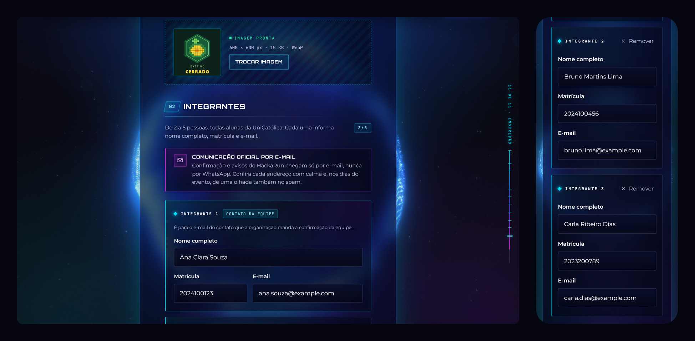
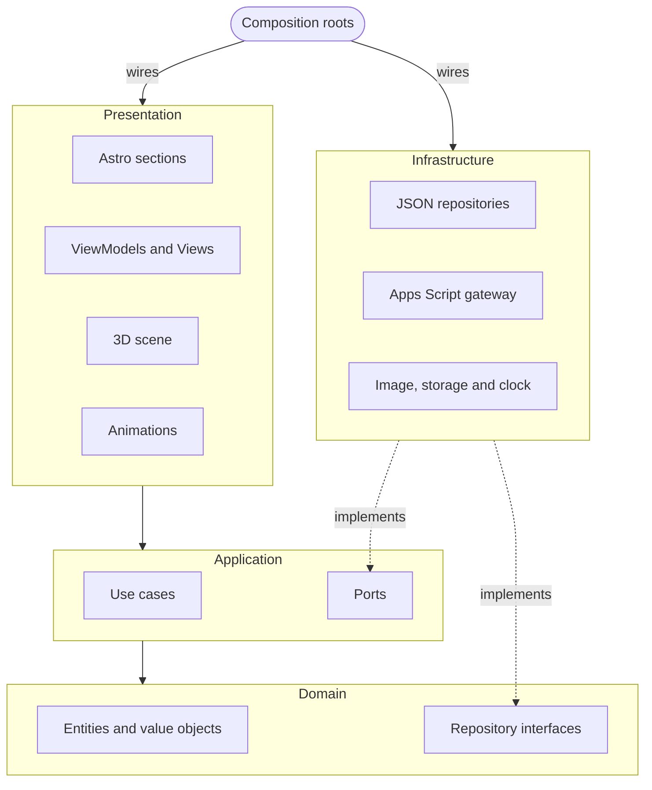
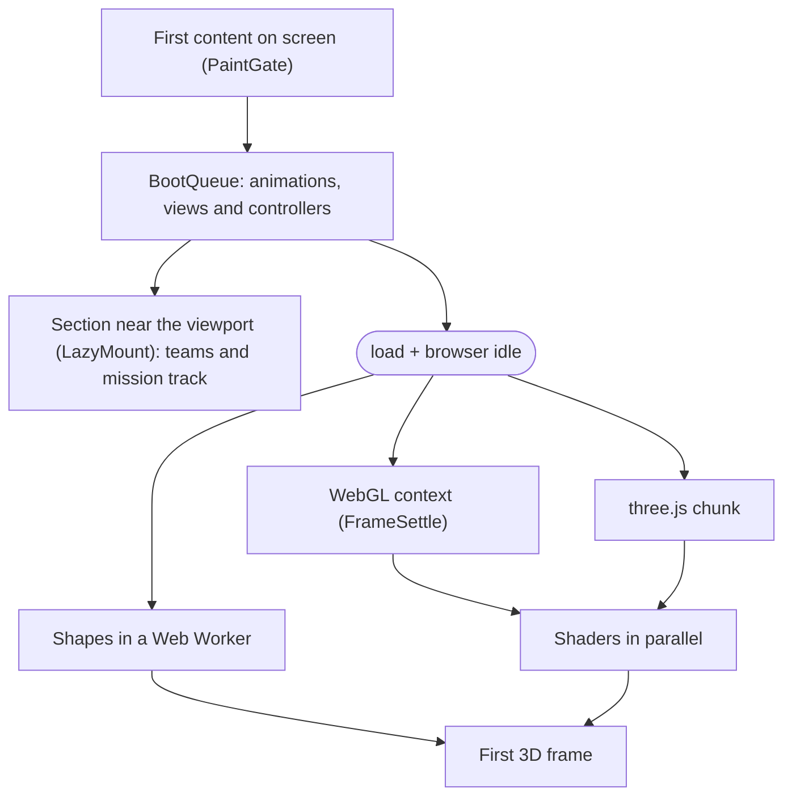

<div align="center">

<sub>[Português](README.md) · **English**</sub>

<picture>
  <source media="(prefers-reduced-motion: reduce)" srcset="https://raw.githubusercontent.com/hackarun-unicatolica/lp-hackarun/main/docs/media/scroll-preview-poster.jpg" />
  
</picture>

# HackaRun

**Desvende. Programe. Conquiste.** <sub>(Uncover. Code. Conquer.)</sub>

Landing page for the 1st HackaRun, UniCatólica's technology, innovation and entrepreneurship event. The site presents
the schedule, the missions and the teams, and takes team registrations, which are saved to a Google Sheet. In the
background, a WebGL 3D scene changes shape at each section as the page scrolls.

[](https://github.com/hackarun-unicatolica/lp-hackarun/actions/workflows/ci.yml)


[](#performance)

**[See the site → hackarun.pages.dev](https://hackarun.pages.dev)**

[Contributing (pt-BR)](CONTRIBUTING.md) · [Changelog (pt-BR)](CHANGELOG.md)

</div>

---

**Contents:** [Overview](#overview) · [Screens](#screens) · [3D scenes](#3d-scenes-by-section) ·
[Stack](#stack) · [Architecture](#architecture) · [Performance](#performance) · [Accessibility](#accessibility) ·
[Security and LGPD](#security-and-lgpd) · [Running locally](#running-it-locally) · [Contributing](#contributing) ·
[Deploy](#deploy) · [Roadmap](#roadmap) · [Credits](#credits)

## Overview

- **The event:** the 1st HackaRun, from November 11 to 14, 2026, in Palmas, Tocantins, Brazil. It is held by
  UniCatólica, organized by LAES (the university's Software Engineering and Artificial Intelligence student league),
  and Capim Dourado Shopping is the awards partner. The event has two parts: a schedule open to the public, with
  workshops, talks and exhibitor booths, and a team hackathon for UniCatólica students, with the final at the mall.
- **The site:** schedule in tabs by day, missions, mentors, prizes, FAQ, a registration page and a page with the
  confirmed teams, each with its photo or logo.
- **3D scene:** eight objects generated in code (globe, stopwatch, question mark, map, terrain, stage, trophy and
  galaxy), with 9,000 to 42,000 particles and post-processing (bloom, vignette and chromatic aberration). There are no
  3D models or videos.
- **Performance:** Lighthouse mobile scores 98 for Performance and 100 for Accessibility, Best Practices and SEO.
- **Accessibility:** the content works without JavaScript or WebGL, the page respects `prefers-reduced-motion`, and a
  button pauses the animations.
- **Registration without a server of its own:** the form sends the data to a Google Apps Script, which saves the
  registration to Google Sheets and the team photo to Google Drive.

## Screens

The site is in Portuguese.

<p align="center">
  
  <br /><sub>Nine sections of the page on desktop.</sub>
</p>

<p align="center">
  
  <br /><sub>The same page on a phone (390 px).</sub>
</p>

<p align="center">
  
  <br /><sub>The <code>/equipes</code> page. The teams and images in this screenshot are fictional.</sub>
</p>

<p align="center">
  
  <br /><sub>The <code>/inscricao</code> page, with fictional data and simulated submission.</sub>
</p>

## 3D scenes by section

Each section of the page has a scene (`data-scene`). While scrolling, the particles move from one shape to the next,
and the camera follows the transition ([`FlightPath`](src/presentation/experience/camera/FlightPath.ts)). The shapes
are generated in a Web Worker and share the same spatial order (a Morton curve), which keeps the change from one shape
to another continuous.

| Section                     | Scene     | Object                                                   |
| --------------------------- | --------- | -------------------------------------------------------- |
| Hero (`#inicio`)            | `core`    | Globe made of particle bands                             |
| The event (`#sobre`)        | `orbit`   | Stopwatch with dial, hand and rings                      |
| NPCs (`#npcs`)              | `enigma`  | 3D question mark                                         |
| Missions (`#missoes`)       | `map`     | Map with a platform, a spiral route and eight markers    |
| Schedule and mentors        | `terrain` | Grid terrain with mountains and a sun                    |
| Final (`#final`)            | `stage`   | Stage with an LED wall, truss and light beams            |
| Prizes (`#premios`)         | `trophy`  | Trophy                                                   |
| Teams and FAQ               | `dust`    | Spiral galaxy, as a background for reading               |
| Registration (`#inscricao`) | `core`    | The globe again, turning slowly, with a soft light pulse |

The tilde of the Orbitron font, used in the headings, was redrawn with fontTools: in the original file, "NÃO" looked
like "NÀO" at large sizes.

## Stack

| Layer     | Technologies                                                                                                                 |
| --------- | ---------------------------------------------------------------------------------------------------------------------------- |
| Base      | [Astro 7](https://astro.build) (static site), TypeScript 6 (strictest), Vite                                                 |
| 3D        | [Three.js](https://threejs.org) r186, custom GLSL shaders, EffectComposer, UnrealBloomPass and a custom post-processing pass |
| Animation | [GSAP](https://gsap.com) 3.15 (ScrollTrigger) and [Lenis](https://lenis.darkroom.engineering) 1.3                            |
| Styling   | CSS (custom properties, cascade layers, `clamp()`, `content-visibility`) and design tokens                                   |
| Fonts     | Orbitron, Montserrat and JetBrains Mono, self-hosted, with Latin characters only                                             |
| Images    | Photo downscaling in the browser (`createImageBitmap` and canvas) and Google's image CDN for the teams                       |
| Backend   | Google Apps Script, Google Sheets (Equipes, Integrantes and Resumo tabs) and Google Drive                                    |
| Quality   | Vitest, ESLint, Prettier, Astro Check, Playwright and Lighthouse                                                             |
| Workflow  | Husky, lint-staged, commitlint (Conventional Commits) and GitHub Actions                                                     |
| Hosting   | Cloudflare Pages                                                                                                             |

## Architecture

The code follows Clean Architecture, with DDD in the domain and MVVM in the interface. Dependencies always point to
the domain, and ESLint ([`eslint.config.js`](eslint.config.js)) flags any import between layers that breaks this rule.



- **Domain:** does not import other layers or UI libraries (`three`, `gsap`, `lenis`, `astro`).
- **Application:** depends only on the domain.
- **Presentation:** uses the application ports and never imports the infrastructure; adapters are wired in
  `src/composition`.
- **Shared** (`EventBus`, `Observable`, `Ticker`): used by the other layers and imports none of them.

The domain has two aggregates (`HackathonEvent` and `TeamRegistration`), value objects such as `TeamName`, `FullName`,
`StudentId`, `Email` and `TimeSlot`, and the `RegistrationPolicy` service, which decides whether registration is
coming soon, open or closed. In the interface, ViewModels keep state in `Observable` and do not touch the DOM; Views
only connect them to the page. Modules communicate through a typed `EventBus`
([`AppEvents.ts`](src/presentation/app/AppEvents.ts)).

Loading in the browser follows this order, without delaying the first content on screen:



The `/inscricao` and `/equipes` pages use a separate entry point ([`LightApp`](src/presentation/app/LightApp.ts)),
without 3D, GSAP or Lenis.

<details>
<summary><b>Design patterns and where they are</b></summary>

| Pattern              | Where                                                                                                                                                                                                                                           |
| -------------------- | ----------------------------------------------------------------------------------------------------------------------------------------------------------------------------------------------------------------------------------------------- |
| Strategy             | [`ShapeStrategy`](src/presentation/experience/shapes/ShapeStrategy.ts) (8 objects), [`RenderPipeline`](src/presentation/experience/post/RenderPipeline.ts), `QualityProfile`, `ScrollDriver`                                                    |
| Factory + registry   | [`ShapeFactory`](src/presentation/experience/shapes/ShapeFactory.ts), [`BoltFactory`](src/presentation/motion/animators/hero/lightning/BoltFactory.ts)                                                                                          |
| Registry             | [`AnimatorRegistry`](src/presentation/motion/animators/AnimatorRegistry.ts)                                                                                                                                                                     |
| Template Method      | [`SectionAnimator`](src/presentation/motion/animators/SectionAnimator.ts)                                                                                                                                                                       |
| Adapter              | [`SmoothScroll`](src/presentation/motion/core/SmoothScroll.ts) (Lenis), [`AppsScriptRegistrationGateway`](src/infrastructure/registration/AppsScriptRegistrationGateway.ts), [`CanvasImageCodec`](src/infrastructure/image/CanvasImageCodec.ts) |
| Decorator            | [`RetryingRegistrationGateway`](src/infrastructure/registration/RetryingRegistrationGateway.ts): 3 attempts, with increasing waits between them                                                                                                 |
| Proxy with fallback  | [`FallbackTeamRepository`](src/infrastructure/repositories/FallbackTeamRepository.ts): live list from the sheet, with the build-time list as a backup                                                                                           |
| Null Object          | [`UnavailableRegistrationGateway`](src/infrastructure/registration/UnavailableRegistrationGateway.ts): without an endpoint, every submission answers "closed"                                                                                   |
| Observer             | [`Observable`](src/shared/core/Observable.ts), [`EventBus`](src/shared/core/EventBus.ts)                                                                                                                                                        |
| Singleton            | [`Ticker.shared`](src/shared/core/Ticker.ts) (a single `requestAnimationFrame` for the site), [`serverContainer()`](src/composition/server.ts)                                                                                                  |
| Facade               | [`GetLandingPage`](src/application/use-cases/GetLandingPage.ts), [`ExperienceStage`](src/presentation/experience/ExperienceStage.ts)                                                                                                            |
| Composite            | [`strokes.ts`](src/presentation/experience/shapes/strokes.ts): a shape is a list of strokes                                                                                                                                                     |
| Builder              | [`PointBrush`](src/presentation/experience/shapes/PointBrush.ts), [`BoltBuilder`](src/presentation/motion/animators/hero/lightning/BoltBuilder.ts), [`StageBuilder`](src/presentation/experience/StageBuilder.ts)                               |
| Repository + Mapper  | [`StaticListRepository`](src/infrastructure/repositories/StaticListRepository.ts), [`EventMapper`](src/infrastructure/mappers/EventMapper.ts)                                                                                                   |
| Dependency inversion | [`BootSteps`](src/presentation/app/BootQueue.ts), the interface the boot sequence sees                                                                                                                                                          |

</details>

## Performance

Lighthouse mobile on the production build, median of 3 runs (10/12/2026):

| Metric                                | Before   | Now     |
| ------------------------------------- | -------- | ------- |
| Performance                           | 66       | 98      |
| Total Blocking Time                   | 1,600 ms | 98 ms   |
| Largest Contentful Paint              | 2.9 s    | 2.2 s   |
| Cumulative Layout Shift               | –        | 0.001   |
| Accessibility, Best Practices and SEO | 100      | 100     |
| Initial JavaScript (gzip)             | –        | 68.2 KB |

The `/inscricao` and `/equipes` pages score 99 for Performance. The main measures:

- The HTML is ready at build time, and the critical CSS ships with the page.
- The page's JavaScript only loads after the first content appears on screen
  ([`PaintGate`](src/presentation/app/PaintGate.ts)), and startup is split into short steps
  ([`BootQueue`](src/presentation/app/BootQueue.ts)).
- three.js is in a separate file, loaded after `load`. The shapes are generated in a Web Worker, and the shaders are
  compiled in parallel.
- The particle count (9,000, 22,000 or 42,000) depends on the GPU, and quality drops automatically if the frame rate
  falls below 45.
- Sections far from the top use `content-visibility: auto`.
- The 3D stops when the tab is in the background.

## Accessibility

The target is **WCAG 2.2 AA**.

- Skip link and always-visible focus, including in Windows high-contrast mode.
- With `prefers-reduced-motion`, scrolling is native and entrance animations do not run.
- A **Pause animations** button in the header and in the mobile menu, which freezes the 3D and the CSS animations.
- Schedule in tabs following the WAI-ARIA pattern, keyboard navigable. Without JavaScript, the four days are shown in
  sequence.
- Form with one `fieldset` per member, an error summary, `aria-invalid`, `aria-describedby` and screen reader
  announcements.
- All content works without JavaScript or WebGL.

## Security and LGPD

- **Security headers** in [`public/_headers`](public/_headers): a Content Security Policy without inline scripts,
  `X-Frame-Options: DENY`, `nosniff` and Referrer-Policy.
- **Only the data needed:** team name, photo or logo and, for each member, full name, student ID and e-mail.
- **Little public information:** the teams page shows only the team name, the number of members and the photo, and
  only after the organizers confirm the registration.
- **No duplicates:** a team name, e-mail or student ID already used by another team is rejected, and a resubmission
  does not create a new row in the sheet.
- **Photo checked on the server:** the file is validated by its real format (JPEG, PNG or WebP) and by size, and gets
  a random name in Drive.
- **Spam protection:** a honeypot field, a minimum fill time and a submission limit.
- **LGPD** (Brazil's data protection law): privacy notice at [`/privacidade`](src/pages/privacidade.astro). Each
  registration stores the notice version accepted and the date of acceptance.

## Quality

| Item           | Status                                                                                 |
| -------------- | -------------------------------------------------------------------------------------- |
| Tests          | Vitest, with tests per layer and Apps Script tests that run the real code              |
| Lint and types | ESLint with no errors and TypeScript in its strictest mode, with Astro Check           |
| Formatting     | Prettier across the repository                                                         |
| CI             | GitHub Actions on every push to `main` and every PR: lint, formatting, tests and build |
| Commits        | Conventional Commits, checked by commitlint                                            |
| Visual tests   | [`scripts/qa/`](scripts/qa/README.md): screenshots, anchors, overflow and Lighthouse   |

---

## Running it locally

**1. Install the tools**

| Tool            | Version                      | Used for                                    |
| --------------- | ---------------------------- | ------------------------------------------- |
| Git             | recent                       | Cloning the project and opening PRs         |
| Node.js         | 24 LTS (minimum 22.18)       | Running, testing and building               |
| npm             | the one that ships with Node | Dependencies and scripts                    |
| Brave or Chrome | current                      | Optional: visual test scripts               |
| Python          | 3.11 or newer                | Optional: only to rebuild the Orbitron font |

The Node version used in CI is in the `.nvmrc` file.

**2. Clone the project**

Team members join as collaborators and clone the original repository, so each PR gets a Cloudflare preview. The steps
are in [CONTRIBUTING.md](CONTRIBUTING.md#fluxo-de-trabalho-da-equipe) (pt-BR).

```bash
git clone https://github.com/hackarun-unicatolica/lp-hackarun.git
cd lp-hackarun
```

People outside the team fork the repository on GitHub and clone their fork.

**3. Set up the project**

```bash
npm run setup
```

The command checks the Node version, installs the dependencies and creates the `.env` file from `.env.example`. To do
it by hand:

```bash
npm ci
cp .env.example .env
```

**4. Run the site**

```bash
npm run dev
```

Open `http://localhost:4321`. The form is at `http://localhost:4321/inscricao`. Locally, registration runs in
**simulated mode**: nothing is sent and no sheet is changed. Submitted teams show up at `/equipes` while the tab is
open.

**5. Check before opening a PR**

```bash
npm run validate
npm run format:check
```

`npm run validate` runs lint, tests and the build, like CI.

**6. Test real submissions (optional)**

Use your own sheet, never the official one. Follow [`apps-script/README.md`](apps-script/README.md) (pt-BR) to create
the Apps Script and deploy it as a Web App. Then put the URL ending in `/exec` in your `.env`, in the
`PUBLIC_REGISTRATION_ENDPOINT` variable, and run `npm run dev` again. The `.env` file is not committed.

<details>
<summary><b>Common problems</b></summary>

| Symptom                                  | What to do                                                                                      |
| ---------------------------------------- | ----------------------------------------------------------------------------------------------- |
| `npm run setup` rejects the Node version | Install Node 24 LTS and open a new terminal. `node -v` shows the version in use.                |
| `npm warn EBADENGINE` during `npm ci`    | It is only a warning. Updating Node 24 to the latest release fixes it.                          |
| Port 4321 is busy                        | Astro uses the next free port and prints the address in the terminal.                           |
| `&&` fails in PowerShell                 | Windows PowerShell 5.1 does not accept `&&`: run one command per line.                          |
| The commit is rejected                   | Check the `type(scope): description` format and the ESLint errors. Do not use `--no-verify`.    |
| I changed `.env` and nothing happened    | Variables are read at startup: stop `npm run dev` and run it again.                             |
| The form comes back filled in            | It is the draft saved in the tab. Use "Limpar rascunho" (clear draft) or close the tab.         |
| The 3D does not show up                  | Check that the browser supports WebGL2 or try `?quality=low`. Without 3D, the page still works. |

</details>

### Scripts

| Command                           | Description                                                   |
| --------------------------------- | ------------------------------------------------------------- |
| `npm run setup`                   | Sets up the project: checks Node, installs and creates `.env` |
| `npm run dev`                     | Development server at `http://localhost:4321`                 |
| `npm run build`                   | Type check and production build in `dist/`                    |
| `npm run preview`                 | Serves the build locally                                      |
| `npm test`                        | Tests                                                         |
| `npm run lint` / `lint:fix`       | ESLint / with automatic fixes                                 |
| `npm run format` / `format:check` | Prettier: format / check                                      |
| `npm run validate`                | Lint, tests and build                                         |

The visual test scripts are in [`scripts/qa/`](scripts/qa/README.md) and have their own install
(`npm run setup -- --qa`).

### Project structure

<details>
<summary><b>Folders</b></summary>

```text
src/
├── domain/          # entities, value objects, aggregates and repository interfaces
├── application/     # use cases, DTOs and ports
├── infrastructure/  # JSON content, mappers, repositories, Apps Script, image and storage
├── presentation/    # pages, sections, components, view-models, views, animations and 3D scene
├── shared/          # EventBus, Observable, Ticker and utilities
├── composition/     # where the layers are wired together
├── assets/          # official logos and the Orbitron font
└── pages/           # inicio, inscricao, equipes, privacidade and 404
apps-script/         # Google Apps Script code and setup steps
public/              # share image, favicon and _headers
scripts/             # setup, font patch and visual tests (qa/)
tests/               # tests per layer
docs/media/          # images used in this README
```

</details>

### Content and registration

- **Content** (schedule, missions, FAQ, prizes, mentors and partners) lives in `src/infrastructure/content/*.json`.
  Invalid data stops the build.
- **Registration** is for teams only, with 2 to 5 students, each with full name, student ID and e-mail. The Apps
  Script saves each team in the **Equipes** tab (with the photo in the cell itself), each person in the
  **Integrantes** tab and the totals in the **Resumo** tab.
- **Teams on the site:** a team appears at `/equipes` when the organizers change its Status to `confirmado` in the
  sheet. Details are in [`apps-script/README.md`](apps-script/README.md) (pt-BR).

## Contributing

The full workflow is in [CONTRIBUTING.md](CONTRIBUTING.md) (pt-BR). In short:

1. Create a branch from `main`: `git switch -c feat/<topic>` (or `fix/`, `docs/`, `refactor/`).
2. Write commits in **Conventional Commits**, in English, for example `feat(sections): add day tabs to the schedule`.
   The accepted scopes are in [`commitlint.config.js`](commitlint.config.js).
3. Run `npm run validate` and `npm run format:check`.
4. Push the branch and open a Pull Request to `main`. CI must pass, the Cloudflare preview shows up on the PR and one
   of the owners ([CODEOWNERS](.github/CODEOWNERS)) approves it.
5. The merge uses **Squash and merge**, and the official site is updated right after.

## Deploy

The site runs on **Cloudflare Pages**, on the free plan: **[hackarun.pages.dev](https://hackarun.pages.dev)**.

- Each merge to `main` publishes a new version in 1 to 2 minutes.
- Each PR gets a preview address, posted by Cloudflare on the PR itself. In the preview, registration is simulated and
  nothing is saved to the sheet.
- To turn registration on for the official site, set the `PUBLIC_REGISTRATION_ENDPOINT` variable in the Cloudflare
  production environment and deploy again.

To publish a fork on your own account: in Cloudflare, open **Workers & Pages → Create application → Pages → Connect to
Git**, choose the repository and use `npm run build` as the build command with `dist` as the output folder.

## Roadmap

- [x] Architecture, domain and official content
- [x] Scroll-driven 3D scene with eight objects
- [x] Second version of the design, with the event's official identity
- [x] Lighthouse mobile above 90 for Performance and 100 in the other categories
- [x] Button to pause the animations
- [x] Official schedule, with both parts of the event and day tabs
- [x] Team-only registration on its own page, with the sheet organized in three tabs
- [x] Teams page with each team's photo or logo
- [x] Publishing on Cloudflare Pages, with automatic deploys and a preview on every PR
- [ ] Opening registration, once the coordinators set the number of spots and the deadline
- [ ] Rules and mission scoring, presented at the event opening
- [ ] Prizes, mentors and judges, announced by the organizers

## Credits

- **Page design and development:** [Marcos Vinicius Muniz Arruda](https://github.com/Marcos-Codfy)
- **Visual identity:** Eduarda Victória (Liga Acadêmica)
- **Held by:** UniCatólica
- **Organized by:** LAES · Liga Acadêmica de Engenharia de Software e Inteligência Artificial
- **Partner:** Capim Dourado Shopping
- **Fonts:** Orbitron, Montserrat and JetBrains Mono (SIL Open Font License)

<sub>HackaRun, UniCatólica, LAES, Capim Dourado Shopping and their logos are trademarks of their respective owners and
appear here only to identify the event.</sub>

---

<div align="center">

<sub>Page design and development by <a href="https://github.com/Marcos-Codfy">Marcos Vinicius Muniz Arruda</a> ·
Palmas, Brazil · 2026</sub>

<!-- LINKEDIN: replace with the profile link when you want to show it here. -->

</div>
