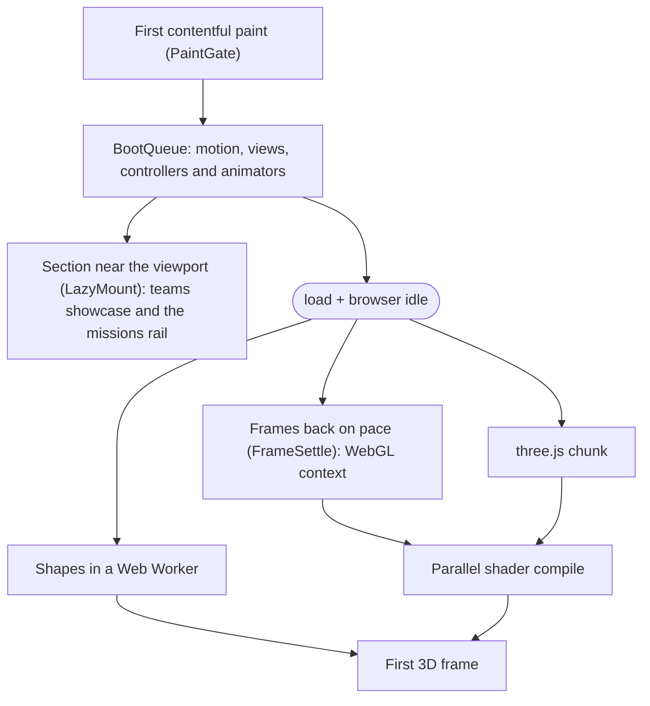

<div align="center">

<sub>[Português](README.md) · **English**</sub>

<picture>
  <source media="(prefers-reduced-motion: reduce)" srcset="https://raw.githubusercontent.com/Marcos-Codfy/lp-hackarun/main/docs/media/scroll-preview-poster.jpg" />
  
</picture>

# HackaRun · Overdrive

**Desvende. Programe. Conquiste.** <sub>(Uncover. Code. Conquer.)</sub>

The landing page for the 1st HackaRun, UniCatólica's technology, innovation and entrepreneurship event. It tells the
story as you scroll: a single WebGL particle field turns into a different 3D object for each section, and team
registrations land straight in a Google Sheet.

<sub>**Overdrive** is the codename of this page's cinematic v2: like the turbo boost in racing games, it speeds up from
scene to scene and, at the finish, the globe charges up and releases a pulse of energy.</sub>

[](https://github.com/Marcos-Codfy/lp-hackarun/actions/workflows/ci.yml)


[](#performance)

<!-- DEMO: the badge and link for the official site (Cloudflare Pages) go here once it is live. -->

[Project guide (pt-BR)](docs/GUIA_DO_PROJETO.md) · [Decisions (ADRs)](docs/adr) · [Changelog](CHANGELOG.md) ·
[Design spec](docs/design/design-spec.md) · [Contributing](CONTRIBUTING.md)

</div>

---

**For reviewers:** [In 30 seconds](#in-30-seconds) · [Visuals](#visuals) ·
[Visual script](#visual-script-one-3d-scene-per-section) · [Stack](#stack) · [Architecture](#architecture) ·
[Performance](#performance) · [Accessibility](#accessibility)<br />
**For developers:** [Run it on your machine](#run-it-on-your-machine) · [Scripts](#scripts) ·
[Registration](#content-and-registration) · [Contributing](#contributing) · [Deploy](#deploy) · [Roadmap](#roadmap)

## In 30 seconds

- **My role:** solo development. I created the event's visual identity with Eduarda, a fellow member of the Academic
  League, and, on top of it, designed the page and built the 3D and shaders, the front end, the Apps Script
  registration API, the tests, the CI and the docs.
- **What it is:** the official site of HackaRun 2026, the 1st edition of UniCatólica's event, organized by LAES (the
  Software Engineering and Artificial Intelligence Academic League), with Capim Dourado Shopping, a local mall, as the
  exclusive partner of the awards. It is a 4-day event, November 11 to 14, 2026, in Palmas, Tocantins, Brazil, with
  two tracks: a program open to the public (7 workshops, talks and up to 10 exhibitor stands) and a hackathon for
  UniCatólica students only, an objective-based race in teams that ends at the HackaRun Experience, at the mall. The
  page covers the schedule in tabs, 8 missions, mentors, prizes, a hunt for 3 hidden tokens, a team registration page
  (with a draft kept in the tab and a way back to the same spot on the landing page) and another page for the
  confirmed teams, with each team's photo or logo, live. All site content is in Brazilian Portuguese.
- **What sets it apart:** 8 procedural 3D objects (globe, stopwatch, "?", holographic map, synthwave terrain, stage,
  trophy and galaxy) made of 9,000 to 42,000 particles, with no 3D models and no video
  ([ADR 0005](docs/adr/0005-procedural-particles-over-video.md)), plus cinematic post-processing and a choreographed
  camera for every transition.
- **Fast:** Lighthouse mobile Performance **98** (up from 66), 2.2 s LCP and 0.001 CLS. Accessibility, Best practices
  and SEO at **100**. The registration and teams pages, with no 3D, score 99.
- **Accessible:** all content shows up without JavaScript and without WebGL (only submitting the registration needs
  JavaScript, and the page says so), `prefers-reduced-motion` is respected and there is a pause animations button
  (WCAG 2.2.2).
- **Zero-cost backend:** form → Google Apps Script → a Google Sheet with three tabs (teams with the photo thumbnail
  inside the cell, members with one row per person and a live summary), with the team photo in Google Drive, one team
  per person, idempotent retries, rate limits, a concurrency lock and versioned LGPD (Brazil's data protection law)
  consent.
- **Engineering:** Clean Architecture + DDD + MVVM with the dependency rule enforced by ESLint, 786 tests, CI on
  GitHub Actions, Conventional Commits, 9 ADRs and an `npm run setup` for anyone who forks it.

## Visuals

<p align="center">
  
  <br /><sub>Nine sections, nine moments of the same particle field. In the hero, the UniCatólica and course lockup opens the screen, and the official logo right below it is the H1 and the LCP element.</sub>
</p>

<p align="center">
  
  <br /><sub>On a phone (390 px), at the same quality tier a recent device gets.</sub>
</p>

<p align="center">
  
  <br /><sub>The <code>/equipes</code> page reads the confirmed teams from the Google Sheet and shares its sub-navigation with the registration page. The teams and images in this capture are made up, for illustration only.</sub>
</p>

<p align="center">
  
  <br /><sub>Registration has a page of its own, light and with no 3D: the photo is resized right in the browser, the steps show what is already done and the draft stays in the tab if someone leaves and comes back. Made-up data, on a test build with a simulated submission.</sub>
</p>

## Visual script: one 3D scene per section

Each section declares `data-scene`. Scrolling blends the shapes on the GPU continuously and reversibly, and
[`FlightPath`](src/presentation/experience/camera/FlightPath.ts) has camera choreography for every transition, from
flying through the globe shell to the final pull-back. The shapes are built in a Web Worker with the same spatial order
(a Morton curve) in all of them, so particle k sits in the "same place" in every object and the morph flows instead of
scrambling.

| Section                     | Scene     | Object                                                                  |
| --------------------------- | --------- | ----------------------------------------------------------------------- |
| Hero (`#inicio`)            | `core`    | Energy globe made of particle ribbons, its silhouette lit by fresnel    |
| About (`#sobre`)            | `orbit`   | Stopwatch-gyroscope: dial, sweep hand and gimbal rings                  |
| NPCs (`#npcs`)              | `enigma`  | Extruded question mark with a dashed clue band and a HUD halo           |
| Missions (`#missoes`)       | `map`     | Holographic map: round platform, spiral route and 8 energized beacons   |
| Schedule and mentors        | `terrain` | Synthwave floor: scrolling grid, mountains and a striped sun            |
| Grand final (`#final`)      | `stage`   | Show stage: 16:9 LED wall, truss, 8 light cannons and a bouncing crowd  |
| Prizes (`#premios`)         | `trophy`  | Lathe-profile cup drawn in lines, tube handles and a star on top        |
| Teams and FAQ               | `dust`    | A distant, calm galaxy with 2 spiral arms: a quiet backdrop for reading |
| Registration (`#inscricao`) | `core`    | The globe returns calm, only breathes, charges for 0.9 s and pulses     |

Orbitron, the brand's official font, has its tilde redrawn in Python with fontTools: in the original, "NÃO"
(Portuguese for "no") looked like "NÀO" in large headings ([ADR 0006](docs/adr/0006-cinematic-v2-and-official-identity.md)).

## Stack

| Layer    | Technologies                                                                                                    |
| -------- | --------------------------------------------------------------------------------------------------------------- |
| Base     | [Astro 7](https://astro.build) (SSG), TypeScript 6 (strictest), Vite                                            |
| 3D       | [Three.js](https://threejs.org) r186 + custom GLSL, EffectComposer, UnrealBloomPass and a custom cinematic pass |
| Motion   | [GSAP](https://gsap.com) 3.15 (ScrollTrigger), [Lenis](https://lenis.darkroom.engineering) 1.3, `LineSplit`     |
| Styling  | Modern CSS (custom properties, `@property`, cascade layers, `clamp()`, `content-visibility`), design tokens     |
| Fonts    | Orbitron (with the fixed tilde), Montserrat and JetBrains Mono, self-hosted via Fontsource, latin subset only   |
| Images   | `createImageBitmap` + canvas in the browser (WebP or JPEG), Google's image CDN for the team photos              |
| Backend  | Google Apps Script (V8) + Google Sheets (Equipes, Integrantes and Resumo tabs) + Google Drive, serverless       |
| Quality  | Vitest + happy-dom, ESLint 10 + typescript-eslint, Prettier, Astro Check, Playwright + Lighthouse               |
| Workflow | Husky, lint-staged, commitlint (Conventional Commits), GitHub Actions, `npm run setup`                          |
| Hosting  | Cloudflare Pages ([ADR 0003](docs/adr/0003-cloudflare-pages-hosting.md))                                        |

Full list of libraries, patterns and concepts (pt-BR):
[`docs/pdf/HackaRun_LP_Stack_e_Padroes.pdf`](docs/pdf/HackaRun_LP_Stack_e_Padroes.pdf).

## Architecture

Clean Architecture with DDD and MVVM. Dependencies point toward the domain, and ESLint (`no-restricted-imports` in
[`eslint.config.js`](eslint.config.js)) rejects any aliased import (`@application/*`, `@infrastructure/*`…) that breaks
the rule.


- **Domain:** imports no other layer and no framework (`three`, `gsap`, `lenis`, `astro`).
- **Application:** depends on the domain, never on infrastructure, presentation or a framework.
- **Presentation:** never imports `@infrastructure`; adapters are wired in `src/composition` and arrive ready to use.
- **Shared** (`EventBus`, `Observable`, `Ticker`): used by the other layers and imports none of them.

**DDD building blocks:** `Entity` and `ValueObject` base types, `Result<T, E>` with `ok` and `fail`, two aggregate
roots (`HackathonEvent` and `TeamRegistration`), entities such as `EventDay`, `Session` and `Activity`, value objects
such as `TeamName`, `TeamMember`, `FullName`, `StudentId`, `Email`, `TeamImage`, `TimeSlot`, `Audience`, `Countdown`
and `ScoringRule`, the `RegistrationPolicy` domain service (soon, open, closing, closed) and 13 use cases. Invalid JSON
content fails the build, and a test checks the schedule against the event's official document.

**MVVM:** 6 DOM-free ViewModels holding state in `Observable` (countdown, HUD, pause, NPC hunt, form and teams), and
Views that only bind the DOM. Modules talk through a typed `EventBus`
([`AppEvents.ts`](src/presentation/app/AppEvents.ts)): `scene:enter`, `experience:charged`, `motion:paused`,
`npc:found` and more.

**In the browser**, in priority order and without holding back the first paint:



**Every 3D frame:** scroll → `SceneDirector` (continuous scene index) → `SceneMixer` (weights) → vertex shader (morph
between targets) → `RenderPass` → bloom → cinematic pass → opaque canvas blended over the CSS aurora. At the end of the
page, a motion profile of its own ([`CoreMotion`](src/presentation/experience/scene/CoreMotion.ts)) calms the globe
down: it turns slowly, only breathes, and the charge turns into light, not agitation.

**Light pages:** `/inscricao` (registration) and `/equipes` (teams) use a separate boot
([`LightApp`](src/presentation/app/LightApp.ts)) with no 3D, GSAP or Lenis. The form is only downloaded there, and only
while registration is open. "Voltar ao evento" (back to the event,
[`backToEvent.ts`](src/presentation/views/navigation/backToEvent.ts)) goes back through history, so the landing page
reappears at the same spot, straight from the bfcache.

<details>
<summary><b>Design patterns and where they live</b></summary>

| Pattern              | Where                                                                                                                                                                                                                                           |
| -------------------- | ----------------------------------------------------------------------------------------------------------------------------------------------------------------------------------------------------------------------------------------------- |
| Strategy             | [`ShapeStrategy`](src/presentation/experience/shapes/ShapeStrategy.ts) (8 objects), [`RenderPipeline`](src/presentation/experience/post/RenderPipeline.ts), `QualityProfile`, `ScrollDriver`                                                    |
| Factory + registry   | [`ShapeFactory`](src/presentation/experience/shapes/ShapeFactory.ts), [`BoltFactory`](src/presentation/motion/animators/hero/lightning/BoltFactory.ts)                                                                                          |
| Registry             | [`AnimatorRegistry`](src/presentation/motion/animators/AnimatorRegistry.ts)                                                                                                                                                                     |
| Template Method      | [`SectionAnimator`](src/presentation/motion/animators/SectionAnimator.ts)                                                                                                                                                                       |
| Adapter              | [`SmoothScroll`](src/presentation/motion/core/SmoothScroll.ts) (Lenis), [`AppsScriptRegistrationGateway`](src/infrastructure/registration/AppsScriptRegistrationGateway.ts), [`CanvasImageCodec`](src/infrastructure/image/CanvasImageCodec.ts) |
| Decorator            | [`RetryingRegistrationGateway`](src/infrastructure/registration/RetryingRegistrationGateway.ts): 3 attempts, exponential backoff with jitter                                                                                                    |
| Fallback proxy       | [`FallbackTeamRepository`](src/infrastructure/repositories/FallbackTeamRepository.ts): live sheet first, build-time list as backup                                                                                                              |
| Null Object          | [`UnavailableRegistrationGateway`](src/infrastructure/registration/UnavailableRegistrationGateway.ts): in production with no endpoint, every submission answers "closed"                                                                        |
| Observer             | [`Observable`](src/shared/core/Observable.ts), [`EventBus`](src/shared/core/EventBus.ts)                                                                                                                                                        |
| Singleton            | [`Ticker.shared`](src/shared/core/Ticker.ts) (one rAF for the whole site), [`serverContainer()`](src/composition/server.ts)                                                                                                                     |
| Facade               | [`GetLandingPage`](src/application/use-cases/GetLandingPage.ts), [`ExperienceStage`](src/presentation/experience/ExperienceStage.ts)                                                                                                            |
| Composite            | [`strokes.ts`](src/presentation/experience/shapes/strokes.ts): a shape is a list of weighted strokes                                                                                                                                            |
| Builder              | [`PointBrush`](src/presentation/experience/shapes/PointBrush.ts), [`BoltBuilder`](src/presentation/motion/animators/hero/lightning/BoltBuilder.ts), [`StageBuilder`](src/presentation/experience/StageBuilder.ts)                               |
| Repository + Mapper  | [`StaticListRepository`](src/infrastructure/repositories/StaticListRepository.ts), [`EventMapper`](src/infrastructure/mappers/EventMapper.ts)                                                                                                   |
| Cooperative job      | [`ParticleJob`](src/presentation/experience/shapes/ParticleJob.ts): a generator that yields the thread                                                                                                                                          |
| Dependency inversion | [`BootSteps`](src/presentation/app/BootQueue.ts), the interface the boot sees                                                                                                                                                                   |

</details>

More in the [project guide (pt-BR)](docs/GUIA_DO_PROJETO.md#6-arquitetura) and the [ADRs](docs/adr).

## Performance

Lighthouse mobile on the production build, Brave headless, median of 3 runs on 2026-10-12:

| Metric                                | Project target | Before   | Now         |
| ------------------------------------- | -------------- | -------- | ----------- |
| Performance                           | ≥ 90           | 66       | **98**      |
| Total Blocking Time                   | –              | 1,600 ms | **98 ms**   |
| Largest Contentful Paint              | < 2.5 s        | 2.9 s    | **2.2 s**   |
| First Contentful Paint                | –              | –        | 1.4 s       |
| Speed Index                           | –              | –        | 2.1 s       |
| Cumulative Layout Shift               | < 0.05         | –        | **0.001**   |
| Accessibility, Best practices and SEO | 100            | 100      | **100**     |
| Initial JS (entry chunk, gzip)        | < 70 KB        | –        | **68.2 KB** |

<sub>Before: the score from the last report prior to the performance work. Dash: no target of its own or no earlier
record. Initial JS: the entry script, the `App` chunk and their static imports, gzipped (1 KB = 1,024 bytes).
`/inscricao` and `/equipes` score 99 on Performance, with a 2.0 s LCP and 0 TBT.</sub>

Every target I set myself is met. What keeps it that way:

- Static HTML with the hero ready at build time. The official logo is the H1 and the LCP element, with high priority,
  and the small CSS is inlined. On pages without a hero, the header logo gets the priority instead.
- The app's JavaScript only downloads after the browser records the first contentful paint
  ([`PaintGate`](src/presentation/app/PaintGate.ts), with a 3 s cap), and the boot runs in short steps that yield the
  thread ([`BootQueue`](src/presentation/app/BootQueue.ts) with `scheduler.yield()`). Each section only sets up its
  animations when it gets close to the viewport, and a custom `LineSplit` replaces GSAP SplitText.
- The teams showcase and the missions rail counter are separate chunks, loaded by
  [`LazyMount`](src/presentation/app/LazyMount.ts) when the section gets close, when the page opens on or jumps to it,
  or when someone taps or focuses it. The form lives on the `/inscricao` page and is never downloaded on the landing
  page.
- three.js in its own chunk (592 KB, 152 KB gzip), imported after `load` and once the browser is idle. The shapes are
  built in a Web Worker, the WebGL context is only created once frames are back on the display's pace
  ([`FrameSettle`](src/presentation/experience/FrameSettle.ts)), and the shaders compile in parallel.
- Adaptive quality: 9,000, 22,000 or 42,000 particles depending on the GPU, and bloom, resolution and tier step down if
  FPS stays below 45.
- Self-hosted fonts, latin subset only, two preloaded, `font-display: swap`.
- `content-visibility: auto` on far sections, with `contain-intrinsic-size` measured at 390 and 1440 px, without
  breaking anchors ([`anchorcheck.mjs`](scripts/qa/anchorcheck.mjs) verifies it).
- 3D rendering pauses when the tab is hidden, and the logo lightning only runs while the hero is visible.
- `/inscricao` and `/equipes` have no 3D, GSAP or Lenis (14 KB of initial JS). Photos come at 600 px from Google's CDN
  with `loading="lazy"`, `decoding="async"` and a fixed width and height (no layout shift); on upload, the browser
  already brings each photo down to ~300 KB.
- The calm globe at the end costs no extra render pass: 4 uniforms on the particles, 1 on the lens pass and a blend of
  a few numbers per frame.
- Immutable caching for one year on `/_astro/*` and HTML always revalidated ([`public/_headers`](public/_headers)).

<sub>Measured again on 2026-10-12, after the registration page and the calm final globe, on the production build served
with gzip. TBT varies between runs (68 to 245 ms across these three), always from boot tasks and the 3D chunk.</sub>

## Accessibility

The target is **WCAG 2.2 AA**, and Lighthouse scores accessibility at 100:

- A "Pular para o conteúdo" skip link and visible focus (`:focus-visible`, never `outline: none`), including Windows
  high contrast (`forced-colors: active`).
- `prefers-reduced-motion`: instant native scrolling, whole-scene swaps, 3D drawn on demand only and no entrance
  animations.
- A **pause animations** button (WCAG 2.2.2) in the header and the mobile menu: it freezes the 3D clock, the
  lightning and the CSS loops, and the choice is saved. Its tooltip closes with Esc (WCAG 1.4.13).
- Mobile menu with the rest of the page `inert`, a focus trap, Esc to close and focus returned to the toggle. Anchor
  links move focus to the target section.
- The schedule uses the WAI-ARIA tabs pattern (roving tabindex, arrow keys, Home/End and automatic activation).
  Without JavaScript, the tab bar is hidden and the 4 days are stacked.
- A step-by-step form with one `fieldset` per member: adding or removing someone moves focus and announces the team
  size ("Integrante 3 adicionado. A equipe tem 3 de 5 integrantes."). The steps indicator uses `aria-current="step"`
  and tells screen readers when a step has fields to fix. It has an error summary grouped by block, `aria-invalid` and
  `aria-describedby`, live regions for status and screen-reader copies of the "typed" or "decoded" text. The photo
  field has a preview, a replace button, drag and drop and an announced status. And a click on "Confirmar inscrição"
  is not lost when a field error shows up above the button.
- A sub-navigation on `/inscricao` and `/equipes` with `aria-current="page"` and the full accessible name even when
  the label shortens on phones; the link to the current page scrolls to the top and moves focus to the content
  instead of reloading.
- The `/equipes` page has a labeled search, a count announced in a live region and "Foto ou logo da equipe X" alt text
  on every card. On the production build, Lighthouse scores accessibility at 100 on `/equipes` and on `/inscricao`
  while registration is open.
- Full content without JavaScript and without WebGL: the HTML is complete at build time, and the form says so when
  JavaScript is off.

## Security and privacy (LGPD)

- **Strict CSP** in [`public/_headers`](public/_headers): `script-src 'self'` with no inline script, `connect-src`
  limited to the site's own origin and Apps Script, `img-src` limited to the site's own origin and
  `lh3.googleusercontent.com` (the team photos), `object-src 'none'` and `frame-ancestors 'none'`, plus `nosniff`,
  `X-Frame-Options: DENY`, COOP, Permissions-Policy and Referrer-Policy.
- **Only what is needed at registration:** the team name, a photo or logo and, for each member, full name, student ID
  and e-mail. No phone number, course or sensitive data. Official communication goes by e-mail.
- **Minimal public data:** the teams page shows only the team name, member count and photo or logo (never people's
  names, student IDs or e-mails), and only after the organizers confirm the registration. Cards are built from a
  `<template>` using `textContent` (nothing from the sheet becomes HTML), and the photo URL is only built from an id in
  the Drive id format.
- **Draft kept in the tab only:** what is typed on `/inscricao` lives in `sessionStorage` (gone when the tab closes,
  on a successful submit or on "Limpar rascunho"), consent is never stored, and whatever comes back from storage is
  checked (origin from a fixed list, a submission key in the server's format, a photo with a valid type and size).
- **One team per person:** a team name, e-mail or student ID already used by another team comes back as a conflict,
  ignoring case and accents, and the site flags the right field. Each form session sends a UUID key, so a retry gets
  the same protocol code back, with no duplicate row.
- **Uploads checked on the server:** the photo is validated by its leading bytes (JPEG, PNG or WebP), the declared
  type has to match and the cap is 400 KB. The file in Drive gets a random name, never the protocol code or anything
  typed.
- **Anti-spam:** a honeypot field, a 3 s minimum fill time, and per-e-mail (the counter keys on the SHA-256 hash of the
  contact e-mail only) and global limits.
- **Protected sheet:** formula injection (`= + - @`) is neutralized, `LockService` prevents concurrent writes and the
  Apps Script asks only for the minimum scopes (its own spreadsheet and Drive), checked by a test.
- **LGPD:** a privacy notice at [`/privacidade`](src/pages/privacidade.astro) in 9 sections, from who handles the data
  to in-browser storage, including the team photo, retention and how to ask for removal. Each registration stores the
  accepted notice version and the consent time (`CONSENT_VERSION`, currently `2026-10-v3`), and the server rejects
  submissions without them or with an old version. Consent includes permission to publish the photo and a statement
  that every member, and everyone in the picture, agreed.

## Quality

| Item       | Status                                                                                                            |
| ---------- | ----------------------------------------------------------------------------------------------------------------- |
| Tests      | **786 tests in 102 files** (Vitest + happy-dom), split by layer, including 9 suites that run the real Apps Script |
| Lint       | ESLint with no errors or warnings: layer rules, a 250 code-line cap per file, `import type`                       |
| Types      | `astro/tsconfigs/strictest` (`noUncheckedIndexedAccess`, `exactOptionalPropertyTypes`, …) + Astro Check           |
| Formatting | Prettier across the repository                                                                                    |
| CI         | GitHub Actions on push to `main` and on PRs: `npm ci` → lint → format check → tests → build → `dist` artifact     |
| Commits    | Husky + lint-staged on pre-commit and commitlint on commit-msg (a scope outside the list triggers a warning)      |
| Browser QA | [`scripts/qa/`](scripts/qa/README.md): screenshots, anchors, overflow, Web Vitals, long tasks and Lighthouse      |

**By the numbers:** 439 files and 33,361 lines in `src` (TypeScript, Astro, GLSL and CSS), of which 90 files and 5,852
lines are the 3D module; 102 test files and 10 helpers, with 9,910 lines; 999 lines of Apps Script in 8 files; 9 ADRs.

---

## For developers

### Run it on your machine

This walkthrough is for anyone who forks the project and wants to work on it. The commands work in Git Bash,
PowerShell and the macOS or Linux terminal; where something differs, both versions are shown.

**1. Install the basics**

| Tool            | Version                             | What for                                                                              |
| --------------- | ----------------------------------- | ------------------------------------------------------------------------------------- |
| Git             | any recent version                  | Cloning, branching and opening PRs                                                    |
| Node.js         | 24 LTS (`.nvmrc`; 22.18 at minimum) | Running, testing and building. With nvm: `nvm install 24` and `nvm use 24`            |
| npm             | the one bundled with Node           | Dependencies and scripts                                                              |
| Brave or Chrome | current                             | Optional: QA scripts (screenshots and Lighthouse) on a real GPU                       |
| Python          | 3.11 or newer                       | Optional: only to regenerate the font or the PDF assets                               |
| VS Code         | any recent version                  | Optional: the repo recommends the Astro, ESLint, Prettier and EditorConfig extensions |

On Windows, nvm is [nvm-windows](https://github.com/coreybutler/nvm-windows); `.nvmrc` holds the version CI uses.

**2. Fork and clone your fork**

On GitHub, click **Fork**, then:

```bash
git clone https://github.com/<your-username>/lp-hackarun.git
cd lp-hackarun
git remote add upstream https://github.com/Marcos-Codfy/lp-hackarun.git
```

`origin` is your fork (where you push) and `upstream` is the original repository (where updates come from).

**3. Set up the project**

```bash
npm run setup
```

The script checks your Node version, runs `npm ci` if the dependencies are not installed yet, creates `.env` from
`.env.example` and prints the next steps. Use `npm run setup -- --qa` to also install the QA scripts and
`npm run setup -- --check` to only check, without installing anything. If you would rather do it by hand:

```bash
npm ci
cp .env.example .env
```

<sub>In the Windows cmd shell, use `copy` instead of `cp`. In Git Bash and PowerShell, `cp` works.</sub>

**4. Run the site**

```bash
npm run dev
```

Open `http://localhost:4321`; the form is at `http://localhost:4321/inscricao` (no trailing slash). The page reloads
on every save. With `PUBLIC_REGISTRATION_ENDPOINT` empty (the `.env.example` default), registration runs in
**simulated mode**: nothing leaves your machine and no spreadsheet is touched. The form validates everything like
the real one, and the "registered" teams show up as confirmed, with their photo, on `/equipes` and the landing page
while the tab stays open (they live in `sessionStorage`). To see the error states, use a contact e-mail starting with
`falha` (network error), `servidor` (script down) or `duplicado` (duplicate registration). A team name, e-mail or
student ID repeated across the simulated teams gives the same field error as the real server.

| URL parameter                    | Effect                                                               |
| -------------------------------- | -------------------------------------------------------------------- |
| `?quality=low\|medium\|high`     | Forces the 3D tier and turns off the automatic FPS-based adjustment  |
| `?now=2026-11-14T16:00:00-03:00` | Shifts the site clock to check the countdown milestones              |
| `/inscricao?origem=hero`         | Registration origin (Origem column); anything off the list: `direct` |

**5. Check before opening a PR**

```bash
npm test
npm run lint
npm run format
npm run validate
```

`npm run validate` runs lint, tests and the build, the same as CI. To see the build as it ships, run `npm run build`
and then `npm run preview`.

**6. QA scripts (optional)**

Screenshots at several widths, anchors, overflow, Web Vitals and Lighthouse, with the installed Brave or Chrome:

```bash
npm run setup -- --qa
```

This installs Playwright and Lighthouse inside `scripts/qa/` only (same as `cd scripts/qa` and `npm install`) and warns
you if no browser is found. Without Brave or Chrome, run `npx playwright install chromium` inside `scripts/qa/`. Usage
examples are in [Scripts](#scripts).

**7. Python asset scripts (optional)**

Only needed to regenerate Orbitron with the fixed tilde or the PDF assets. Both scripts read fonts from
`node_modules`, so run `npm ci` first:

```bash
python -m pip install -r requirements.txt
python scripts/fonts/patch_orbitron_tilde.py
python scripts/docs/build_pdf_assets.py
```

<sub>On Windows, if `python` is missing or opens the Microsoft Store, use `py` instead (`py -m pip install -r
requirements.txt`).</sub>

**8. Point the form at a test spreadsheet of your own**

To test real submissions, use a spreadsheet of **your own**, never the official one:

1. In your Google Drive, create a spreadsheet (for example, "HackaRun · teste").
2. Follow sections 2 to 5 of [`apps-script/README.md`](apps-script/README.md) (pt-BR): paste the 8 `.gs` files and
   `appsscript.json`, run `configurarPlanilha()` and deploy it as a **Web app**.
3. Copy the URL ending in `/exec` into your `.env`:
   `PUBLIC_REGISTRATION_ENDPOINT=https://script.google.com/macros/s/<id>/exec`.
4. Stop `npm run dev` (Ctrl+C) and start it again: `.env` is only read at startup.

Submissions land in the Equipes and Integrantes tabs of your spreadsheet, and a team shows up on `/equipes` once you
set its Status to `confirmado`. `.env` stays out of Git. Do not put the URL in `event.json`, or it will ride along in
your PR.

<details>
<summary><b>Troubleshooting</b></summary>

| Symptom                                              | What to do                                                                                                                                      |
| ---------------------------------------------------- | ----------------------------------------------------------------------------------------------------------------------------------------------- |
| `npm run setup` rejects your Node version            | Install Node 24 LTS (`nvm install 24` and `nvm use 24`) and open a new terminal. `node -v` shows the version in use.                            |
| `npm warn EBADENGINE` during `npm ci`                | It is only a warning: a few lint dependencies ask for Node 24.16 or newer. Update Node 24 to the latest patch and it goes away.                 |
| Port 4321 is busy                                    | Astro tries the next free port and prints the URL in the terminal. To pick one: `npm run dev -- --port 4322`. Or close the other `npm run dev`. |
| `&&` fails in PowerShell                             | Windows PowerShell 5.1 has no `&&`: run one command per line or separate them with `;`. The commands in this README already come one per line.  |
| Setting an environment variable for a single command | bash: `BRAVE_PATH="/path/to/brave" node shots.mjs <url>` · PowerShell: `$env:BRAVE_PATH = 'C:\path\to\brave.exe'; node shots.mjs <url>`         |
| `npm ci` fails with `EPERM` or `EBUSY` on Windows    | Stop `npm run dev`, close any editor or terminal using the folder and run it again.                                                             |
| The commit is rejected                               | Husky runs commitlint and lint-staged: check the `type(scope): description` format and the ESLint errors. Do not use `--no-verify`.             |
| I changed `.env` and nothing happened                | Variables are read at startup: stop `npm run dev` and start it again.                                                                           |
| I want to clear the simulated teams                  | Close the tab or delete the `hackarun:dev:simulated-teams` key from `sessionStorage` (DevTools → Application).                                  |
| The form comes back filled in                        | That is the tab's draft: use "Limpar rascunho" in the steps card or delete the `hackarun:registration-draft:v2*` keys from `sessionStorage`.    |
| `/inscricao/` returns 404                            | URLs have no trailing slash (`trailingSlash: 'never'`): open `/inscricao`.                                                                      |
| The 3D does not show up                              | Check that the browser has WebGL2 and that data saver is off. Try `?quality=low`. Without 3D, the page is still complete.                       |

</details>

### Environment variables

| Variable                       | Required | Description                                                                           |
| ------------------------------ | -------- | ------------------------------------------------------------------------------------- |
| `PUBLIC_SITE_URL`              | no       | Public URL (canonical, sitemap, Open Graph). Default: `https://lp-hackarun.pages.dev` |
| `PUBLIC_REGISTRATION_ENDPOINT` | no       | Apps Script Web App URL. Empty means "inscrições em breve" (simulated mode in dev)    |
| `DOCS_OUT_DIR`                 | no       | Extra folder where `npm run docs:pdf` copies the PDFs and the guide                   |

The QA scripts read `BRAVE_PATH` or `CHROME_PATH` to find the browser.

### Scripts

| Command                           | Description                                                            |
| --------------------------------- | ---------------------------------------------------------------------- |
| `npm run setup`                   | Prepares your machine: checks Node, installs dependencies, adds `.env` |
| `npm run dev`                     | Development server at `http://localhost:4321`                          |
| `npm run build`                   | Type check (`astro check`) + production build to `dist/`               |
| `npm run preview`                 | Serves the build locally                                               |
| `npm test` / `test:watch`         | Unit tests once / in watch mode                                        |
| `npm run lint` / `lint:fix`       | ESLint (layer rules, file size) / with autofix                         |
| `npm run format` / `format:check` | Prettier: write / verify                                               |
| `npm run validate`                | Lint + tests + build (CI runs this plus `format:check`)                |
| `npm run docs:pdf`                | Generates the 2 PDF docs in `docs/pdf/`                                |

<details>
<summary><b>Asset scripts (Python) and QA scripts (Playwright + Lighthouse)</b></summary>

Script-generated assets are never edited by hand: run the script and commit the output. The Python dependencies are
in [`requirements.txt`](requirements.txt).

| Command                                        | Requires                        | Generates                                                 |
| ---------------------------------------------- | ------------------------------- | --------------------------------------------------------- |
| `python scripts/fonts/patch_orbitron_tilde.py` | `fonttools`, `brotli`           | `src/assets/fonts/orbitron-pt-latin-wght.woff2`           |
| `python scripts/docs/build_pdf_assets.py`      | `fonttools`, `brotli`, `Pillow` | `scripts/docs/assets/` (TTF fonts and logos for the PDFs) |

The QA scripts have their own `package.json`, so Playwright and Lighthouse stay out of the project's `npm ci`. They
use the installed Brave or Chrome with a real GPU and take the URL as an argument. Keep the build running in one
terminal (`npm run build`, then `npm run preview`) and, in another, inside `scripts/qa/`:

```bash
node shots.mjs http://localhost:4321/ 390 844 out/m390 "#sobre,#programacao" --mobile
node anchorcheck.mjs http://localhost:4321/           # anchors land just below the header
node overflow.mjs http://localhost:4321/              # nothing overflows at 360 and 390 px
node lighthouse.mjs http://localhost:4321/ --runs=3   # Lighthouse mobile with a median
```

There are also `vitals.mjs` (LCP, CLS and time until the 3D is ready), `longtasks.mjs` (long tasks with 4x CPU
throttling and slow 4G) and `trace.mjs` (a trace up to first paint and the boot steps). Full walkthrough in
[`scripts/qa/README.md`](scripts/qa/README.md).

</details>

### Project structure

<details>
<summary><b>Folder tree</b></summary>

```text
src/
├── domain/          # entities, value objects, aggregates, a domain service and repository interfaces
├── application/     # use cases, DTOs and ports
├── infrastructure/  # JSON content, mappers, repositories, Apps Script, image, storage, clock and ICS
├── presentation/    # app, layouts, sections, components, controllers, formatters, view-models, views, motion,
│                    # styles and experience/ (3D: camera, input, layers, particles, post, quality, scene, shaders, shapes)
├── shared/          # EventBus, Observable, Ticker and utilities
├── composition/     # composition roots (build and browser)
├── assets/          # official logos and Orbitron with the redrawn tilde
└── pages/           # index, inscricao (registration), equipes (teams), privacidade (LGPD), 404 and the .ics calendar
apps-script/         # registration API, the three-tab sheet and photos in Drive (Google Apps Script) + setup guide
design/              # briefing references and the teaser video (not shipped)
public/              # og-image, favicon, _headers and robots
scripts/             # setup.mjs, font patch, PDF generator and qa/
tests/               # tests split by layer
docs/                # guide, design spec, ADRs, stack manifest, PDFs and README media
requirements.txt     # dependencies of the Python asset scripts
```

</details>

### Content and registration

- **Content** (the schedule's days, blocks and activities, missions, FAQ, prizes, mentors, partners) lives in
  `src/infrastructure/content/*.json`. It can be edited without coding; invalid data fails the build and the tests
  validate the real content.
- **Registration** is team-only, 2 to 5 students, with each member's full name, student ID and e-mail, on the
  `/inscricao` page ([ADR 0009](docs/adr/0009-registration-on-its-own-page.md), pt-BR). Every CTA on the site links
  there with its origin in the URL (`?origem=hero`, `?origem=final`...), which lands in the Origem column. It goes to
  a Google Sheet through Apps Script (`doPost`), and the team's photo or logo goes to a Google Drive folder. The script
  builds the sheet by itself (`configurarPlanilha()`): the **Equipes** tab has one row per team, with the photo
  thumbnail inside the cell (`=IMAGE()`) and the Status in a color-coded dropdown; the **Integrantes** tab has one row
  per person; and the **Resumo** tab has the counters and the confirmed teams' e-mails ready to paste. Equipes and
  Integrantes have a filter on every column.
- **Teams on the site:** a team shows up on `/equipes` once the organizers set the Status column to `confirmado`, and
  the public list (`doGet ?action=teams`) is cached for 60 s, with the cache cleared automatically when the Status,
  name, member count or photo changes. Taking a photo down only takes clearing its **ID da foto** cell; for a removal
  request (LGPD) or an inappropriate image, first delete the file in Drive and empty the trash. Step-by-step
  setup (pt-BR) in [`apps-script/README.md`](apps-script/README.md).
- **Script Properties:** `CLOSES_AT` (deadline), `CAPACITY` (max teams), `INSCRICOES_FECHADAS` (closes immediately, no
  site redeploy) and `FOTOS_PASTA_ID` (the photo folder). Changed the privacy notice text? Bump `CONSENT_VERSION` in
  [`SubmitRegistration.ts`](src/application/use-cases/SubmitRegistration.ts) and in
  [`Validation.gs`](apps-script/Validation.gs), and publish the script together with the site.
- **Calendar:** the build generates `/hackarun-2026.ics` (RFC 5545) with one event per schedule block, downloaded from
  the "Adicionar à agenda" (add to calendar) buttons on the registration page.

### Contributing

The full workflow (pt-BR) is in [CONTRIBUTING.md](CONTRIBUTING.md). In short:

1. Sync your `main` with the original: `git switch main`, `git pull upstream main` and `git push origin main`.
2. Branch off it: `git switch -c feat/<topic>` (or `fix/`, `docs/`, `refactor/`, `test/`).
3. Make small commits in **Conventional Commits**, in English: `type(scope): description`, for example
   `feat(sections): add day tabs to the schedule`. The allowed scopes are in
   [`commitlint.config.js`](commitlint.config.js): `domain`, `application`, `infra`, `ui`, `sections`, `experience`,
   `motion`, `a11y`, `perf`, `seo`, `content`, `docs`, `ci`, `deps`, `config` and `tests`.
4. Run `npm run validate` and `npm run format:check`.
5. `git push -u origin feat/<topic>` and open a Pull Request against `main` on `Marcos-Codfy/lp-hackarun`, filling in
   the template. CI has to be green, and the merge is a squash after one review.

Each release's changes are in [CHANGELOG.md](CHANGELOG.md).

### Deploy

Free hosting on **Cloudflare Pages**. The official launch of this repository is on hold, by my decision; once it
happens, the link goes at the top of this README. To publish your fork on your own account:

1. Cloudflare → **Workers & Pages → Create → Pages → Connect to Git**.
2. Preset **Astro** · Build `npm run build` · Output `dist`.
3. Variables: `NODE_VERSION=24`, `PUBLIC_SITE_URL` and, if you want the form live, `PUBLIC_REGISTRATION_ENDPOINT`
   pointing at your test spreadsheet.

Once connected, every push to `main` deploys to production, and every PR gets a preview URL. The comparison with other
options is in [ADR 0003](docs/adr/0003-cloudflare-pages-hosting.md).

## Roadmap

- [x] Architecture, domain and official content
- [x] Scroll-driven 3D experience with 8 objects
- [x] Cinematic v2 redesign (Overdrive) with the official identity ([ADR 0006](docs/adr/0006-cinematic-v2-and-official-identity.md))
- [x] Lighthouse mobile ≥ 90 on performance and 100 on accessibility, best practices and SEO
- [x] Pause animations button (WCAG 2.2.2)
- [x] QA scripts (Playwright + Lighthouse) versioned in the repository
- [x] Teams page with each team's photo or logo, moderated through confirmation ([ADR 0007](docs/adr/0007-team-photos-google-drive.md))
- [x] The event's real schedule, with both tracks, a tab per day and the HackaRun Experience
- [x] Team-only registration form and a sheet organized in three tabs, with the photo in the cell and filters ([ADR 0008](docs/adr/0008-team-only-registration-and-organized-sheet.md))
- [x] A guide to run and contribute from a fork, with `npm run setup`
- [x] Mobile LCP under 2.5 s (2.2 s on 2026-10-12)
- [x] Initial JS under 70 KB gzip (68.4 KB)
- [x] Apps Script deployed on the registration spreadsheet and tested end to end (photo in the cell, duplicates blocked)
- [x] Registration on a page of its own, with a draft kept in the tab and a way back to the same spot on the landing page ([ADR 0009](docs/adr/0009-registration-on-its-own-page.md))
- [x] A calmer globe at the end of the page: it turns slowly, breathes and releases a soft pulse
- [x] UniCatólica and course lockup (Software Engineering and Artificial Intelligence) at the top of the hero, and LAES as organizer in the partners band
- [ ] Registrations switched on in the official site, together with the Cloudflare launch
- [ ] Official launch on Cloudflare Pages: on hold, by my decision
- [ ] Rules and mission scoring: the organizers present them at the opening, on November 12, at 7:35 p.m.
- [ ] Prizes, mentors and judges: the organizers reveal them closer to the event

## Credits

- **Design and development:** [Marcos Vinicius Muniz Arruda](https://github.com/Marcos-Codfy)
- **Visual identity:** Marcos Vinicius Muniz Arruda and Eduarda, a fellow member of the Academic League
- **Hosted by:** UniCatólica
- **Organized by:** LAES, the Software Engineering and Artificial Intelligence Academic League
- **Partner:** Capim Dourado Shopping, exclusive partner of the awards
- **Fonts:** Orbitron, Montserrat and JetBrains Mono (SIL Open Font License)

<sub>HackaRun, UniCatólica, LAES, Capim Dourado Shopping and their logos are trademarks of their respective owners
and appear here only to identify the event.</sub>

---

<div align="center">

<sub>Design and development by <a href="https://github.com/Marcos-Codfy">Marcos Vinicius Muniz Arruda</a> ·
Palmas, Brazil · 2026</sub>

<!-- LINKEDIN: replace with the profile link when you want it shown here. -->

</div>
