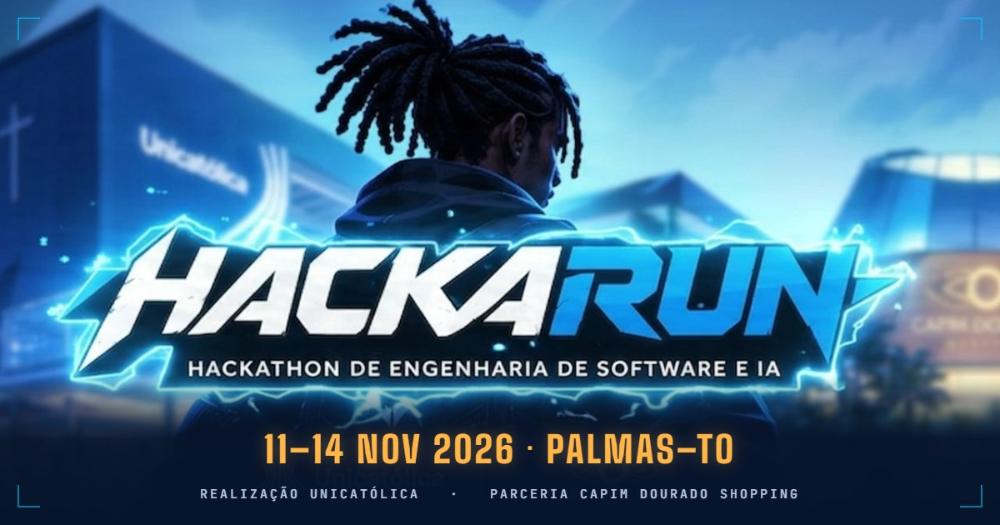
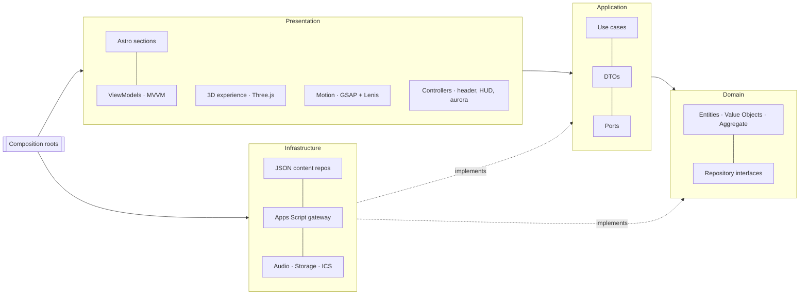
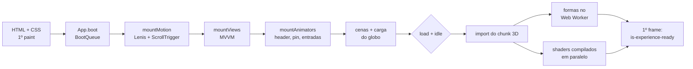

<div align="center">



# HackaRun 2026 · Landing Page

**Desvende. Programe. Conquiste.**

Landing page oficial do hackathon dos cursos de Engenharia de Software e Inteligência Artificial da Unicatólica,
em parceria com o Capim Dourado Shopping · Palmas–TO · 11 a 14 de novembro de 2026.

[](https://github.com/Marcos-Codfy/lp-hackarun/actions/workflows/ci.yml)


<br />


[](https://www.conventionalcommits.org/pt-br/v1.0.0/)

[Guia do projeto](docs/GUIA_DO_PROJETO.md) · [Design spec](docs/design/design-spec.md) · [Decisões (ADRs)](docs/adr) · [Como contribuir](CONTRIBUTING.md)

</div>

---

## Sumário

- [Sobre](#sobre)
- [Destaques](#destaques)
- [A corrida em 8 cenas](#a-corrida-em-8-cenas)
- [Stack](#stack)
- [Arquitetura](#arquitetura)
- [Começando](#começando)
- [Variáveis de ambiente](#variáveis-de-ambiente)
- [Scripts](#scripts)
- [Estrutura do projeto](#estrutura-do-projeto)
- [Conteúdo e inscrições](#conteúdo-e-inscrições)
- [Identidade e assets](#identidade-e-assets)
- [Performance](#performance)
- [Qualidade](#qualidade)
- [Deploy](#deploy)
- [Contribuindo](#contribuindo)
- [Roadmap](#roadmap)
- [Créditos](#créditos)

## Sobre

O **HackaRun** é um hackathon em formato de corrida: minicursos, mentoria de egressos e uma sequência de missões
técnicas espalhadas por salas e laboratórios, onde personagens (os **NPCs**) guardam as pistas do desafio. A final e a
premiação acontecem no Capim Dourado Shopping, com palco, telão e banda ao vivo.

Esta landing page apresenta o evento, a programação, as missões e as equipes confirmadas, e **recebe as inscrições**.
A versão 2 é cinematográfica: vazio quase preto, neon saturado da paleta oficial, brilho real (bloom) e uma câmera
coreografada que acompanha o scroll de ponta a ponta.

## Destaques

- **Experiência 3D guiada pelo scroll:** um único campo de partículas em WebGL vira um objeto diferente a cada seção
  (globo, cronômetro, "?", mapa holográfico, terreno synthwave, palco, troféu, galáxia). Tudo gerado por código e
  animado em GLSL, sem modelos 3D nem vídeo.
- **Linguagem de cinema:** pós-processamento com bloom, vinheta, grão, aberração cromática, flash e onda de choque;
  campo de estrelas ao fundo, bokeh na frente, color grading por cena e câmera com enquadramentos, voos entre cenas e
  "câmera na mão".
- **Clímax sincronizado:** na seção de inscrição o globo se reconstrói, carrega por 1,5 s e estoura com flash, tremor e
  som (`cta-globe.mp3`) no mesmo evento, revelando o CTA. O scroll nunca é travado.
- **Identidade oficial:** logo PNG oficial com raios procedurais em volta, paleta do manual, Orbitron com o **til
  redesenhado** (a original lia "NÀO"), Montserrat no texto, JetBrains Mono no HUD e logos oficiais dos parceiros.
- **Rápida por construção:** HTML estático (Astro SSG), JavaScript iniciado só depois do primeiro paint, three.js num
  chunk carregado após o `load`, `content-visibility` nas seções longe do topo e qualidade adaptativa por GPU e FPS.
- **Acessível:** feita para WCAG 2.2 AA, Lighthouse mobile 100 em acessibilidade, navegação por teclado,
  `prefers-reduced-motion`, som desligado por padrão e conteúdo completo sem JavaScript e sem WebGL.
- **Inscrição sem servidor e sem custo:** formulário → Google Apps Script → Google Sheets, com anti-spam, LGPD e
  equipes confirmadas aparecendo ao vivo no site.
- **Pronta pra equipe:** Clean Architecture + DDD + MVVM, testes unitários, ESLint com regra de dependência entre
  camadas, Conventional Commits validados no commit, CI no GitHub Actions e QA visual com Playwright + Lighthouse.

## A corrida em 8 cenas

Cada seção declara `data-scene`; o scroll mistura as formas na GPU de forma contínua e reversível.

| Seção                    | Cena      | Objeto                                                                   |
| ------------------------ | --------- | ------------------------------------------------------------------------ |
| Hero (`#inicio`)         | `core`    | Globo de energia em fitas de partículas, borda acesa (fresnel)           |
| O evento (`#sobre`)      | `orbit`   | Cronômetro-giroscópio: mostrador, ponteiro de varredura e anéis em cardã |
| NPCs (`#npcs`)           | `enigma`  | Ponto de interrogação extrudado com auréola de HUD                       |
| Missões (`#missoes`)     | `map`     | Mapa de missões em holograma: rota em espiral com 8 faróis               |
| Programação e mentores   | `terrain` | Terreno synthwave: grade rolando, montanhas e sol em faixas              |
| Grande final (`#final`)  | `stage`   | Palco do show: telão de LED, treliça, canhões de luz e plateia           |
| Prêmios (`#premios`)     | `trophy`  | Troféu de torno em linhas, com alças e estrela                           |
| Equipes e FAQ            | `dust`    | Galáxia distante e calma, fundo de leitura                               |
| Inscrição (`#inscricao`) | `core`    | O globo volta, carrega e estoura (clímax)                                |

## Stack

| Camada                 | Tecnologias                                                                                                             |
| ---------------------- | ----------------------------------------------------------------------------------------------------------------------- |
| Base                   | [Astro 7](https://astro.build) (SSG), TypeScript 6 (strictest), Vite                                                    |
| 3D                     | [Three.js](https://threejs.org) r186 + GLSL (ShaderMaterial), EffectComposer + UnrealBloomPass + passe próprio de lente |
| Motion                 | [GSAP](https://gsap.com) 3.15 (ScrollTrigger, SplitText), [Lenis](https://lenis.darkroom.engineering)                   |
| Estilo                 | CSS moderno (custom properties, `@property`, cascade layers, `clamp()`, `content-visibility`), design tokens            |
| Fontes                 | Orbitron (com til corrigido), Montserrat e JetBrains Mono, self-hosted (Fontsource), só o subset latin                  |
| Áudio                  | Web Audio API; sons sintetizados em Python (NumPy + LAME)                                                               |
| Backend (sem servidor) | Google Apps Script Web App + Google Sheets                                                                              |
| Qualidade              | Vitest + happy-dom, ESLint + typescript-eslint, Prettier, Astro Check, Playwright + Brave, Lighthouse                   |
| Fluxo                  | Husky, lint-staged, commitlint (Conventional Commits), GitHub Actions                                                   |
| Hospedagem             | Cloudflare Pages (plano gratuito)                                                                                       |

Lista completa de bibliotecas, padrões e conceitos:
[`docs/pdf/HackaRun_LP_Stack_e_Padroes.pdf`](docs/pdf/HackaRun_LP_Stack_e_Padroes.pdf).

## Arquitetura

Clean Architecture com DDD. As dependências apontam sempre para o domínio, e o ESLint bloqueia imports que violem a
regra.



**No build:** `index.astro` → `GetLandingPage` (use case) → repositórios JSON → entidades validadas → DTOs → HTML.

**No browser**, em ordem de prioridade, um passo curto por tarefa e sem segurar o primeiro paint:



**A cada frame do 3D:** scroll → `SceneDirector` (índice contínuo de cena) → `SceneMixer` (pesos) → vertex shader
(morph entre os alvos de cada objeto) → `RenderPass` → bloom → passe cinematográfico (exposição, aberração, flash,
onda de choque, vinheta, grão) → canvas opaco somado à aurora em `mix-blend-mode: screen`.

Detalhes em [docs/GUIA_DO_PROJETO.md](docs/GUIA_DO_PROJETO.md#6-arquitetura) e nas [ADRs](docs/adr).

## Começando

**Pré-requisitos:** Node.js 24 LTS (mínimo 22.12) e npm. Python 3 só para regenerar sons, fontes ou assets dos PDFs.

```bash
git clone https://github.com/Marcos-Codfy/lp-hackarun.git
cd lp-hackarun
npm ci
cp .env.example .env
npm run dev
```

Acesse `http://localhost:4321`. Sem endpoint de inscrição, o formulário roda em **modo simulado** no `npm run dev`.

Parâmetros de URL úteis para QA:

| Parâmetro                        | Efeito                                                                |
| -------------------------------- | --------------------------------------------------------------------- |
| `?quality=low\|medium\|high`     | Força o tier do 3D e desliga o ajuste automático por FPS              |
| `?now=2026-11-14T16:00:00-03:00` | Desloca o relógio do site para conferir a troca de marcos do contador |

## Variáveis de ambiente

| Variável                       | Obrigatória | Descrição                                                                             |
| ------------------------------ | ----------- | ------------------------------------------------------------------------------------- |
| `PUBLIC_SITE_URL`              | não         | URL pública (canonical, sitemap, Open Graph). Padrão: `https://lp-hackarun.pages.dev` |
| `PUBLIC_REGISTRATION_ENDPOINT` | não         | URL do Web App do Apps Script. Vazia = "inscrições em breve" (em dev, modo simulado)  |
| `DOCS_OUT_DIR`                 | não         | Pasta extra para onde os PDFs e o guia são copiados pelo `npm run docs:pdf`           |

## Scripts

| Comando            | Descrição                                                 |
| ------------------ | --------------------------------------------------------- |
| `npm run dev`      | Servidor de desenvolvimento                               |
| `npm run build`    | Type-check (`astro check`) + build de produção em `dist/` |
| `npm run preview`  | Serve o build localmente                                  |
| `npm test`         | Testes unitários                                          |
| `npm run lint`     | ESLint                                                    |
| `npm run format`   | Prettier                                                  |
| `npm run validate` | Lint + testes + build (mesmo fluxo da CI)                 |
| `npm run docs:pdf` | Gera os PDFs de documentação em `docs/pdf/`               |

Scripts de assets (Python 3, rodados só quando o asset muda; a saída fica versionada):

| Comando                                        | Requer                          | Gera                                                        |
| ---------------------------------------------- | ------------------------------- | ----------------------------------------------------------- |
| `python scripts/audio/render_cues.py`          | `numpy`, `lameenc`              | `public/audio/cta-globe.mp3` e `public/audio/ui-typing.wav` |
| `python scripts/fonts/patch_orbitron_tilde.py` | `fonttools`, `brotli`           | `src/assets/fonts/orbitron-pt-latin-wght.woff2`             |
| `python scripts/docs/build_pdf_assets.py`      | `fonttools`, `brotli`, `Pillow` | `scripts/docs/assets/` (fontes TTF e logos dos PDFs)        |

## Estrutura do projeto

```text
src/
├── domain/              # entidades, value objects, aggregate, serviços e interfaces de repositório
├── application/         # casos de uso, DTOs e portas
├── infrastructure/      # conteúdo JSON, repositórios, gateway do Apps Script, áudio, storage, calendário
├── assets/
│   ├── brand/           # logo oficial do HackaRun e logos brancas dos parceiros
│   └── fonts/           # Orbitron com o til redesenhado
├── presentation/
│   ├── app/             # App.boot, configuração e contrato de eventos (AppEvents)
│   ├── layouts/         # BaseLayout: head, fontes, SEO, aurora e canvas 3D
│   ├── sections/        # uma seção por arquivo + subcomponentes por pasta
│   ├── components/      # ui, header/footer, HUD, contador, inscrição, equipes, parceiros, NPC, som, SEO
│   ├── controllers/     # header, menu mobile, âncoras, nav spy, trilho do HUD, tema da aurora
│   ├── view-models/     # MVVM: estado e lógica de tela, sem DOM
│   ├── views/           # MVVM: ligam DOM e ViewModel
│   ├── motion/          # scroll (Lenis, ScrollTrigger, SceneDirector) e animações de entrada
│   ├── experience/      # 3D (chunk lazy): shapes, shaders, post, camera, layers, particles, quality
│   └── styles/          # tokens.css (design tokens) e base.css
├── shared/              # Observable, EventBus, Ticker e utilitários
├── composition/         # composition roots (build e browser)
└── pages/               # rotas: index, 404 e calendário .ics
apps-script/             # API de inscrições (Google Apps Script) + guia de instalação
public/                  # og-image, favicon, _headers, robots e áudio
scripts/                 # áudio, patch da fonte e gerador dos PDFs
tests/                   # testes unitários por camada
docs/                    # guia, design spec, asset brief, ADRs, manifesto da stack e PDFs
design/references/       # referências visuais (não vão pro site)
```

## Conteúdo e inscrições

- **Conteúdo** (datas, missões, FAQ, prêmios, mentores, parceiros) fica em `src/infrastructure/content/*.json`. Dá pra
  editar sem programar, e os testes validam o conteúdo real. Dado inválido quebra o build.
- **Inscrições** vão para uma planilha Google via Apps Script. A equipe aparece no site quando a organização marca
  `confirmado` na coluna Status. Instalação em [`apps-script/README.md`](apps-script/README.md).
- **Agenda:** o build gera `/hackarun-2026.ics` com todas as atividades.

## Identidade e assets

| Item             | Onde                                        | Observação                                                                                  |
| ---------------- | ------------------------------------------- | ------------------------------------------------------------------------------------------- |
| Logo             | `src/assets/brand/hackarun-logo.png`        | Imagem oficial, nunca redesenhada; os raios em volta são animados por código                |
| Parceiros        | `src/assets/brand/*-white.png`              | Logos oficiais brancas da Unicatólica e do Capim Dourado (hero e rodapé)                    |
| Paleta           | `src/presentation/styles/tokens.css`        | Azul Noturno, Azul Elétrico, Ciano Neon, Roxo Neon, Magenta, Laranja Conquista, Branco Gelo |
| Tipografia       | `src/presentation/layouts/BaseLayout.astro` | Orbitron (títulos), Montserrat (texto), JetBrains Mono (HUD)                                |
| Sons             | `public/audio/`                             | Flash + grave do globo (`cta-globe.mp3`) e sprite de digitação (`ui-typing.wav`)            |
| Compartilhamento | `public/og-image.jpg`                       | 1200×630, usada no Open Graph e no Twitter Card                                             |

O som começa desligado; o botão de som do header (ícone de equalizador) liga o áudio, e os arquivos só são baixados
depois disso.

## Performance

- HTML estático com o hero pronto no build; o logo oficial (H1 e LCP) é imagem otimizada com prioridade alta; CSS
  pequeno inline.
- Fontes self-hosted, só o subset latin, duas com preload (Orbitron e Montserrat), `font-display: swap`.
- `App.boot()` roda depois do primeiro paint como uma fila de passos curtos (`BootQueue`), cedendo a thread entre eles;
  as animações de entrada só montam quando a seção se aproxima e o SplitText é carregado sob demanda.
- three.js num chunk separado, importado só depois do `load` e com o navegador ocioso; as formas são geradas num
  **Web Worker** enquanto os shaders compilam em paralelo (`KHR_parallel_shader_compile`), antes do primeiro frame.
- `content-visibility: auto` com `contain-intrinsic-size` medido nas seções longe do topo.
- Qualidade adaptativa: tier inicial pela GPU e pelo aparelho; se o FPS ficar abaixo de 45 por 2 s, corta o bloom,
  depois a resolução, depois o tier. Render pausa com a aba oculta; sem WebGL2 ou com `save-data`, o 3D não inicia e
  fica o brilho em CSS.
- Cache imutável para `/_astro/*` e headers de segurança em `public/_headers`.

Orçamento e técnicas em detalhe no [guia](docs/GUIA_DO_PROJETO.md#12-performance).

## Qualidade

| Item                    | Meta        | Situação (Lighthouse mobile, 10/10/2026) |
| ----------------------- | ----------- | ---------------------------------------- |
| Acessibilidade          | ≥ 95        | **100**                                  |
| Boas práticas           | ≥ 95        | **100**                                  |
| SEO                     | 100         | **100**                                  |
| Performance             | ≥ 90        | em otimização                            |
| LCP (4G, celular médio) | < 2,5 s     | em otimização                            |
| CLS                     | < 0,05      | dentro da meta                           |
| JS inicial (gzip)       | < 70 KB     | three.js fica fora, num chunk lazy       |
| Conformidade            | WCAG 2.2 AA | meta de projeto, checklist em cada PR    |

A CI (GitHub Actions) roda lint, formatação, testes e build a cada push e PR. O QA visual (capturas em várias larguras
com Playwright dirigindo o Brave) e o Lighthouse seguem o roteiro do [guia](docs/GUIA_DO_PROJETO.md#13-qa).

## Deploy

Hospedagem gratuita na **Cloudflare Pages**, conectada a este repositório:

1. Cloudflare → **Workers & Pages → Create → Pages → Connect to Git**.
2. Preset **Astro** · Build `npm run build` · Output `dist`.
3. Variáveis: `NODE_VERSION=24`, `PUBLIC_SITE_URL`, `PUBLIC_REGISTRATION_ENDPOINT`.

Push na `main` publica em produção, e cada PR ganha uma URL de preview. Cache e headers de segurança ficam em
`public/_headers`. Comparativo com Vercel e GitHub Pages na [ADR 0003](docs/adr/0003-cloudflare-pages-hosting.md).

## Contribuindo

1. Crie uma branch a partir da `main`: `feat/…`, `fix/…`, `docs/…`.
2. Commits no padrão **Conventional Commits** em inglês, por exemplo `feat(sections): add prizes section`.
3. `npm run validate` e abra um Pull Request usando o template.

Guia completo: [CONTRIBUTING.md](CONTRIBUTING.md).

## Roadmap

- [x] Arquitetura, domínio e conteúdo oficial
- [x] Experiência 3D guiada por scroll com 8 objetos
- [x] Redesign cinematográfico v2 com a identidade oficial ([ADR 0006](docs/adr/0006-cinematic-v2-and-official-identity.md))
- [x] Inscrições via Google Sheets
- [x] Logos oficiais, imagem de compartilhamento e sons sintetizados
- [x] Lighthouse mobile 100 em acessibilidade, boas práticas e SEO
- [ ] Lighthouse mobile ≥ 90 em performance (em andamento)
- [ ] Link oficial de inscrições e regulamento
- [ ] Prêmios, mentores e banca revelados
- [ ] Scripts de QA (Playwright + Lighthouse) versionados no repositório
- [ ] Domínio próprio (opcional)

## Créditos

- **Realização:** Unicatólica · cursos de Engenharia de Software e Inteligência Artificial
- **Parceria:** Capim Dourado Shopping
- **Desenvolvimento:** Marcos Vinicius Muniz Arruda e colaboradores
- **Fontes:** Orbitron, Montserrat e JetBrains Mono (SIL Open Font License)
- **Sons:** sintetizados no próprio projeto, sem amostras de terceiros

---

<div align="center">
<sub>Feito por estudantes, para estudantes · Palmas–TO · 2026</sub>
</div>
