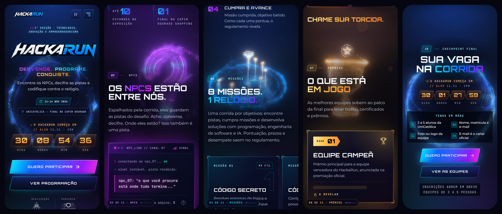
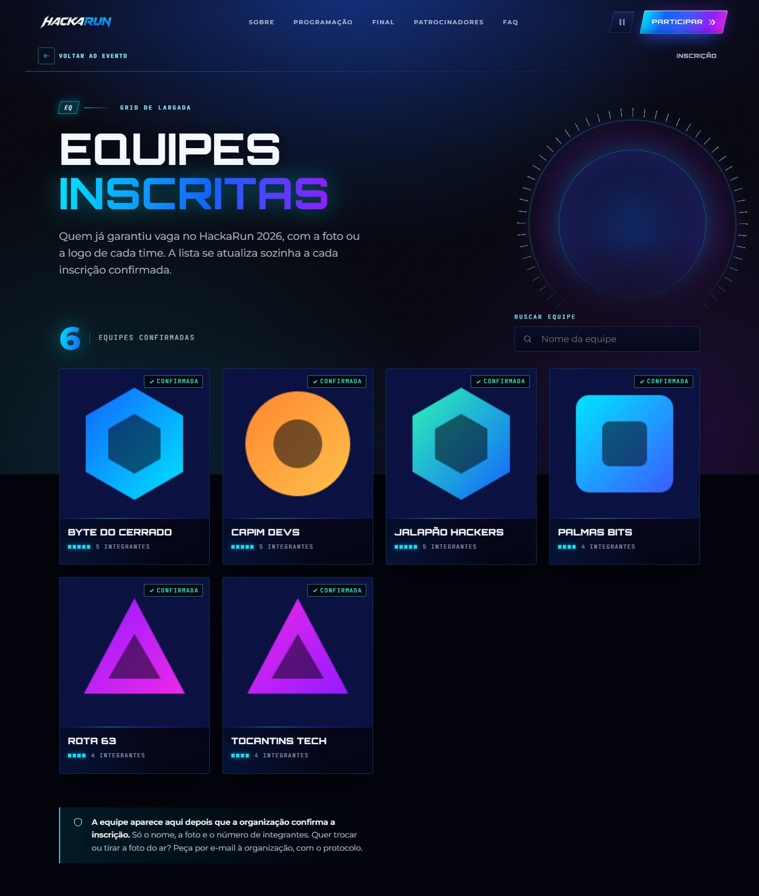
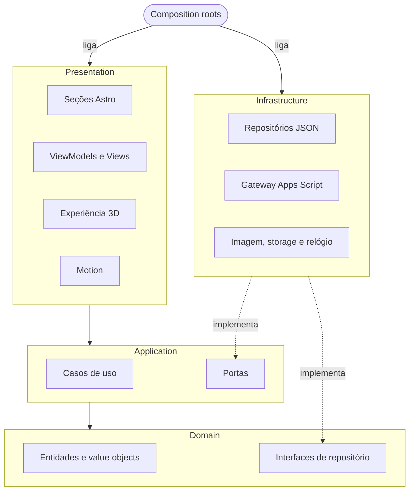
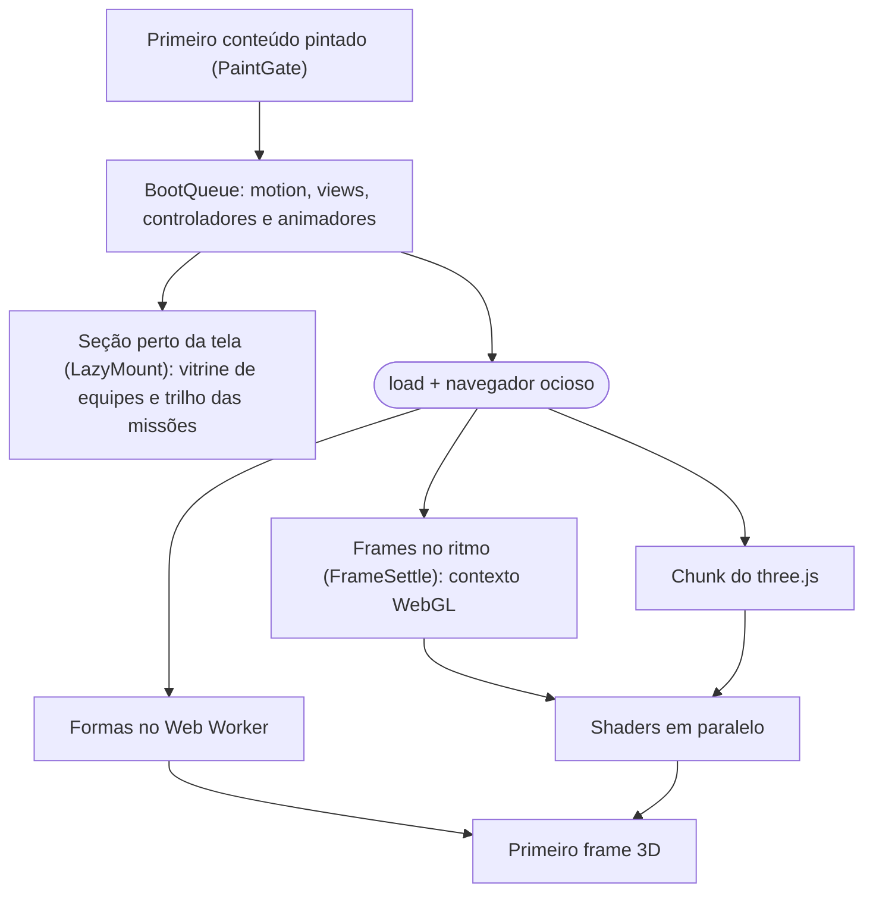

<div align="center">

<sub>**Português** · [English](README.en.md)</sub>

<picture>
  <source media="(prefers-reduced-motion: reduce)" srcset="https://raw.githubusercontent.com/hackarun-unicatolica/lp-hackarun/main/docs/media/scroll-preview-poster.jpg" />
  
</picture>

# HackaRun · Overdrive

**Desvende. Programe. Conquiste.**

A landing page do 1º HackaRun, o evento de tecnologia, inovação e empreendedorismo da UniCatólica. Ela conta a história
pelo scroll: um único campo de partículas em WebGL vira um objeto 3D diferente a cada seção, e a inscrição das equipes
cai direto numa planilha do Google.

<sub>**Overdrive** é o codinome da v2 cinematográfica desta página: como o modo turbo dos jogos de corrida, ela acelera
de cena em cena e, na chegada, o globo carrega e solta um pulso de energia.</sub>

[](https://github.com/hackarun-unicatolica/lp-hackarun/actions/workflows/ci.yml)


[](#performance)

[](https://hackarun.pages.dev)

**[Ver ao vivo → hackarun.pages.dev](https://hackarun.pages.dev)**

[Guia do projeto](docs/GUIA_DO_PROJETO.md) · [Decisões (ADRs)](docs/adr) · [Changelog](CHANGELOG.md) ·
[Design spec](docs/design/design-spec.md) · [Como contribuir](CONTRIBUTING.md)

</div>

---

**Para quem avalia:** [Em 30 segundos](#em-30-segundos) · [Visual](#visual) ·
[Roteiro visual](#roteiro-visual-uma-cena-3d-por-seção) · [Stack](#stack) · [Arquitetura](#arquitetura) ·
[Performance](#performance) · [Acessibilidade](#acessibilidade)<br />
**Para quem desenvolve:** [Como rodar no seu PC](#como-rodar-no-seu-pc) · [Scripts](#scripts) ·
[Inscrições](#conteúdo-e-inscrições) · [Contribuindo](#contribuindo) · [Deploy](#deploy) · [Roadmap](#roadmap)

## Em 30 segundos

- **Meu papel:** desenvolvimento solo. Em cima da identidade visual do evento, criada pela Eduarda Victória (Liga
  Acadêmica), fiz o design da página, o 3D e os shaders, o front-end, a API de inscrições no Apps Script, os testes, a
  CI e a documentação.
- **O que é:** o site oficial do HackaRun 2026, a 1ª edição do evento da UniCatólica, organizado pela LAES (Liga
  Acadêmica de Engenharia de Software e Inteligência Artificial) e com o Capim Dourado Shopping como parceiro
  exclusivo da premiação. São 4 dias, de 11 a 14 de novembro de 2026, em Palmas-TO, em duas frentes: uma programação
  aberta ao público (7 oficinas, palestras e até 10 estandes) e um hackathon só para alunos da UniCatólica, uma
  corrida por objetivos em equipes que termina na HackaRun Experience, no shopping. A página traz a programação em
  abas, 8 missões, mentores, prêmios, uma caça a 3 tokens escondidos, uma página de inscrição das equipes (com
  rascunho na aba e volta ao mesmo ponto da página) e outra só para as equipes confirmadas, com a foto ou a logo de
  cada time, ao vivo.
- **O diferencial:** 8 objetos 3D procedurais (globo, cronômetro, "?", mapa holográfico, terreno synthwave, palco,
  troféu e galáxia) feitos de 9 mil a 42 mil partículas, sem nenhum modelo 3D nem vídeo
  ([ADR 0005](docs/adr/0005-procedural-particles-over-video.md)), com pós-processamento de cinema e uma câmera
  coreografada para cada transição.
- **Rápida:** Lighthouse mobile com Performance **98** (era 66), LCP de 2,2 s e CLS de 0,001. Acessibilidade, Boas
  práticas e SEO em **100**. As páginas de inscrição e de equipes, sem 3D, ficam em 99.
- **Acessível:** todo o conteúdo aparece sem JavaScript e sem WebGL (só o envio da inscrição pede JavaScript, e a
  página avisa), respeita `prefers-reduced-motion` e tem botão de pausar animações (WCAG 2.2.2).
- **Backend de custo zero:** formulário → Google Apps Script → Google Sheets em três abas (equipes com a miniatura da
  foto na célula, integrantes com uma linha por pessoa e um resumo ao vivo), com a foto no Google Drive, uma equipe
  por pessoa, reenvio sem duplicar, limites de envio, trava de concorrência e consentimento LGPD versionado.
- **Engenharia:** Clean Architecture + DDD + MVVM com a regra de dependência travada no ESLint, 828 testes, CI no
  GitHub Actions, Conventional Commits, 9 ADRs e um `npm run setup` para quem faz fork.

## Visual

<p align="center">
  
  <br /><sub>Nove seções, nove momentos do mesmo campo de partículas. No hero, o selo da UniCatólica com os dois cursos abre a tela, e o logo oficial logo abaixo é o H1 e o LCP.</sub>
</p>

<p align="center">
  
  <br /><sub>No celular (390 px), no mesmo tier de qualidade que um aparelho recente recebe.</sub>
</p>

<p align="center">
  
  <br /><sub>A página <code>/equipes</code> lê da planilha as equipes confirmadas e divide a sub-navegação com a de inscrição. Os times e as imagens desta captura são fictícios, só para ilustrar.</sub>
</p>

<p align="center">
  
  <br /><sub>A inscrição tem uma página própria, leve e sem 3D: a foto sai reduzida no próprio navegador, as etapas marcam o que já está pronto e o rascunho fica na aba se a pessoa sair e voltar. Dados fictícios, num build de teste com o envio simulado.</sub>
</p>

## Roteiro visual: uma cena 3D por seção

Cada seção declara `data-scene`. O scroll mistura as formas na GPU de forma contínua e reversível, e o
[`FlightPath`](src/presentation/experience/camera/FlightPath.ts) tem uma coreografia de câmera para cada transição,
do voo por dentro do globo até o recuo final. As formas nascem num Web Worker, com a mesma ordem espacial (curva de
Morton) em todas, então a partícula k ocupa o "mesmo lugar" em cada objeto e a troca flui em vez de embaralhar.

| Seção                    | Cena      | Objeto                                                                    |
| ------------------------ | --------- | ------------------------------------------------------------------------- |
| Hero (`#inicio`)         | `core`    | Globo de energia em fitas de partículas, com a silhueta acesa por fresnel |
| O evento (`#sobre`)      | `orbit`   | Cronômetro-giroscópio: mostrador, ponteiro de varredura e anéis em cardã  |
| NPCs (`#npcs`)           | `enigma`  | Ponto de interrogação extrudado com faixa de pista e auréola de HUD       |
| Missões (`#missoes`)     | `map`     | Mapa holográfico: plataforma, rota em espiral e 8 faróis com energia      |
| Programação e mentores   | `terrain` | Terreno synthwave: grade rolando, montanhas e sol em faixas               |
| Grande final (`#final`)  | `stage`   | Palco do show: telão de LED 16:9, treliça, 8 canhões de luz e plateia     |
| Prêmios (`#premios`)     | `trophy`  | Taça de torno em linhas, alças de tubo e estrela no topo                  |
| Equipes e FAQ            | `dust`    | Galáxia distante e calma, com 2 braços em espiral: fundo de leitura       |
| Inscrição (`#inscricao`) | `core`    | O globo volta calmo, só respira, carrega por 0,9 s e solta um pulso suave |

A Orbitron, fonte oficial da marca, tem o til redesenhado em Python com fontTools: no original, "NÃO" parecia "NÀO" em
título grande ([ADR 0006](docs/adr/0006-cinematic-v2-and-official-identity.md)).

## Stack

| Camada     | Tecnologias                                                                                                  |
| ---------- | ------------------------------------------------------------------------------------------------------------ |
| Base       | [Astro 7](https://astro.build) (SSG), TypeScript 6 (strictest), Vite                                         |
| 3D         | [Three.js](https://threejs.org) r186 + GLSL próprio, EffectComposer, UnrealBloomPass e passe cinematográfico |
| Motion     | [GSAP](https://gsap.com) 3.15 (ScrollTrigger), [Lenis](https://lenis.darkroom.engineering) 1.3, `LineSplit`  |
| Estilo     | CSS moderno (custom properties, `@property`, cascade layers, `clamp()`, `content-visibility`), design tokens |
| Fontes     | Orbitron (com til corrigido), Montserrat e JetBrains Mono, self-hosted via Fontsource, só o subset latin     |
| Imagens    | `createImageBitmap` + canvas no navegador (WebP ou JPEG), CDN de imagens do Google para as fotos das equipes |
| Backend    | Google Apps Script (V8) + Google Sheets (abas Equipes, Integrantes e Resumo) + Google Drive, sem servidor    |
| Qualidade  | Vitest + happy-dom, ESLint 10 + typescript-eslint, Prettier, Astro Check, Playwright + Lighthouse            |
| Fluxo      | Husky, lint-staged, commitlint (Conventional Commits), GitHub Actions, `npm run setup`                       |
| Hospedagem | Cloudflare Pages ([ADR 0003](docs/adr/0003-cloudflare-pages-hosting.md))                                     |

Lista completa de bibliotecas, padrões e conceitos:
[`docs/pdf/HackaRun_LP_Stack_e_Padroes.pdf`](docs/pdf/HackaRun_LP_Stack_e_Padroes.pdf).

## Arquitetura

Clean Architecture com DDD e MVVM. As dependências apontam para o domínio, e o ESLint (`no-restricted-imports` em
[`eslint.config.js`](eslint.config.js)) recusa o import por alias (`@application/*`, `@infrastructure/*`…) que viola a
regra.



- **Domínio:** não importa outras camadas nem framework (`three`, `gsap`, `lenis`, `astro`).
- **Aplicação:** depende do domínio, nunca de infraestrutura, apresentação ou framework.
- **Apresentação:** nunca importa `@infrastructure`; os adapters são ligados em `src/composition` e chegam prontos.
- **Shared** (`EventBus`, `Observable`, `Ticker`): usado pelas outras camadas e não importa nenhuma.

**Blocos de DDD:** `Entity` e `ValueObject` como base, `Result<T, E>` com `ok` e `fail`, dois aggregate roots
(`HackathonEvent` e `TeamRegistration`), entidades como `EventDay`, `Session` e `Activity`, value objects como
`TeamName`, `TeamMember`, `FullName`, `StudentId`, `Email`, `TeamImage`, `TimeSlot`, `Audience`, `Countdown` e
`ScoringRule`, o serviço de domínio `RegistrationPolicy` (em breve, aberta, encerrando, encerrada) e 12 casos de uso.
Conteúdo inválido no JSON quebra o build, e um teste confere a programação contra o documento oficial do evento.

**MVVM:** 6 ViewModels sem DOM, com estado em `Observable` (contador, HUD, pausa, caça aos NPCs, formulário e
equipes), e Views que só ligam o DOM. Os módulos conversam por um `EventBus` tipado
([`AppEvents.ts`](src/presentation/app/AppEvents.ts)): `scene:enter`, `experience:charged`, `motion:paused`,
`npc:found` e outros.

**No navegador**, em ordem de prioridade e sem segurar o primeiro paint:



**A cada frame do 3D:** scroll → `SceneDirector` (índice contínuo de cena) → `SceneMixer` (pesos) → vertex shader
(morph entre os alvos) → `RenderPass` → bloom → passe cinematográfico → canvas opaco somado à aurora em CSS. No fim da
página, um perfil de movimento próprio ([`CoreMotion`](src/presentation/experience/scene/CoreMotion.ts)) acalma o
globo: ele gira devagar, só respira, e a carga vira luz, não agitação.

**Páginas leves:** `/inscricao` e `/equipes` usam um boot à parte
([`LightApp`](src/presentation/app/LightApp.ts)), sem 3D, GSAP nem Lenis. O formulário só é baixado lá, e só com as
inscrições abertas. O "Voltar ao evento" ([`backToEvent.ts`](src/presentation/views/navigation/backToEvent.ts)) volta
pelo histórico, então a landing page reaparece no mesmo ponto, direto do bfcache.

<details>
<summary><b>Padrões de projeto e onde estão</b></summary>

| Padrão                  | Onde                                                                                                                                                                                                                                            |
| ----------------------- | ----------------------------------------------------------------------------------------------------------------------------------------------------------------------------------------------------------------------------------------------- |
| Strategy                | [`ShapeStrategy`](src/presentation/experience/shapes/ShapeStrategy.ts) (8 objetos), [`RenderPipeline`](src/presentation/experience/post/RenderPipeline.ts), `QualityProfile`, `ScrollDriver`                                                    |
| Factory + registry      | [`ShapeFactory`](src/presentation/experience/shapes/ShapeFactory.ts), [`BoltFactory`](src/presentation/motion/animators/hero/lightning/BoltFactory.ts)                                                                                          |
| Registry                | [`AnimatorRegistry`](src/presentation/motion/animators/AnimatorRegistry.ts)                                                                                                                                                                     |
| Template Method         | [`SectionAnimator`](src/presentation/motion/animators/SectionAnimator.ts)                                                                                                                                                                       |
| Adapter                 | [`SmoothScroll`](src/presentation/motion/core/SmoothScroll.ts) (Lenis), [`AppsScriptRegistrationGateway`](src/infrastructure/registration/AppsScriptRegistrationGateway.ts), [`CanvasImageCodec`](src/infrastructure/image/CanvasImageCodec.ts) |
| Decorator               | [`RetryingRegistrationGateway`](src/infrastructure/registration/RetryingRegistrationGateway.ts): 3 tentativas, backoff exponencial com jitter                                                                                                   |
| Proxy com fallback      | [`FallbackTeamRepository`](src/infrastructure/repositories/FallbackTeamRepository.ts): planilha ao vivo, lista do build como reserva                                                                                                            |
| Null Object             | [`UnavailableRegistrationGateway`](src/infrastructure/registration/UnavailableRegistrationGateway.ts): em produção sem endpoint, todo envio responde "encerrada"                                                                                |
| Observer                | [`Observable`](src/shared/core/Observable.ts), [`EventBus`](src/shared/core/EventBus.ts)                                                                                                                                                        |
| Singleton               | [`Ticker.shared`](src/shared/core/Ticker.ts) (um único rAF no site), [`serverContainer()`](src/composition/server.ts)                                                                                                                           |
| Facade                  | [`GetLandingPage`](src/application/use-cases/GetLandingPage.ts), [`ExperienceStage`](src/presentation/experience/ExperienceStage.ts)                                                                                                            |
| Composite               | [`strokes.ts`](src/presentation/experience/shapes/strokes.ts): uma forma é uma lista de traços com peso                                                                                                                                         |
| Builder                 | [`PointBrush`](src/presentation/experience/shapes/PointBrush.ts), [`BoltBuilder`](src/presentation/motion/animators/hero/lightning/BoltBuilder.ts), [`StageBuilder`](src/presentation/experience/StageBuilder.ts)                               |
| Repository + Mapper     | [`StaticListRepository`](src/infrastructure/repositories/StaticListRepository.ts), [`EventMapper`](src/infrastructure/mappers/EventMapper.ts)                                                                                                   |
| Job cooperativo         | [`ParticleJob`](src/presentation/experience/shapes/ParticleJob.ts): um generator que cede a thread                                                                                                                                              |
| Inversão de dependência | [`BootSteps`](src/presentation/app/BootQueue.ts), a interface que o boot enxerga                                                                                                                                                                |

</details>

Detalhes no [guia do projeto](docs/GUIA_DO_PROJETO.md#6-arquitetura) e nas [ADRs](docs/adr).

## Performance

Lighthouse mobile no build de produção, Brave headless, mediana de 3 execuções em 12/10/2026:

| Métrica                             | Meta do projeto | Antes    | Agora       |
| ----------------------------------- | --------------- | -------- | ----------- |
| Performance                         | ≥ 90            | 66       | **98**      |
| Total Blocking Time                 | –               | 1.600 ms | **98 ms**   |
| Largest Contentful Paint            | < 2,5 s         | 2,9 s    | **2,2 s**   |
| First Contentful Paint              | –               | –        | 1,4 s       |
| Speed Index                         | –               | –        | 2,1 s       |
| Cumulative Layout Shift             | < 0,05          | –        | **0,001**   |
| Acessibilidade, Boas práticas e SEO | 100             | 100      | **100**     |
| JS inicial (entrada, gzip)          | < 70 KB         | –        | **68,2 KB** |

<sub>Antes: nota do último relatório antes do trabalho de performance. Traço: sem meta própria ou sem registro
anterior. JS inicial: o script de entrada, o chunk do `App` e o que eles importam direto, em gzip (KB de 1.024
bytes). `/inscricao` e `/equipes` ficam em 99 de Performance, com LCP de 2,0 s e TBT 0.</sub>

Todas as metas que eu mesmo coloquei estão batidas. O que segura isso:

- HTML estático com o hero pronto no build. O logo oficial é o H1 e o LCP, com prioridade alta, e o CSS pequeno entra
  inline. Nas páginas sem hero, o logo do header é que ganha a prioridade.
- O JavaScript do app só baixa depois que o navegador registra o primeiro conteúdo pintado
  ([`PaintGate`](src/presentation/app/PaintGate.ts), com teto de 3 s), e o boot roda em passos curtos que cedem a
  thread ([`BootQueue`](src/presentation/app/BootQueue.ts) com `scheduler.yield()`). Cada seção só monta as animações
  quando chega perto da tela, e um `LineSplit` próprio substitui o SplitText do GSAP.
- A vitrine de equipes e o contador do trilho das missões são chunks à parte, carregados pelo
  [`LazyMount`](src/presentation/app/LazyMount.ts) quando a seção chega perto, quando a página abre ou salta pra ela
  ou quando a pessoa toca ou foca nela. O formulário mora na página `/inscricao` e nem é baixado na landing page.
- three.js num chunk separado (592 KB, 152 KB gzip), importado depois do `load` e com o navegador ocioso. As formas
  nascem num Web Worker, o contexto WebGL só é criado quando os frames voltam ao ritmo da tela
  ([`FrameSettle`](src/presentation/experience/FrameSettle.ts)) e os shaders compilam em paralelo.
- Qualidade adaptativa: 9 mil, 22 mil ou 42 mil partículas conforme a GPU, e o bloom, a resolução e o tier caem se o
  FPS ficar abaixo de 45.
- Fontes self-hosted, só o subset latin, duas com preload e `font-display: swap`.
- `content-visibility: auto` nas seções longe do topo, com `contain-intrinsic-size` medido em 390 e 1440 px, sem
  quebrar as âncoras ([`anchorcheck.mjs`](scripts/qa/anchorcheck.mjs) confere).
- Render do 3D pausado com a aba oculta, e raios do logo só com o hero visível.
- `/inscricao` e `/equipes` sem 3D, GSAP nem Lenis (14 KB de JS inicial). As fotos vêm em 600 px do CDN do Google,
  com `loading="lazy"`, `decoding="async"` e largura e altura fixas (sem pulo de layout); no envio, o navegador já
  reduz cada foto para ~300 KB.
- O globo calmo do fim não custa um passe de render a mais: são 4 uniforms nas partículas, 1 no passe de lente e uma
  mistura de números por frame.
- Cache imutável de 1 ano para `/_astro/*` e HTML sempre revalidado ([`public/_headers`](public/_headers)).

<sub>Medido de novo em 12/10/2026, depois da página de inscrição e do globo final calmo, no build de produção servido
com gzip. O TBT oscila entre execuções (de 68 a 245 ms nessas três), sempre por tarefas do boot e do chunk do 3D.</sub>

## Acessibilidade

A meta é **WCAG 2.2 AA**, e o Lighthouse dá 100 em acessibilidade:

- Link "Pular para o conteúdo" e foco visível (`:focus-visible`, nunca `outline: none`), inclusive no alto contraste
  do Windows (`forced-colors: active`).
- `prefers-reduced-motion`: scroll nativo instantâneo, cenas trocadas inteiras, 3D desenhado só sob demanda e entradas
  sem animação.
- Botão **Pausar animações** (WCAG 2.2.2) no header e no menu do celular: congela o relógio do 3D, os raios e os loops
  em CSS, e a escolha fica salva. O tooltip fecha com Esc (WCAG 1.4.13).
- Menu do celular com `inert` no resto da página, focus trap, Esc e foco devolvido ao botão. O link de âncora leva o
  foco para a seção.
- Programação em abas no padrão WAI-ARIA (tabindex móvel, setas, Home/End e ativação automática). Sem JavaScript, a
  barra de abas some e os 4 dias aparecem empilhados.
- Formulário em etapas, com um `fieldset` por integrante: adicionar ou remover alguém move o foco e anuncia a equipe
  ("Integrante 3 adicionado. A equipe tem 3 de 5 integrantes."). O indicador de etapas usa `aria-current="step"` e
  avisa o leitor de tela quando uma etapa tem campos a ajustar. Tem resumo de erros agrupado por bloco, `aria-invalid`
  e `aria-describedby`, regiões live para status e cópia para leitor de tela dos textos "digitados" ou
  "decodificados". O campo da foto tem prévia, troca, arrastar e soltar e status anunciado. E o clique em "Confirmar
  inscrição" não se perde quando o erro de um campo aparece acima do botão.
- Sub-navegação em `/inscricao` e `/equipes` com `aria-current="page"` e o nome acessível inteiro mesmo quando o rótulo
  encurta no celular; o link da página atual sobe para o topo e leva o foco ao conteúdo, sem recarregar.
- Página `/equipes` com busca com `label`, contagem anunciada em região live e alt "Foto ou logo da equipe X" em cada
  card. No Lighthouse do build de produção, acessibilidade 100 em `/equipes` e em `/inscricao` com as inscrições
  abertas.
- Conteúdo completo sem JavaScript e sem WebGL: o HTML sai pronto do build, e o formulário avisa quando o JavaScript
  está desligado.

## Segurança e LGPD

- **CSP estrita** em [`public/_headers`](public/_headers): `script-src 'self'` sem script inline, `connect-src` só com
  a própria origem e o Apps Script, `img-src` só com a própria origem e `lh3.googleusercontent.com` (as fotos das
  equipes), `object-src 'none'` e `frame-ancestors 'none'`, mais `nosniff`, `X-Frame-Options: DENY`, COOP,
  Permissions-Policy e Referrer-Policy.
- **Só o necessário na inscrição:** nome da equipe, foto ou logo e, de cada integrante, nome completo, matrícula e
  e-mail. Nada de telefone, curso ou dado sensível. A comunicação oficial é por e-mail.
- **Dados mínimos em público:** a página de equipes mostra só o nome da equipe, a quantidade de integrantes e a foto ou
  logo (nunca nomes de pessoas, matrículas ou e-mails), e só depois que a organização confirma a inscrição. Os cards
  são montados a partir de um `<template>` com `textContent` (nada da planilha vira HTML), e o endereço da foto só é
  montado a partir de um id com o formato do Drive.
- **Rascunho só na aba:** o que é digitado em `/inscricao` fica no `sessionStorage` (some ao fechar a aba, no envio ou
  em "Limpar rascunho"), o aceite nunca é guardado, e o que volta do armazenamento é conferido (origem de uma lista
  fixa, chave de envio no formato do servidor, foto com tipo e tamanho válidos).
- **Uma equipe por pessoa:** nome de equipe, e-mail ou matrícula que já estão em outra equipe voltam como conflito,
  sem diferenciar caixa nem acento, e o site marca o campo certo. Cada sessão do formulário manda uma chave UUID, e o
  reenvio recebe o mesmo protocolo, sem linha duplicada.
- **Upload conferido no servidor:** a foto é validada pelos primeiros bytes (JPEG, PNG ou WebP), o tipo declarado
  precisa bater e o teto é 400 KB. O arquivo no Drive ganha um nome sorteado, nunca o protocolo nem algo digitado.
- **Anti-spam:** campo honeypot, tempo mínimo de 3 s de preenchimento e limites por e-mail (o contador usa só o hash
  SHA-256 do e-mail de contato) e global.
- **Planilha protegida:** fórmula injetada (`= + - @`) é neutralizada, o `LockService` evita gravação concorrente e o
  Apps Script pede só os escopos mínimos (a própria planilha e o Drive), conferidos por teste.
- **LGPD:** aviso de privacidade em [`/privacidade`](src/pages/privacidade.astro) com 9 seções, de quem cuida dos dados
  ao armazenamento no navegador, incluindo a foto da equipe, a retenção e como pedir a remoção. Cada inscrição grava a
  versão do aviso aceita e a hora do aceite (`CONSENT_VERSION`, hoje `2026-10-v3`), e o servidor recusa o envio sem
  isso ou com uma versão antiga. O aceite inclui a autorização para publicar a foto e a declaração de que todos os
  integrantes, e quem aparece na imagem, concordaram.

## Qualidade

| Item            | Situação                                                                                                    |
| --------------- | ----------------------------------------------------------------------------------------------------------- |
| Testes          | **828 testes em 108 arquivos** (Vitest + happy-dom), por camada, incluindo 12 suítes do Apps Script real    |
| Lint            | ESLint sem erros e sem avisos: regra de camadas, teto de 250 linhas de código por arquivo, `import type`    |
| Tipos           | `astro/tsconfigs/strictest` (`noUncheckedIndexedAccess`, `exactOptionalPropertyTypes`, …) + Astro Check     |
| Formatação      | Prettier em todo o repositório                                                                              |
| CI              | GitHub Actions (push na `main` e PR): `npm ci` → lint → formatação → testes → build sem simulação → `dist`  |
| Commits         | Husky + lint-staged no pre-commit e commitlint no commit-msg (escopo fora da lista gera aviso)              |
| QA no navegador | [`scripts/qa/`](scripts/qa/README.md): capturas, âncoras, overflow, Web Vitals, tarefas longas e Lighthouse |

**Em números:** 439 arquivos e 33.322 linhas em `src` (TypeScript, Astro, GLSL e CSS), dos quais 90 arquivos e 5.852
linhas são do módulo 3D; 108 arquivos de teste e 12 helpers, com 10.686 linhas; 1.117 linhas de Apps Script em 8
arquivos; 9 ADRs.

---

## Para desenvolvedores

### Como rodar no seu PC

Este passo a passo é para quem vai fazer fork e mexer no projeto. Os comandos valem para o Git Bash, o PowerShell e o
terminal do macOS ou do Linux; onde muda alguma coisa, as duas versões aparecem.

**1. Instale o básico**

| Ferramenta      | Versão                             | Para quê                                                                              |
| --------------- | ---------------------------------- | ------------------------------------------------------------------------------------- |
| Git             | qualquer versão recente            | Clonar, criar branch e abrir PR                                                       |
| Node.js         | 24 LTS (`.nvmrc`; no mínimo 22.18) | Rodar, testar e gerar o build. Com nvm: `nvm install 24` e `nvm use 24`               |
| npm             | o que vem com o Node               | Dependências e scripts                                                                |
| Brave ou Chrome | atual                              | Opcional: scripts de QA (capturas e Lighthouse) com GPU de verdade                    |
| Python          | 3.11 ou mais novo                  | Opcional: só para regenerar a fonte ou os assets dos PDFs                             |
| VS Code         | qualquer versão recente            | Opcional: o repositório sugere as extensões de Astro, ESLint, Prettier e EditorConfig |

No Windows, o nvm é o [nvm-windows](https://github.com/coreybutler/nvm-windows); o `.nvmrc` diz a versão que a CI usa.

**2. Faça o fork e clone o seu fork**

No GitHub, clique em **Fork** e depois:

```bash
git clone https://github.com/<seu-usuario>/lp-hackarun.git
cd lp-hackarun
git remote add upstream https://github.com/hackarun-unicatolica/lp-hackarun.git
```

O `origin` é o seu fork (onde você dá push) e o `upstream` é o repositório original (de onde vêm as atualizações).

**É da equipe?** O repositório fica na organização `hackarun-unicatolica` do GitHub. Peça para entrar como
colaborador e pule o fork: clone o original (`git clone https://github.com/hackarun-unicatolica/lp-hackarun.git`),
sem `upstream`. Assim os seus PRs ganham a prévia da Cloudflare. O passo a passo está no
[CONTRIBUTING.md](CONTRIBUTING.md#fluxo-de-trabalho-da-equipe).

**3. Prepare o projeto**

```bash
npm run setup
```

O script confere a versão do Node, roda o `npm ci` se as dependências ainda não estiverem instaladas, cria o `.env` a
partir do `.env.example` e mostra os próximos passos. Use `npm run setup -- --qa` para instalar também os scripts de QA
e `npm run setup -- --check` para só conferir, sem instalar nada. Se preferir fazer à mão:

```bash
npm ci
cp .env.example .env
```

<sub>No cmd do Windows, troque o `cp` por `copy`. No Git Bash e no PowerShell, `cp` funciona.</sub>

**4. Rode o site**

```bash
npm run dev
```

Abra `http://localhost:4321`; o formulário fica em `http://localhost:4321/inscricao` (sem barra no fim). A página
recarrega sozinha a cada arquivo salvo. Com o `PUBLIC_REGISTRATION_ENDPOINT` vazio (o padrão do `.env.example`), a
inscrição roda em **modo simulado**: nada sai do seu computador e nenhuma planilha é tocada. O formulário valida
tudo como o de verdade, e as equipes "inscritas" aparecem já confirmadas, com a foto, em `/equipes` e na LP enquanto a
aba estiver aberta (ficam no `sessionStorage`). Para ver os estados de erro, use um e-mail de contato que comece com
`falha` (erro de rede), `servidor` (script fora do ar) ou `duplicado` (inscrição repetida). Nome de equipe, e-mail ou
matrícula repetidos entre as equipes simuladas dão o mesmo erro de campo que o servidor de verdade.

| Parâmetro de URL                 | Efeito                                                                |
| -------------------------------- | --------------------------------------------------------------------- |
| `?quality=low\|medium\|high`     | Força o tier do 3D e desliga o ajuste automático por FPS              |
| `?now=2026-11-14T16:00:00-03:00` | Desloca o relógio do site para conferir a troca de marcos do contador |
| `/inscricao?origem=hero`         | Origem da inscrição (coluna Origem); fora da lista, vira `direct`     |

**5. Confira antes de abrir o PR**

```bash
npm test
npm run lint
npm run format
npm run validate
```

O `npm run validate` roda lint, testes e build, o mesmo que a CI. Para ver o build como vai ao ar, rode
`npm run build` e depois `npm run preview`.

**6. Scripts de QA (opcional)**

Capturas em várias larguras, âncoras, overflow, Web Vitals e Lighthouse, com o Brave ou o Chrome instalado:

```bash
npm run setup -- --qa
```

Isso instala o Playwright e o Lighthouse só dentro de `scripts/qa/` (dá no mesmo que `cd scripts/qa` e `npm install`)
e avisa se não achar o navegador. Sem Brave nem Chrome, rode `npx playwright install chromium` dentro de `scripts/qa/`.
Exemplos de uso na seção [Scripts](#scripts).

**7. Scripts de assets em Python (opcional)**

Só para regenerar a Orbitron com o til corrigido ou os assets dos PDFs. Os dois scripts leem fontes de
`node_modules`, então rode o `npm ci` antes:

```bash
python -m pip install -r requirements.txt
python scripts/fonts/patch_orbitron_tilde.py
python scripts/docs/build_pdf_assets.py
```

<sub>No Windows, se o `python` não existir ou abrir a Microsoft Store, use `py` no lugar dele (`py -m pip install -r
requirements.txt`).</sub>

**8. Ligue o formulário a uma planilha de teste sua**

Para testar o envio de verdade, use uma planilha **sua**, nunca a oficial:

1. No seu Google Drive, crie uma planilha (por exemplo, "HackaRun · teste").
2. Siga as seções 2 a 5 do [`apps-script/README.md`](apps-script/README.md): cole os 8 arquivos `.gs` e o
   `appsscript.json`, rode `configurarPlanilha()` e publique como **App da Web**.
3. Copie a URL que termina em `/exec` para o seu `.env`:
   `PUBLIC_REGISTRATION_ENDPOINT=https://script.google.com/macros/s/<id>/exec`.
4. Pare o `npm run dev` (Ctrl+C) e rode de novo: o `.env` só é lido na partida.

As inscrições caem nas abas Equipes e Integrantes da sua planilha, e a equipe aparece em `/equipes` quando você troca
o Status para `confirmado`. O `.env` fica fora do Git. Não coloque a URL no `event.json`, senão ela vai junto no PR.

<details>
<summary><b>Problemas comuns</b></summary>

| Sintoma                                             | O que fazer                                                                                                                                      |
| --------------------------------------------------- | ------------------------------------------------------------------------------------------------------------------------------------------------ |
| O `npm run setup` recusa a versão do Node           | Instale o Node 24 LTS (`nvm install 24` e `nvm use 24`) e abra um terminal novo. `node -v` mostra a versão em uso.                               |
| `npm warn EBADENGINE` no `npm ci`                   | É só aviso: algumas dependências de lint pedem Node 24.16 ou mais novo. Atualize o Node 24 para o último patch e o aviso some.                   |
| A porta 4321 está ocupada                           | O Astro tenta a próxima porta livre e mostra a URL no terminal. Para escolher uma: `npm run dev -- --port 4322`. Ou feche o outro `npm run dev`. |
| `&&` dá erro no PowerShell                          | O Windows PowerShell 5.1 não tem `&&`: rode um comando por linha ou separe com `;`. Os comandos deste README já vêm um por linha.                |
| Definir uma variável de ambiente só para um comando | bash: `BRAVE_PATH="/caminho/brave" node shots.mjs <url>` · PowerShell: `$env:BRAVE_PATH = 'C:\caminho\brave.exe'; node shots.mjs <url>`          |
| `npm ci` falha com `EPERM` ou `EBUSY` no Windows    | Pare o `npm run dev`, feche o editor ou terminal que estiver usando a pasta e rode de novo.                                                      |
| O commit é recusado                                 | O Husky roda o commitlint e o lint-staged: confira o formato `tipo(escopo): descrição` e os erros do ESLint. Não use `--no-verify`.              |
| Mudei o `.env` e nada mudou                         | Variáveis entram na partida: pare o `npm run dev` e rode de novo.                                                                                |
| Quero limpar as equipes simuladas                   | Feche a aba ou apague a chave `hackarun:dev:simulated-teams` do `sessionStorage` (DevTools → Application).                                       |
| O formulário volta preenchido                       | É o rascunho da aba: use "Limpar rascunho" no cartão das etapas ou apague as chaves `hackarun:registration-draft:v2*` do `sessionStorage`.       |
| `/inscricao/` dá 404                                | Os endereços não têm barra no fim (`trailingSlash: 'never'`): abra `/inscricao`.                                                                 |
| O 3D não aparece                                    | Confira se o navegador tem WebGL2 e se a economia de dados está desligada. Teste com `?quality=low`. Sem 3D, a página continua inteira.          |

</details>

### Variáveis de ambiente

| Variável                        | Obrigatória | Descrição                                                                                                    |
| ------------------------------- | ----------- | ------------------------------------------------------------------------------------------------------------ |
| `PUBLIC_SITE_URL`               | não         | URL pública (canonical, sitemap, robots.txt, Open Graph). Padrão: `https://hackarun.pages.dev`               |
| `PUBLIC_REGISTRATION_ENDPOINT`  | não         | URL do Web App do Apps Script. Vazia = "inscrições em breve" (em dev, modo simulado)                         |
| `PUBLIC_REGISTRATION_SIMULATED` | não         | `true` só nas prévias da Cloudflare: sem endpoint, a inscrição roda simulada e as páginas saem com `noindex` |
| `DOCS_OUT_DIR`                  | não         | Pasta extra para onde o `npm run docs:pdf` copia os PDFs e o guia                                            |

Os scripts de QA leem `BRAVE_PATH` ou `CHROME_PATH` para achar o navegador.

### Scripts

| Comando                           | Descrição                                                             |
| --------------------------------- | --------------------------------------------------------------------- |
| `npm run setup`                   | Prepara o PC: confere o Node, instala as dependências e cria o `.env` |
| `npm run dev`                     | Servidor de desenvolvimento em `http://localhost:4321`                |
| `npm run build`                   | Type-check (`astro check`) + build de produção em `dist/`             |
| `npm run preview`                 | Serve o build localmente                                              |
| `npm test` / `test:watch`         | Testes unitários uma vez / em modo watch                              |
| `npm run lint` / `lint:fix`       | ESLint (camadas, tamanho de arquivo) / com correção                   |
| `npm run format` / `format:check` | Prettier: formata / confere                                           |
| `npm run validate`                | Lint + testes + build (a CI roda isso e também o `format:check`)      |
| `npm run docs:pdf`                | Gera os 2 PDFs de documentação em `docs/pdf/`                         |

<details>
<summary><b>Scripts de assets (Python) e de QA (Playwright + Lighthouse)</b></summary>

Assets gerados por script não se editam à mão: rode o script e versione a saída. As dependências em Python estão no
[`requirements.txt`](requirements.txt).

| Comando                                        | Requer                          | Gera                                                 |
| ---------------------------------------------- | ------------------------------- | ---------------------------------------------------- |
| `python scripts/fonts/patch_orbitron_tilde.py` | `fonttools`, `brotli`           | `src/assets/fonts/orbitron-pt-latin-wght.woff2`      |
| `python scripts/docs/build_pdf_assets.py`      | `fonttools`, `brotli`, `Pillow` | `scripts/docs/assets/` (fontes TTF e logos dos PDFs) |

Os scripts de QA têm `package.json` próprio, então Playwright e Lighthouse não pesam o `npm ci` do projeto. Eles
usam o Brave ou o Chrome instalado, com GPU real, e recebem a URL como argumento. Deixe o build rodando num terminal
(`npm run build` e depois `npm run preview`) e, em outro, dentro de `scripts/qa/`:

```bash
node shots.mjs http://localhost:4321/ 390 844 out/m390 "#sobre,#programacao" --mobile
node anchorcheck.mjs http://localhost:4321/           # âncoras param logo abaixo do header
node overflow.mjs http://localhost:4321/              # nada passa da tela em 360 e 390 px
node lighthouse.mjs http://localhost:4321/ --runs=3   # Lighthouse mobile com mediana
```

Também há `vitals.mjs` (LCP, CLS e tempo até o 3D), `longtasks.mjs` (tarefas longas com CPU 4x e 4G lento) e
`trace.mjs` (trace até o primeiro paint e passos do boot). Roteiro completo em
[`scripts/qa/README.md`](scripts/qa/README.md).

</details>

### Estrutura do projeto

<details>
<summary><b>Árvore de pastas</b></summary>

```text
src/
├── domain/          # entidades, value objects, aggregates, serviço e interfaces de repositório
├── application/     # casos de uso, DTOs e portas
├── infrastructure/  # conteúdo JSON, mappers, repositórios, Apps Script, imagem, storage e relógio
├── presentation/    # app, layouts, sections, components, controllers, formatters, view-models, views, motion,
│                    # styles e experience/ (3D: camera, input, layers, particles, post, quality, scene, shaders, shapes)
├── shared/          # EventBus, Observable, Ticker, utilitários e config/ (modo da inscrição, produção ou prévia)
├── composition/     # composition roots (build e navegador)
├── assets/          # logos oficiais e a Orbitron com o til redesenhado
└── pages/           # index, inscricao, equipes, privacidade (LGPD), 404 e robots.txt
apps-script/         # API de inscrições, planilha em 3 abas e fotos no Drive (Google Apps Script) + passo a passo
design/              # referências visuais do briefing e o vídeo teaser (não vão para o site)
public/              # og-image, favicon e _headers (cache, CSP e segurança)
scripts/             # setup.mjs, patch da fonte, gerador dos PDFs e qa/
tests/               # testes por camada
docs/                # guia, design spec, ADRs, manifesto da stack, PDFs e mídia do README
requirements.txt     # dependências dos scripts de assets em Python
```

</details>

### Conteúdo e inscrições

- **Conteúdo** (dias, blocos e atividades da programação, missões, FAQ, prêmios, mentores, parceiros) fica em
  `src/infrastructure/content/*.json`. Dá para editar sem programar; dado inválido quebra o build e os testes validam o
  conteúdo real.
- **Inscrições** são só de equipe, de 2 a 5 alunos, com nome completo, matrícula e e-mail de cada integrante, na
  página `/inscricao` ([ADR 0009](docs/adr/0009-registration-on-its-own-page.md)). Cada CTA do site leva para lá com a
  origem no endereço (`?origem=hero`, `?origem=final`...), que vai para a coluna Origem. Elas vão para uma planilha
  Google via Apps Script (`doPost`), e a foto ou logo da equipe vai para uma pasta do Google Drive.
  O script monta a planilha sozinho (`configurarPlanilha()`): a aba **Equipes** tem uma linha por equipe, com a
  miniatura da foto na célula (`=IMAGE()`) e o Status num menu com cor; a aba **Integrantes** tem uma linha por pessoa;
  e a aba **Resumo** tem os contadores e os e-mails das equipes confirmadas prontos para colar. Equipes e Integrantes
  têm filtro em todas as colunas.
- **Equipes no site:** a equipe aparece em `/equipes` quando a organização marca `confirmado` na coluna Status, e a
  lista pública (`doGet ?action=teams`) tem cache de 60 s, limpo sozinho quando o Status, o nome, a quantidade ou a foto
  muda. Para tirar uma foto do ar, basta apagar a célula **ID da foto**; num pedido de remoção (LGPD) ou numa imagem
  imprópria, apague antes o arquivo no Drive e esvazie a lixeira. Instalação passo a passo em
  [`apps-script/README.md`](apps-script/README.md).
- **Propriedades do script:** `CLOSES_AT` (prazo), `CAPACITY` (máximo de equipes), `INSCRICOES_FECHADAS` (fecha na
  hora, sem novo deploy) e `FOTOS_PASTA_ID` (pasta das fotos). Mudou o texto do aviso de privacidade? Suba o
  `CONSENT_VERSION` em [`SubmitRegistration.ts`](src/application/use-cases/SubmitRegistration.ts) e no
  [`Validation.gs`](apps-script/Validation.gs), e publique o script junto com o site.

### Contribuindo

O fluxo completo está no [CONTRIBUTING.md](CONTRIBUTING.md). Quem é da equipe entra como colaborador e clona o
repositório direto (sem fork, para o PR ganhar a prévia da Cloudflare); quem é de fora usa um fork. Em resumo:

1. Crie uma branch a partir da `main` atualizada: `git switch -c feat/<assunto>` (ou `fix/`, `docs/`, `refactor/`,
   `test/`).
2. Faça commits pequenos em **Conventional Commits**, em inglês: `tipo(escopo): descrição`, por exemplo
   `feat(sections): add day tabs to the schedule`. Os escopos aceitos estão no
   [`commitlint.config.js`](commitlint.config.js): `domain`, `application`, `infra`, `ui`, `sections`, `experience`,
   `motion`, `a11y`, `perf`, `seo`, `content`, `docs`, `ci`, `deps`, `config` e `tests`.
3. Rode `npm run validate` e `npm run format:check`.
4. `git push -u origin feat/<assunto>` e abra um Pull Request para a `main`, preenchendo o template. A CI precisa
   ficar verde, a prévia da Cloudflare aparece no PR e um dos donos do código ([CODEOWNERS](.github/CODEOWNERS))
   aprova.
5. O merge é com **Squash and merge**, com o título do PR em Conventional Commits, e a produção atualiza sozinha.

As mudanças de cada versão ficam no [CHANGELOG.md](CHANGELOG.md).

### Deploy

O site oficial está na **Cloudflare Pages**, no plano gratuito e sem cartão cadastrado:
**[hackarun.pages.dev](https://hackarun.pages.dev)**. Escolhi a integração com o Git da própria Cloudflare (nenhum
token guardado no GitHub) e mantive o site 100% estático, sem nada que gere cobrança.

- **Produção automática:** cada merge na `main` publica sozinho, em 1 a 2 minutos.
- **Prévia em todo PR:** o bot da Cloudflare comenta no PR um endereço próprio (`<hash>.hackarun.pages.dev`). Na
  prévia a inscrição é simulada, com o aviso "Prévia de revisão: as inscrições são simuladas e nada é gravado na
  planilha.", e as páginas saem com `noindex`.
- **Variáveis por ambiente** (Settings → Variables and Secrets do projeto):

| Variável                        | Production                                                                       | Preview                      |
| ------------------------------- | -------------------------------------------------------------------------------- | ---------------------------- |
| `NODE_VERSION`                  | `24`                                                                             | `24`                         |
| `PUBLIC_SITE_URL`               | `https://hackarun.pages.dev`                                                     | `https://hackarun.pages.dev` |
| `PUBLIC_REGISTRATION_ENDPOINT`  | vazia até a abertura ("inscrições em breve")                                     | não existe                   |
| `PUBLIC_REGISTRATION_SIMULATED` | não existe (sem endpoint, o build quebra de propósito; com endpoint, é ignorada) | `true`                       |

- **Custo zero:** plano Free sem cartão, sem `functions/`, `_worker.js` ou `wrangler.toml`. Se os 500 builds do mês
  acabarem, os builds novos só esperam o mês virar; o site continua no ar.

A configuração completa (projeto, proteção da `main`, donos do código, como abrir as inscrições e como voltar um
deploy) está no [guia do projeto, seção 16](docs/GUIA_DO_PROJETO.md#16-deploy-na-cloudflare-pages-grátis). Para
publicar o seu fork na sua conta:

1. Cloudflare → **Workers & Pages → Create application → Pages → Connect to Git**.
2. Preset **Astro** · Build `npm run build` · Output `dist`.
3. Variáveis: `NODE_VERSION=24`, `PUBLIC_SITE_URL` com o endereço do seu projeto e, se quiser o formulário ligado,
   `PUBLIC_REGISTRATION_ENDPOINT` com a URL da sua planilha de teste.

O comparativo com outras opções está na [ADR 0003](docs/adr/0003-cloudflare-pages-hosting.md).

## Roadmap

- [x] Arquitetura, domínio e conteúdo oficial
- [x] Experiência 3D guiada por scroll com 8 objetos
- [x] Redesign cinematográfico v2 (Overdrive) com a identidade oficial ([ADR 0006](docs/adr/0006-cinematic-v2-and-official-identity.md))
- [x] Lighthouse mobile ≥ 90 em performance e 100 em acessibilidade, boas práticas e SEO
- [x] Botão de pausar animações (WCAG 2.2.2)
- [x] Scripts de QA (Playwright + Lighthouse) versionados no repositório
- [x] Página de equipes com foto ou logo, moderada pela confirmação ([ADR 0007](docs/adr/0007-team-photos-google-drive.md))
- [x] Programação real do evento, com as duas frentes, as abas por dia e a HackaRun Experience
- [x] Formulário de inscrição só de equipe e planilha organizada em três abas, com a foto na célula e filtros ([ADR 0008](docs/adr/0008-team-only-registration-and-organized-sheet.md))
- [x] Guia para rodar e contribuir a partir de um fork, com `npm run setup`
- [x] LCP mobile abaixo de 2,5 s (2,2 s em 12/10/2026)
- [x] JS inicial abaixo de 70 KB gzip (68,4 KB)
- [x] Apps Script publicado na planilha de inscrições e testado de ponta a ponta (foto na célula, duplicados barrados)
- [x] Inscrição numa página própria, com rascunho na aba e volta ao mesmo ponto da landing page ([ADR 0009](docs/adr/0009-registration-on-its-own-page.md))
- [x] Globo do fim da página mais calmo: gira devagar, respira e solta um pulso suave
- [x] Selo da UniCatólica com os cursos de Engenharia de Software e Inteligência Artificial no topo do hero, e a LAES como organização na faixa de parceiros
- [x] Publicação oficial na Cloudflare Pages ([hackarun.pages.dev](https://hackarun.pages.dev)), com deploy automático da `main` e prévia em todo PR
- [ ] Inscrições ligadas no site oficial: quando a coordenação definir as vagas e o prazo
- [ ] Regulamento e pontuação das missões: a organização apresenta na abertura, em 12/11, às 19h35
- [ ] Prêmios, mentores e banca: a organização revela mais perto do evento

## Créditos

- **Design da página e desenvolvimento:** [Marcos Vinicius Muniz Arruda](https://github.com/Marcos-Codfy)
- **Identidade visual:** Eduarda Victória (Liga Acadêmica)
- **Realização:** UniCatólica
- **Organização:** LAES · Liga Acadêmica de Engenharia de Software e Inteligência Artificial
- **Parceria:** Capim Dourado Shopping, parceiro exclusivo da premiação
- **Fontes:** Orbitron, Montserrat e JetBrains Mono (SIL Open Font License)

<sub>HackaRun, UniCatólica, LAES, Capim Dourado Shopping e os respectivos logos são marcas de seus titulares e aparecem
aqui apenas para identificar o evento.</sub>

---

<div align="center">

<sub>Design da página e desenvolvimento por <a href="https://github.com/Marcos-Codfy">Marcos Vinicius Muniz Arruda</a> ·
Palmas-TO · 2026</sub>

<!-- LINKEDIN: troque pelo link do perfil quando quiser exibi-lo aqui. -->

</div>
