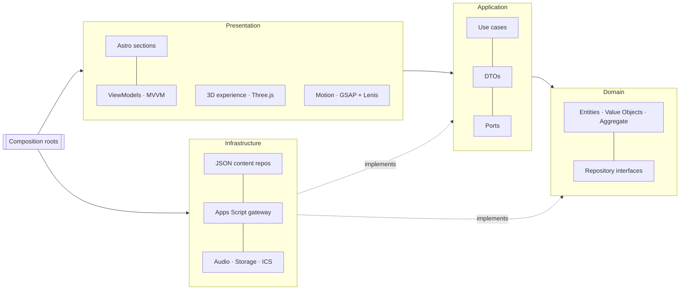

<div align="center">


# HackaRun 2026 · Landing Page

**Encontre os NPCs. Decifre as pistas. Codifique contra o relógio.**

Landing page oficial do hackathon dos cursos de Engenharia de Software e Inteligência Artificial da Unicatólica,
em parceria com o Capim Dourado Shopping · Palmas–TO · 11 a 14 de novembro de 2026.

[](https://github.com/Marcos-Codfy/lp-hackarun/actions/workflows/ci.yml)


[](https://www.conventionalcommits.org/pt-br/v1.0.0/)

[Guia do projeto](docs/GUIA_DO_PROJETO.md) · [Design spec](docs/design/design-spec.md) · [Decisões (ADRs)](docs/adr) · [Como contribuir](CONTRIBUTING.md)

</div>

---

## Sumário

- [Sobre](#sobre)
- [Destaques](#destaques)
- [Stack](#stack)
- [Arquitetura](#arquitetura)
- [Começando](#começando)
- [Scripts](#scripts)
- [Estrutura do projeto](#estrutura-do-projeto)
- [Conteúdo e inscrições](#conteúdo-e-inscrições)
- [Qualidade](#qualidade)
- [Deploy](#deploy)
- [Contribuindo](#contribuindo)
- [Roadmap](#roadmap)
- [Créditos](#créditos)

## Sobre

O **HackaRun** é um hackathon em formato de corrida: minicursos, mentoria de egressos e uma sequência de missões
técnicas espalhadas por salas e laboratórios, onde personagens (os **NPCs**) guardam as pistas do desafio. A final e a
premiação acontecem no Capim Dourado Shopping, com palco, telão e banda ao vivo.

Esta landing page apresenta o evento, a programação, as missões e as equipes confirmadas, e **recebe as inscrições**.
O visual segue a linguagem de campeonatos de e-sports, com uma experiência 3D guiada pelo scroll.

## Destaques

- **Experiência 3D guiada pelo scroll:** um único sistema de partículas em WebGL que se transforma a cada seção
  (globo → nebulosa → "?" → rota das missões → arena → telão → troféu → globo), feito 100% em shaders, sem modelos
  nem vídeo.
- **Rápida de verdade:** HTML estático (Astro SSG); o 3D carrega num chunk separado, depois do primeiro paint, com
  qualidade adaptativa por dispositivo e FPS.
- **Acessível:** WCAG 2.2 AA, navegação por teclado, `prefers-reduced-motion`, conteúdo completo sem JS e sem WebGL.
- **Inscrição sem servidor e sem custo:** formulário → Google Apps Script → Google Sheets, com anti-spam, LGPD e
  equipes confirmadas aparecendo ao vivo no site.
- **Pronta pra equipe:** Clean Architecture + DDD + MVVM, testes unitários, lint com regra de dependência entre
  camadas, Conventional Commits validados no commit e CI no GitHub Actions.

## Stack

| Camada                 | Tecnologias                                                                                                |
| ---------------------- | ---------------------------------------------------------------------------------------------------------- |
| Base                   | [Astro 7](https://astro.build) (SSG), TypeScript 6 (strictest), Vite                                       |
| 3D                     | [Three.js](https://threejs.org) + GLSL (ShaderMaterial, simplex noise)                                     |
| Motion                 | [GSAP](https://gsap.com) (ScrollTrigger, SplitText), [Lenis](https://lenis.darkroom.engineering)           |
| Estilo                 | CSS moderno (custom properties, cascade layers, `clamp()`), design tokens, fontes self-hosted (Fontsource) |
| Backend (sem servidor) | Google Apps Script Web App + Google Sheets                                                                 |
| Qualidade              | Vitest + happy-dom, ESLint + typescript-eslint, Prettier, Astro Check                                      |
| Fluxo                  | Husky, lint-staged, commitlint (Conventional Commits), GitHub Actions                                      |
| Hospedagem             | Cloudflare Pages (plano gratuito)                                                                          |

Lista completa de bibliotecas, padrões e conceitos: [`docs/pdf/HackaRun_LP_Stack_e_Padroes.pdf`](docs/pdf/HackaRun_LP_Stack_e_Padroes.pdf).

## Arquitetura

Clean Architecture com DDD. As dependências apontam sempre para o domínio, e o ESLint bloqueia imports que violem a
regra.



**No build:** `index.astro` → `GetLandingPage` (use case) → repositórios JSON → entidades validadas → DTOs → HTML.
**No browser:** `App.boot()` → `mountMotion` (scroll e cenas) → `mountViews` (MVVM) → `mountAnimators` →
`mountExperience` (3D, lazy).

Detalhes em [docs/GUIA_DO_PROJETO.md](docs/GUIA_DO_PROJETO.md#6-arquitetura) e nas [ADRs](docs/adr).

## Começando

**Pré-requisitos:** Node.js 24 LTS (mínimo 22.12) e npm.

```bash
git clone https://github.com/Marcos-Codfy/lp-hackarun.git
cd lp-hackarun
npm ci
cp .env.example .env
npm run dev
```

Acesse `http://localhost:4321`.

| Variável                       | Obrigatória | Descrição                                                                             |
| ------------------------------ | ----------- | ------------------------------------------------------------------------------------- |
| `PUBLIC_SITE_URL`              | não         | URL pública (canonical, sitemap, Open Graph). Padrão: `https://lp-hackarun.pages.dev` |
| `PUBLIC_REGISTRATION_ENDPOINT` | não         | URL do Web App do Apps Script. Vazia = "inscrições em breve" (em dev, modo simulado)  |
| `DOCS_OUT_DIR`                 | não         | Pasta extra para onde os PDFs de documentação são copiados                            |

## Scripts

| Comando            | Descrição                                                 |
| ------------------ | --------------------------------------------------------- |
| `npm run dev`      | Servidor de desenvolvimento                               |
| `npm run build`    | Type-check (`astro check`) + build de produção em `dist/` |
| `npm run preview`  | Serve o build localmente                                  |
| `npm test`         | Testes unitários                                          |
| `npm run lint`     | ESLint                                                    |
| `npm run format`   | Prettier                                                  |
| `npm run validate` | Lint + testes + build (mesmo fluxo da CI)                 |
| `npm run docs:pdf` | Gera os PDFs de documentação em `docs/pdf/`               |

## Estrutura do projeto

```text
src/
├── domain/           # entidades, value objects, aggregate, serviços e interfaces de repositório
├── application/      # casos de uso, DTOs e portas
├── infrastructure/   # conteúdo JSON, repositórios, gateway do Apps Script, áudio, storage, calendário
├── presentation/     # layouts, seções, componentes, MVVM, motion e experiência 3D
├── shared/           # Observable, EventBus, Ticker e utilitários
├── composition/      # composition roots (build e browser)
└── pages/            # rotas: index, 404 e calendário .ics
apps-script/          # API de inscrições (Google Apps Script) + guia de instalação
tests/                # testes unitários por camada
docs/                 # guia, design spec, ADRs e PDFs
```

## Conteúdo e inscrições

- **Conteúdo** (datas, missões, FAQ, prêmios, mentores) fica em `src/infrastructure/content/*.json`. Dá pra editar
  sem programar, e os testes validam o conteúdo real.
- **Inscrições** vão para uma planilha Google via Apps Script. A equipe aparece no site quando a organização marca
  `confirmado` na coluna Status. Instalação em [`apps-script/README.md`](apps-script/README.md).
- **Agenda:** o build gera `/hackarun-2026.ics` com todas as atividades.

## Qualidade

| Item                    | Meta                                             |
| ----------------------- | ------------------------------------------------ |
| LCP (4G, celular médio) | < 2,5 s                                          |
| CLS                     | < 0,05                                           |
| JS inicial (gzip)       | < 70 KB (o 3D é carregado depois)                |
| Lighthouse mobile       | Performance ≥ 90 · Acessibilidade ≥ 95 · SEO 100 |
| Acessibilidade          | WCAG 2.2 AA                                      |

A CI (GitHub Actions) roda lint, testes e build a cada push e PR.

## Deploy

Hospedagem gratuita na **Cloudflare Pages**, conectada a este repositório:

1. Cloudflare → **Workers & Pages → Create → Pages → Connect to Git**.
2. Preset **Astro** · Build `npm run build` · Output `dist`.
3. Variáveis: `NODE_VERSION=24`, `PUBLIC_SITE_URL`, `PUBLIC_REGISTRATION_ENDPOINT`.

Push na `main` publica em produção, e cada PR ganha uma URL de preview. Cache e headers de segurança ficam em
`public/_headers`. Comparativo com Vercel e GitHub Pages na [ADR 0003](docs/adr/0003-cloudflare-pages-hosting.md).

## Contribuindo

1. Crie uma branch a partir da `main`: `feat/…`, `fix/…`, `docs/…`.
2. Commits no padrão **Conventional Commits** em inglês, por exemplo `feat(sections): add prizes section`.
3. `npm run validate` e abra um Pull Request usando o template.

Guia completo: [CONTRIBUTING.md](CONTRIBUTING.md).

## Roadmap

- [x] Arquitetura, domínio e conteúdo oficial
- [x] Experiência 3D guiada por scroll
- [x] Inscrições via Google Sheets
- [ ] Link oficial de inscrições e regulamento
- [ ] Prêmios, mentores e banca revelados
- [ ] Logos oficiais em SVG e imagem de compartilhamento
- [ ] Áudio final do globo
- [ ] Domínio próprio (opcional)

## Créditos

- **Realização:** Unicatólica · cursos de Engenharia de Software e Inteligência Artificial
- **Parceria:** Capim Dourado Shopping
- **Desenvolvimento:** Marcos Vinicius Muniz Arruda e colaboradores

---

<div align="center">
<sub>Feito por estudantes, para estudantes · Palmas–TO · 2026</sub>
</div>
