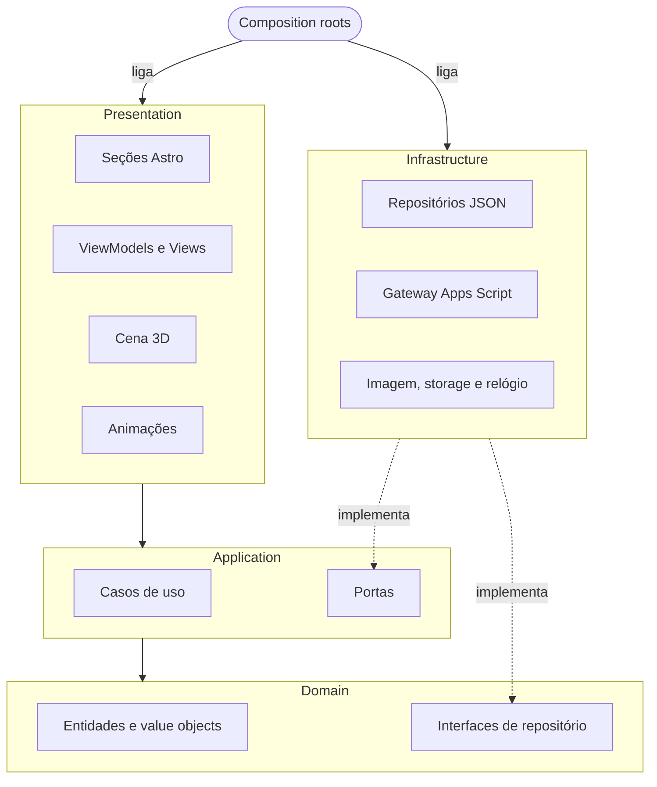
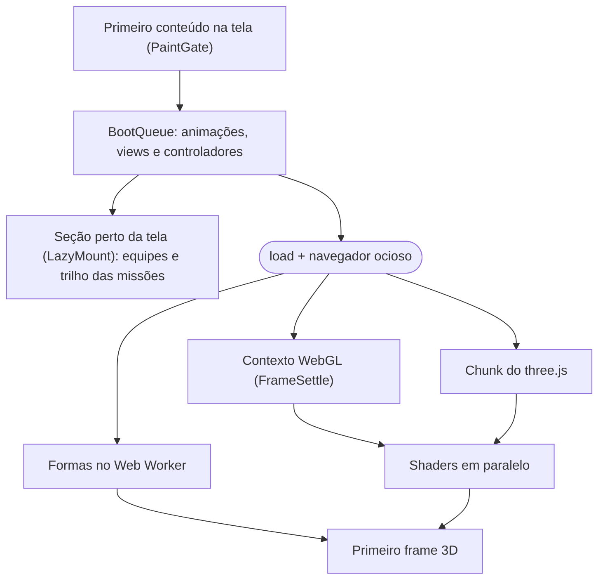

<div align="center">

<sub>**Português** · [English](README.en.md)</sub>

<picture>
  <source media="(prefers-reduced-motion: reduce)" srcset="https://raw.githubusercontent.com/hackarun-unicatolica/lp-hackarun/main/docs/media/scroll-preview-poster.jpg" />
  
</picture>

# HackaRun

**Desvende. Programe. Conquiste.**

Landing page do 1º HackaRun, evento de tecnologia, inovação e empreendedorismo da UniCatólica. O site apresenta a
programação, as missões e as equipes, e recebe a inscrição das equipes, que é gravada numa planilha do Google. Ao fundo,
uma cena 3D em WebGL muda de forma a cada seção, acompanhando o scroll.

[](https://github.com/hackarun-unicatolica/lp-hackarun/actions/workflows/ci.yml)


[](#performance)

**[Ver o site → hackarun.pages.dev](https://hackarun.pages.dev)**

[Como contribuir](CONTRIBUTING.md) · [Changelog](CHANGELOG.md)

</div>

---

**Sumário:** [Visão geral](#visão-geral) · [Telas](#telas) · [Cenas 3D](#cenas-3d-por-seção) ·
[Tecnologias](#tecnologias) · [Arquitetura](#arquitetura) · [Performance](#performance) ·
[Acessibilidade](#acessibilidade) · [Segurança e LGPD](#segurança-e-lgpd) · [Como rodar](#como-rodar-no-seu-pc) ·
[Contribuindo](#contribuindo) · [Deploy](#deploy) · [Roadmap](#roadmap) · [Créditos](#créditos)

## Visão geral

- **O evento:** 1ª edição do HackaRun, de 11 a 14 de novembro de 2026, em Palmas-TO. A realização é da UniCatólica, a
  organização é da LAES (Liga Acadêmica de Engenharia de Software e Inteligência Artificial) e o Capim Dourado
  Shopping é o parceiro da premiação. O evento tem duas frentes: uma programação aberta ao público, com oficinas,
  palestras e estandes, e um hackathon para alunos da UniCatólica, disputado em equipes, com a final no shopping.
- **O site:** programação em abas por dia, missões, mentores, prêmios, perguntas frequentes, uma página de inscrição e
  uma página com as equipes confirmadas, com a foto ou a logo de cada uma.
- **Cena 3D:** oito objetos gerados por código (globo, cronômetro, ponto de interrogação, mapa, terreno, palco, troféu
  e galáxia), com 9 mil a 42 mil partículas e pós-processamento (bloom, vinheta e aberração cromática). Não há modelos
  3D nem vídeos.
- **Desempenho:** Lighthouse mobile com 98 em Performance e 100 em Acessibilidade, Boas práticas e SEO.
- **Acessibilidade:** o conteúdo funciona sem JavaScript e sem WebGL, a página respeita `prefers-reduced-motion` e há
  um botão para pausar as animações.
- **Inscrições sem servidor próprio:** o formulário envia os dados para um Google Apps Script, que grava a inscrição no
  Google Sheets e a foto da equipe no Google Drive.

## Telas

<p align="center">
  
  <br /><sub>Nove seções da página no desktop.</sub>
</p>

<p align="center">
  
  <br /><sub>A mesma página no celular (390 px).</sub>
</p>

<p align="center">
  
  <br /><sub>Página <code>/equipes</code>. As equipes e as imagens desta captura são fictícias.</sub>
</p>

<p align="center">
  
  <br /><sub>Página <code>/inscricao</code>, com dados fictícios e o envio simulado.</sub>
</p>

## Cenas 3D por seção

Cada seção da página tem uma cena (`data-scene`). Durante o scroll, as partículas passam de uma forma para a outra, e a
câmera acompanha a transição ([`FlightPath`](src/presentation/experience/camera/FlightPath.ts)). As formas são
geradas num Web Worker e usam a mesma ordem espacial (curva de Morton), o que deixa a troca entre uma forma e outra
contínua.

| Seção                    | Cena      | Objeto                                                      |
| ------------------------ | --------- | ----------------------------------------------------------- |
| Início (`#inicio`)       | `core`    | Globo formado por faixas de partículas                      |
| O evento (`#sobre`)      | `orbit`   | Cronômetro com mostrador, ponteiro e anéis                  |
| NPCs (`#npcs`)           | `enigma`  | Ponto de interrogação em 3D                                 |
| Missões (`#missoes`)     | `map`     | Mapa com plataforma, rota em espiral e oito marcadores      |
| Programação e mentores   | `terrain` | Terreno em grade, com montanhas e sol                       |
| Grande final (`#final`)  | `stage`   | Palco com telão, estrutura e canhões de luz                 |
| Prêmios (`#premios`)     | `trophy`  | Troféu                                                      |
| Equipes e FAQ            | `dust`    | Galáxia em espiral, como fundo para a leitura               |
| Inscrição (`#inscricao`) | `core`    | O globo de volta, girando devagar, com um pulso leve de luz |

A fonte Orbitron, usada nos títulos, teve o til redesenhado com fontTools: no arquivo original, "NÃO" parecia "NÀO" em
tamanhos grandes.

## Tecnologias

| Camada     | Tecnologias                                                                                                                          |
| ---------- | ------------------------------------------------------------------------------------------------------------------------------------ |
| Base       | [Astro 7](https://astro.build) (site estático), TypeScript 6 (strictest), Vite                                                       |
| 3D         | [Three.js](https://threejs.org) r186, shaders GLSL próprios, EffectComposer, UnrealBloomPass e um passe de pós-processamento próprio |
| Animação   | [GSAP](https://gsap.com) 3.15 (ScrollTrigger) e [Lenis](https://lenis.darkroom.engineering) 1.3                                      |
| Estilo     | CSS (custom properties, cascade layers, `clamp()`, `content-visibility`) e design tokens                                             |
| Fontes     | Orbitron, Montserrat e JetBrains Mono, hospedadas no próprio site, só com os caracteres latinos                                      |
| Imagens    | Redução das fotos no navegador (`createImageBitmap` e canvas) e CDN de imagens do Google para as equipes                             |
| Backend    | Google Apps Script, Google Sheets (abas Equipes, Integrantes e Resumo) e Google Drive                                                |
| Qualidade  | Vitest, ESLint, Prettier, Astro Check, Playwright e Lighthouse                                                                       |
| Fluxo      | Husky, lint-staged, commitlint (Conventional Commits) e GitHub Actions                                                               |
| Hospedagem | Cloudflare Pages                                                                                                                     |

## Arquitetura

O código segue Clean Architecture, com DDD no domínio e MVVM na interface. As dependências sempre apontam para o
domínio, e o ESLint ([`eslint.config.js`](eslint.config.js)) acusa um import entre camadas que quebre essa regra.



- **Domínio:** não importa outras camadas nem bibliotecas de interface (`three`, `gsap`, `lenis`, `astro`).
- **Aplicação:** depende só do domínio.
- **Apresentação:** usa as portas da aplicação e nunca importa a infraestrutura; os adapters são ligados em
  `src/composition`.
- **Shared** (`EventBus`, `Observable`, `Ticker`): usado pelas outras camadas e não importa nenhuma delas.

O domínio tem dois aggregates (`HackathonEvent` e `TeamRegistration`), value objects como `TeamName`, `FullName`,
`StudentId`, `Email` e `TimeSlot`, e o serviço `RegistrationPolicy`, que define se as inscrições estão em breve,
abertas ou encerradas. Na interface, os ViewModels guardam o estado em `Observable` e não acessam o DOM; as Views só
fazem a ligação com a página. Os módulos se comunicam por um `EventBus` tipado
([`AppEvents.ts`](src/presentation/app/AppEvents.ts)).

O carregamento no navegador segue esta ordem, sem atrasar o primeiro conteúdo na tela:



As páginas `/inscricao` e `/equipes` usam um carregamento à parte ([`LightApp`](src/presentation/app/LightApp.ts)),
sem 3D, GSAP e Lenis.

<details>
<summary><b>Padrões de projeto e onde estão</b></summary>

| Padrão                  | Onde                                                                                                                                                                                                                                            |
| ----------------------- | ----------------------------------------------------------------------------------------------------------------------------------------------------------------------------------------------------------------------------------------------- |
| Strategy                | [`ShapeStrategy`](src/presentation/experience/shapes/ShapeStrategy.ts) (8 objetos), [`RenderPipeline`](src/presentation/experience/post/RenderPipeline.ts), `QualityProfile`, `ScrollDriver`                                                    |
| Factory + registry      | [`ShapeFactory`](src/presentation/experience/shapes/ShapeFactory.ts), [`BoltFactory`](src/presentation/motion/animators/hero/lightning/BoltFactory.ts)                                                                                          |
| Registry                | [`AnimatorRegistry`](src/presentation/motion/animators/AnimatorRegistry.ts)                                                                                                                                                                     |
| Template Method         | [`SectionAnimator`](src/presentation/motion/animators/SectionAnimator.ts)                                                                                                                                                                       |
| Adapter                 | [`SmoothScroll`](src/presentation/motion/core/SmoothScroll.ts) (Lenis), [`AppsScriptRegistrationGateway`](src/infrastructure/registration/AppsScriptRegistrationGateway.ts), [`CanvasImageCodec`](src/infrastructure/image/CanvasImageCodec.ts) |
| Decorator               | [`RetryingRegistrationGateway`](src/infrastructure/registration/RetryingRegistrationGateway.ts): 3 tentativas, com espera crescente entre elas                                                                                                  |
| Proxy com fallback      | [`FallbackTeamRepository`](src/infrastructure/repositories/FallbackTeamRepository.ts): lista ao vivo da planilha, com a lista do build como reserva                                                                                             |
| Null Object             | [`UnavailableRegistrationGateway`](src/infrastructure/registration/UnavailableRegistrationGateway.ts): sem endpoint, todo envio responde "encerrada"                                                                                            |
| Observer                | [`Observable`](src/shared/core/Observable.ts), [`EventBus`](src/shared/core/EventBus.ts)                                                                                                                                                        |
| Singleton               | [`Ticker.shared`](src/shared/core/Ticker.ts) (um único `requestAnimationFrame` no site), [`serverContainer()`](src/composition/server.ts)                                                                                                       |
| Facade                  | [`GetLandingPage`](src/application/use-cases/GetLandingPage.ts), [`ExperienceStage`](src/presentation/experience/ExperienceStage.ts)                                                                                                            |
| Composite               | [`strokes.ts`](src/presentation/experience/shapes/strokes.ts): uma forma é uma lista de traços                                                                                                                                                  |
| Builder                 | [`PointBrush`](src/presentation/experience/shapes/PointBrush.ts), [`BoltBuilder`](src/presentation/motion/animators/hero/lightning/BoltBuilder.ts), [`StageBuilder`](src/presentation/experience/StageBuilder.ts)                               |
| Repository + Mapper     | [`StaticListRepository`](src/infrastructure/repositories/StaticListRepository.ts), [`EventMapper`](src/infrastructure/mappers/EventMapper.ts)                                                                                                   |
| Inversão de dependência | [`BootSteps`](src/presentation/app/BootQueue.ts), a interface que o carregamento enxerga                                                                                                                                                        |

</details>

## Performance

Lighthouse mobile no build de produção, mediana de 3 execuções (12/10/2026):

| Métrica                             | Antes    | Agora   |
| ----------------------------------- | -------- | ------- |
| Performance                         | 66       | 98      |
| Total Blocking Time                 | 1.600 ms | 98 ms   |
| Largest Contentful Paint            | 2,9 s    | 2,2 s   |
| Cumulative Layout Shift             | –        | 0,001   |
| Acessibilidade, Boas práticas e SEO | 100      | 100     |
| JavaScript inicial (gzip)           | –        | 68,2 KB |

As páginas `/inscricao` e `/equipes` ficam em 99 de Performance. As principais medidas:

- O HTML sai pronto do build, e o CSS crítico vai junto na página.
- O JavaScript da página só carrega depois que o primeiro conteúdo aparece na tela
  ([`PaintGate`](src/presentation/app/PaintGate.ts)), e a inicialização é dividida em passos curtos
  ([`BootQueue`](src/presentation/app/BootQueue.ts)).
- O three.js fica num arquivo separado, carregado depois do `load`. As formas são geradas num Web Worker, e os shaders
  são compilados em paralelo.
- A quantidade de partículas (9, 22 ou 42 mil) depende da placa de vídeo, e a qualidade cai sozinha se a taxa de
  quadros ficar abaixo de 45.
- As seções longe do topo usam `content-visibility: auto`.
- O 3D para quando a aba fica em segundo plano.

## Acessibilidade

A meta é a **WCAG 2.2 AA**.

- Link para pular ao conteúdo e foco sempre visível, inclusive no modo de alto contraste do Windows.
- Com `prefers-reduced-motion`, o scroll é nativo e as animações de entrada não acontecem.
- Botão **Pausar animações** no cabeçalho e no menu do celular, que congela o 3D e as animações em CSS.
- Programação em abas no padrão WAI-ARIA, navegável pelo teclado. Sem JavaScript, os quatro dias aparecem em sequência.
- Formulário com um `fieldset` por integrante, resumo dos erros, `aria-invalid`, `aria-describedby` e avisos para
  leitores de tela.
- Todo o conteúdo funciona sem JavaScript e sem WebGL.

## Segurança e LGPD

- **Cabeçalhos de segurança** em [`public/_headers`](public/_headers): Content Security Policy sem script inline,
  `X-Frame-Options: DENY`, `nosniff` e Referrer-Policy.
- **Só os dados necessários:** nome da equipe, foto ou logo e, de cada integrante, nome completo, matrícula e e-mail.
- **Pouca informação pública:** a página de equipes mostra só o nome da equipe, a quantidade de integrantes e a foto,
  e só depois que a organização confirma a inscrição.
- **Sem duplicidade:** nome de equipe, e-mail ou matrícula já usados em outra equipe são recusados, e um reenvio não
  gera uma linha nova na planilha.
- **Foto conferida no servidor:** o arquivo é validado pelo formato real (JPEG, PNG ou WebP) e pelo tamanho, e
  recebe um nome aleatório no Drive.
- **Proteção contra spam:** campo isca, tempo mínimo de preenchimento e limite de envios.
- **LGPD:** aviso de privacidade em [`/privacidade`](src/pages/privacidade.astro). Cada inscrição grava a versão do
  aviso aceita e a data do aceite.

## Qualidade

| Item           | Situação                                                                             |
| -------------- | ------------------------------------------------------------------------------------ |
| Testes         | Vitest, com testes por camada e testes do Apps Script rodando o código real          |
| Lint e tipos   | ESLint sem erros e TypeScript no modo mais rígido, com Astro Check                   |
| Formatação     | Prettier em todo o repositório                                                       |
| CI             | GitHub Actions em todo push na `main` e em todo PR: lint, formatação, testes e build |
| Commits        | Conventional Commits, conferidos pelo commitlint                                     |
| Testes visuais | [`scripts/qa/`](scripts/qa/README.md): capturas, âncoras, overflow e Lighthouse      |

---

## Como rodar no seu PC

**1. Instale as ferramentas**

| Ferramenta      | Versão                | Uso                                              |
| --------------- | --------------------- | ------------------------------------------------ |
| Git             | recente               | Clonar o projeto e abrir PRs                     |
| Node.js         | 24 LTS (mínimo 22.18) | Rodar, testar e gerar o build                    |
| npm             | o que vem com o Node  | Dependências e scripts                           |
| Brave ou Chrome | atual                 | Opcional: scripts de testes visuais              |
| Python          | 3.11 ou mais novo     | Opcional: só para gerar de novo a fonte Orbitron |

A versão do Node usada na CI está no arquivo `.nvmrc`.

**2. Clone o projeto**

Quem é da equipe entra como colaborador e clona o repositório original. Assim, cada PR ganha uma prévia na
Cloudflare. O passo a passo está no [CONTRIBUTING.md](CONTRIBUTING.md#fluxo-de-trabalho-da-equipe).

```bash
git clone https://github.com/hackarun-unicatolica/lp-hackarun.git
cd lp-hackarun
```

Quem é de fora da equipe faz um fork no GitHub e clona o próprio fork.

**3. Prepare o projeto**

```bash
npm run setup
```

O comando confere a versão do Node, instala as dependências e cria o arquivo `.env` a partir do `.env.example`. Para
fazer à mão:

```bash
npm ci
cp .env.example .env
```

**4. Rode o site**

```bash
npm run dev
```

Abra `http://localhost:4321`. O formulário fica em `http://localhost:4321/inscricao`. No ambiente local, a inscrição
roda em **modo simulado**: nada é enviado e nenhuma planilha é alterada. As equipes enviadas aparecem em `/equipes`
enquanto a aba estiver aberta.

**5. Confira antes de abrir o PR**

```bash
npm run validate
npm run format:check
```

O `npm run validate` roda o lint, os testes e o build, como a CI.

**6. Testar o envio de verdade (opcional)**

Use uma planilha sua, nunca a oficial. Siga o [`apps-script/README.md`](apps-script/README.md) para criar o Apps
Script e publicá-lo como App da Web. Depois, coloque a URL que termina em `/exec` no seu `.env`, na variável
`PUBLIC_REGISTRATION_ENDPOINT`, e rode o `npm run dev` de novo. O `.env` não vai para o Git.

<details>
<summary><b>Problemas comuns</b></summary>

| Sintoma                                   | O que fazer                                                                                     |
| ----------------------------------------- | ----------------------------------------------------------------------------------------------- |
| O `npm run setup` recusa a versão do Node | Instale o Node 24 LTS e abra um terminal novo. `node -v` mostra a versão em uso.                |
| `npm warn EBADENGINE` no `npm ci`         | É só um aviso. Atualizar o Node 24 para a última versão resolve.                                |
| A porta 4321 está ocupada                 | O Astro usa a próxima porta livre e mostra o endereço no terminal.                              |
| `&&` dá erro no PowerShell                | O Windows PowerShell 5.1 não aceita `&&`: rode um comando por linha.                            |
| O commit é recusado                       | Confira o formato `tipo(escopo): descrição` e os erros do ESLint. Não use `--no-verify`.        |
| Mudei o `.env` e nada mudou               | As variáveis são lidas na partida: pare o `npm run dev` e rode de novo.                         |
| O formulário volta preenchido             | É o rascunho salvo na aba. Use "Limpar rascunho" ou feche a aba.                                |
| O 3D não aparece                          | Confira se o navegador tem WebGL2 ou teste com `?quality=low`. Sem 3D, a página funciona igual. |

</details>

### Scripts

| Comando                           | Descrição                                                  |
| --------------------------------- | ---------------------------------------------------------- |
| `npm run setup`                   | Prepara o projeto: confere o Node, instala e cria o `.env` |
| `npm run dev`                     | Servidor de desenvolvimento em `http://localhost:4321`     |
| `npm run build`                   | Checagem de tipos e build de produção em `dist/`           |
| `npm run preview`                 | Serve o build localmente                                   |
| `npm test`                        | Testes                                                     |
| `npm run lint` / `lint:fix`       | ESLint / com correção automática                           |
| `npm run format` / `format:check` | Prettier: formata / confere                                |
| `npm run validate`                | Lint, testes e build                                       |

Os scripts de testes visuais ficam em [`scripts/qa/`](scripts/qa/README.md) e têm instalação própria
(`npm run setup -- --qa`).

### Estrutura do projeto

<details>
<summary><b>Pastas</b></summary>

```text
src/
├── domain/          # entidades, value objects, aggregates e interfaces de repositório
├── application/     # casos de uso, DTOs e portas
├── infrastructure/  # conteúdo em JSON, mappers, repositórios, Apps Script, imagem e storage
├── presentation/    # páginas, seções, componentes, view-models, views, animações e cena 3D
├── shared/          # EventBus, Observable, Ticker e utilitários
├── composition/     # onde as camadas são ligadas
├── assets/          # logos oficiais e a fonte Orbitron
└── pages/           # inicio, inscricao, equipes, privacidade e 404
apps-script/         # código do Google Apps Script e o passo a passo de instalação
public/              # imagem de compartilhamento, favicon e _headers
scripts/             # setup, ajuste da fonte e testes visuais (qa/)
tests/               # testes por camada
docs/media/          # imagens deste README
```

</details>

### Conteúdo e inscrições

- **Conteúdo** (programação, missões, perguntas frequentes, prêmios, mentores e parceiros) fica em
  `src/infrastructure/content/*.json`. Um dado inválido interrompe o build.
- **Inscrições** são só de equipe, de 2 a 5 alunos, com nome completo, matrícula e e-mail de cada integrante. O Apps
  Script grava cada equipe na aba **Equipes** (com a foto na própria célula), cada pessoa na aba **Integrantes** e os
  totais na aba **Resumo**.
- **Equipes no site:** uma equipe aparece em `/equipes` quando a organização muda o Status para `confirmado` na
  planilha. Os detalhes estão no [`apps-script/README.md`](apps-script/README.md).

## Contribuindo

O fluxo completo está no [CONTRIBUTING.md](CONTRIBUTING.md). Em resumo:

1. Crie uma branch a partir da `main`: `git switch -c feat/<assunto>` (ou `fix/`, `docs/`, `refactor/`).
2. Faça commits em **Conventional Commits**, em inglês, por exemplo `feat(sections): add day tabs to the schedule`. Os
   escopos aceitos estão no [`commitlint.config.js`](commitlint.config.js).
3. Rode `npm run validate` e `npm run format:check`.
4. Envie a branch e abra um Pull Request para a `main`. A CI precisa passar, a prévia da Cloudflare aparece no PR e um
   dos responsáveis ([CODEOWNERS](.github/CODEOWNERS)) aprova.
5. O merge é feito com **Squash and merge**, e o site oficial é atualizado em seguida.

## Deploy

O site está na **Cloudflare Pages**, no plano gratuito: **[hackarun.pages.dev](https://hackarun.pages.dev)**.

- Cada merge na `main` publica uma nova versão em 1 a 2 minutos.
- Cada PR ganha um endereço de prévia, comentado pela Cloudflare no próprio PR. Na prévia, a inscrição é simulada e
  nada é gravado na planilha.
- Para ligar as inscrições no site oficial, basta configurar a variável `PUBLIC_REGISTRATION_ENDPOINT` no ambiente de
  produção da Cloudflare e publicar de novo.

Para publicar um fork na sua própria conta: na Cloudflare, abra **Workers & Pages → Create application → Pages →
Connect to Git**, escolha o repositório e use o comando de build `npm run build` com a pasta de saída `dist`.

## Roadmap

- [x] Arquitetura, domínio e conteúdo oficial
- [x] Cena 3D guiada pelo scroll, com oito objetos
- [x] Segunda versão do design, com a identidade oficial do evento
- [x] Lighthouse mobile acima de 90 em Performance e 100 nas demais categorias
- [x] Botão para pausar as animações
- [x] Programação oficial, com as duas frentes e as abas por dia
- [x] Inscrição só de equipe, em página própria, com a planilha organizada em três abas
- [x] Página de equipes com a foto ou a logo de cada uma
- [x] Publicação na Cloudflare Pages, com deploy automático e prévia em cada PR
- [ ] Abertura das inscrições, quando a coordenação definir as vagas e o prazo
- [ ] Regulamento e pontuação das missões, apresentados na abertura do evento
- [ ] Prêmios, mentores e banca, divulgados pela organização

## Créditos

- **Design da página e desenvolvimento:** [Marcos Vinicius Muniz Arruda](https://github.com/Marcos-Codfy)
- **Identidade visual:** Eduarda Victória (Liga Acadêmica)
- **Realização:** UniCatólica
- **Organização:** LAES · Liga Acadêmica de Engenharia de Software e Inteligência Artificial
- **Parceria:** Capim Dourado Shopping
- **Fontes:** Orbitron, Montserrat e JetBrains Mono (SIL Open Font License)

<sub>HackaRun, UniCatólica, LAES, Capim Dourado Shopping e os respectivos logos são marcas de seus titulares e aparecem
aqui apenas para identificar o evento.</sub>

---

<div align="center">

<sub>Design da página e desenvolvimento por <a href="https://github.com/Marcos-Codfy">Marcos Vinicius Muniz Arruda</a> ·
Palmas-TO · 2026</sub>

<!-- LINKEDIN: troque pelo link do perfil quando quiser exibi-lo aqui. -->

</div>
