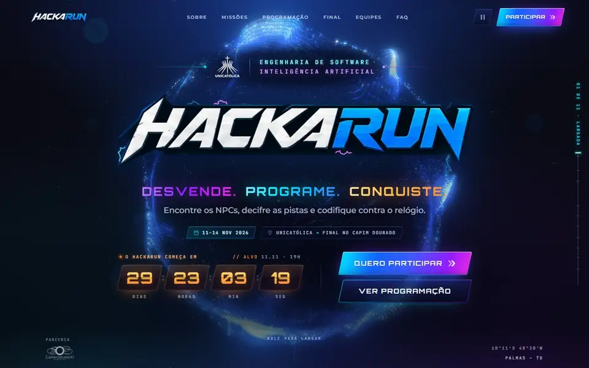
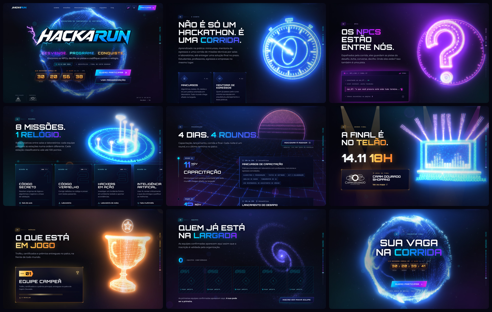
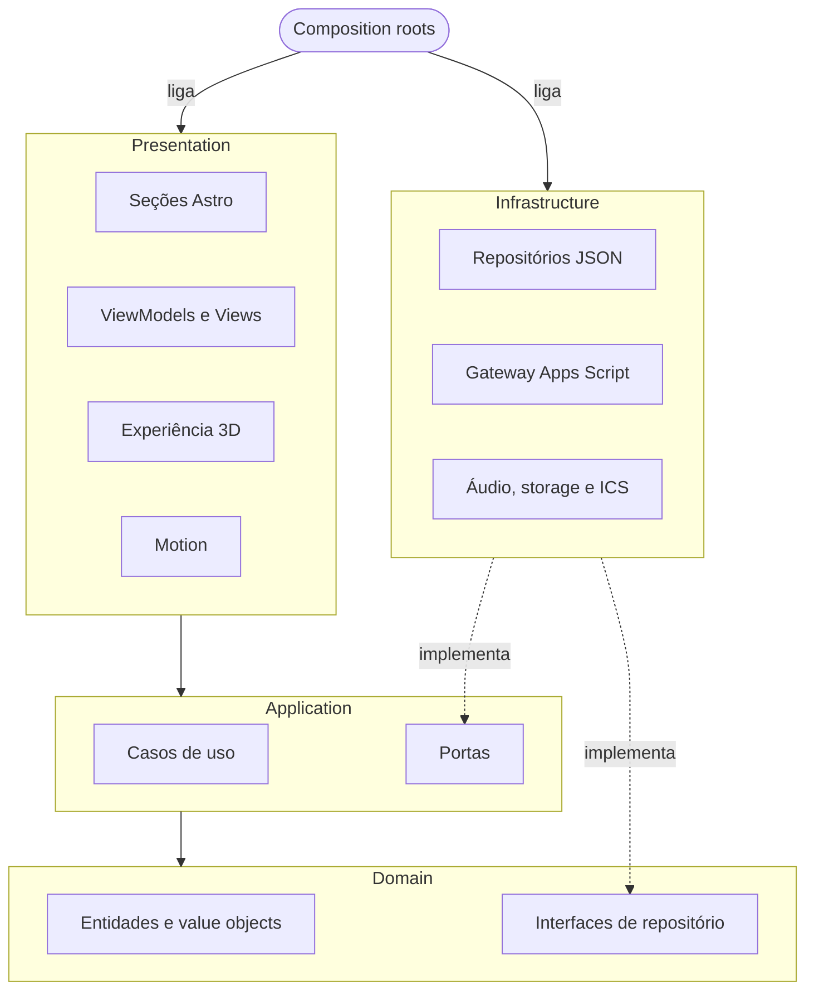
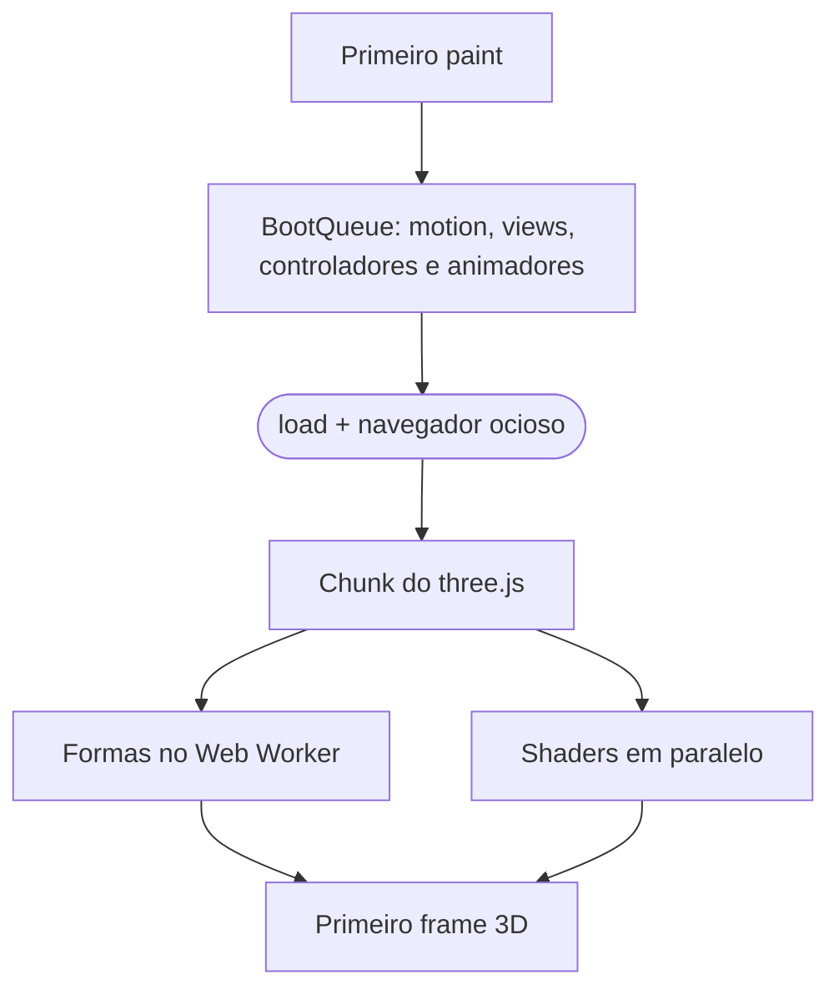

<div align="center">

<sub>**Português** · [English](README.en.md)</sub>

<picture>
  <source media="(prefers-reduced-motion: reduce)" srcset="https://raw.githubusercontent.com/Marcos-Codfy/lp-hackarun/main/docs/media/scroll-preview-poster.jpg" />
  
</picture>

# HackaRun · Overdrive

**Desvende. Programe. Conquiste.**

A landing page do hackathon de Engenharia de Software e IA da Unicatólica, que conta o evento pelo scroll: um único
campo de partículas em WebGL vira um objeto 3D diferente a cada seção, e a inscrição cai direto numa planilha do Google.

<sub>**Overdrive** é o codinome da v2 cinematográfica desta página: como o modo turbo dos jogos de corrida, ela acelera
de cena em cena e, na inscrição, o globo carrega e estoura em energia.</sub>

[](https://github.com/Marcos-Codfy/lp-hackarun/actions/workflows/ci.yml)


[](#performance)

<!-- DEMO: badge e link da versão oficial (Cloudflare Pages) entram aqui quando o site estiver no ar. -->

[Guia do projeto](docs/GUIA_DO_PROJETO.md) · [Decisões (ADRs)](docs/adr) · [Changelog](CHANGELOG.md) ·
[Design spec](docs/design/design-spec.md) · [Como contribuir](CONTRIBUTING.md)

</div>

---

**Para quem avalia:** [Em 30 segundos](#em-30-segundos) · [Visual](#visual) · [Bastidores](#bastidores) ·
[Desafios que resolvi](#desafios-que-resolvi) · [Stack](#stack) · [Arquitetura](#arquitetura) ·
[Performance](#performance) · [Acessibilidade](#acessibilidade)<br />
**Para quem desenvolve:** [Começando](#começando) · [Scripts](#scripts) · [Inscrições](#conteúdo-e-inscrições) ·
[Deploy](#deploy) · [Roadmap](#roadmap)

## Em 30 segundos

- **Meu papel:** projeto solo. Fiz o design da página a partir do manual de marca do evento, o 3D e os shaders, o
  front-end, a API de inscrições no Apps Script, os testes, a CI e a documentação.
- **O que é:** o site oficial do HackaRun 2026, hackathon dos cursos de Engenharia de Software e Inteligência
  Artificial da Unicatólica em parceria com o Capim Dourado Shopping. São 4 dias, de 11 a 14 de novembro de 2026, em
  Palmas-TO. A página traz programação, 8 missões, mentores, prêmios, uma caça a 3 tokens escondidos, as equipes
  confirmadas ao vivo e a inscrição.
- **O diferencial:** 8 objetos 3D procedurais (globo, cronômetro, "?", mapa holográfico, terreno synthwave, palco,
  troféu e galáxia) feitos de 9 mil a 42 mil partículas, sem nenhum modelo 3D nem vídeo, com pós-processamento de
  cinema e uma câmera coreografada para cada transição.
- **Rápida:** Lighthouse mobile com Performance **95** (era 66), TBT de 18 ms e CLS de 0,048. Acessibilidade, Boas
  práticas e SEO em **100**.
- **Acessível:** todo o conteúdo aparece sem JavaScript e sem WebGL (só o envio da inscrição pede JavaScript, e a
  página avisa), respeita `prefers-reduced-motion`, tem botão de pausar animações (WCAG 2.2.2) e o som começa
  desligado.
- **Backend de custo zero:** formulário → Google Apps Script → Google Sheets, com reenvio sem duplicar, limites de
  envio, trava de concorrência e consentimento LGPD versionado.
- **Engenharia:** Clean Architecture + DDD + MVVM com a regra de dependência travada no ESLint, 304 testes, CI no
  GitHub Actions, Conventional Commits e 6 ADRs.

## Visual

<p align="center">
  
  <br /><sub>Nove seções, nove momentos do mesmo campo de partículas. No hero, o logo oficial é o H1 e o LCP.</sub>
</p>

<p align="center">
  
  <br /><sub>No celular (390 px), no mesmo tier de qualidade que um aparelho recente recebe.</sub>
</p>

## Bastidores

O pedido era impacto de cinema com cara de e-sports. Tinha um vídeo pronto para o fundo do hero, mas ele pesava
2,4 MB, ficava borrado em tela grande, cortava o logo no celular em pé e trazia texto com erro. Troquei por partículas
geradas por código: zero byte de mídia no efeito principal e um objeto diferente para cada parte da história do
evento. A decisão está na [ADR 0005](docs/adr/0005-procedural-particles-over-video.md).

O preço apareceu no Lighthouse mobile: 66 de performance, e num celular fraco a página chegava a travar uns 4
segundos. Em vez de cortar efeito, mudei a ordem das coisas ([desafio 1](#1-boot-fatiado-de-66-para-95-no-lighthouse-mobile)).

O detalhe de que mais gosto é o til. A Orbitron é a fonte oficial da marca, mas em título grande o "NÃO" parecia
"NÀO". Trocar de fonte seria fugir da identidade, então redesenhei o til em Python com fontTools, nos pesos de 400
a 900. Quase ninguém vai reparar, mas eu ia ver aquele "NÀO" toda vez que abrisse a página.

Também decidi cedo que o 3D seria um extra: se ele falhar, a página continua inteira. Todo o conteúdo aparece sem
JavaScript e sem WebGL (só a inscrição pede JavaScript), o som começa desligado e qualquer pessoa pode pausar as
animações. Ainda falta baixar o LCP de 2,6 s para menos de 2,5 s e o JS inicial para menos de 70 KB. Os dois estão no
roadmap.

## Desafios que resolvi

### 1. Boot fatiado: de 66 para 95 no Lighthouse mobile

- **Problema:** com todo o setup rodando junto no carregamento, a nota de Performance no Lighthouse mobile era 66.
- **Solução:** `App.boot()` espera o primeiro paint e roda uma [`BootQueue`](src/presentation/app/BootQueue.ts): cada
  passo numa tarefa própria, cedendo a thread com `scheduler.yield()` e marcado como `boot:<nome>` no User Timing do
  DevTools. As animações de uma seção só montam quando ela se aproxima da tela, e o chunk do three.js (155 KB gzip)
  só é importado depois do `load`, com o navegador ocioso.
- **Resultado:** Performance 95 e TBT de 18 ms (era 1.600 ms), na mediana de 3 execuções, sem tirar nenhum efeito.

### 2. Morph de partículas que flui em vez de embaralhar

- **Problema:** se a partícula k cai num lugar qualquer em cada uma das 8 formas, a transição vira ruído.
- **Solução:** cada forma é ordenada por código de Morton 2D (ordem Z, bits intercalados com `spread10`) e recebe a
  mesma permutação Fisher-Yates (semente `20261114`), em [`sampling.ts`](src/presentation/experience/shapes/sampling.ts).
  A chave é código × 2ⁿ + índice, então o `Float64Array.sort()` nativo ordena sem comparador.
- **Resultado:** a partícula k ocupa o "mesmo lugar relativo" em todas as formas, e cortar partículas com `drawRange`
  ainda mostra a forma inteira. No meio do voo, o [vertex shader](src/presentation/experience/shaders/particles.vert.glsl)
  passa as partículas por um campo de fluxo ABC sem divergência, e a troca de cena vira filamentos em espiral.

<details>
<summary><b>Mais 4 desafios de render: worker, shaders, tiers de GPU e SplitText</b></summary>

### 3. Oito nuvens de pontos geradas fora da thread principal

- **Problema:** gerar as formas e as sementes das partículas na thread principal compete com o scroll e o input.
- **Solução:** um Web Worker de módulo ([`shapes.worker.ts`](src/presentation/experience/shapes/shapes.worker.ts))
  devolve os buffers como transferables. Sem worker, o mesmo job gerador
  ([`ParticleJob.ts`](src/presentation/experience/shapes/ParticleJob.ts)) roda fatiado na thread principal, com saída
  idêntica (mesmo código, mesmas sementes), e o trabalho pode ser cancelado se o palpite de tier estiver errado.
- **Resultado:** o worker pesa 7,7 KB gzip e a página continua respondendo enquanto as formas nascem.

### 4. Shaders que compilam sem engasgar

- **Problema:** um shader com 8 formas é grande, e compilar um programa WebGL trava o frame.
- **Solução:** um arquivo GLSL por objeto, e o
  [`ParticleMaterial`](src/presentation/experience/particles/ParticleMaterial.ts) só declara `HAS_<KEY>` e `IDX_<KEY>`
  das cenas presentes: o compilador remove o ramo de uma cena ausente, e os índices da paleta são constantes. O
  [`StageCompiler`](src/presentation/experience/post/StageCompiler.ts) pré-compila em fatias com
  `KHR_parallel_shader_compile`, e o [`GpuContext`](src/presentation/experience/GpuContext.ts) responde de antemão às
  consultas `getParameter` depois de um fence da GPU, para o construtor do three.js não bloquear.
- **Resultado:** shaders, render targets e buffers ficam prontos passo a passo antes de o canvas aparecer.

### 5. O mesmo site num notebook gamer e num celular de entrada

- **Problema:** 42 mil partículas com bloom em tela cheia não cabem em qualquer GPU.
- **Solução:** o [`QualityDetector`](src/presentation/experience/quality/QualityDetector.ts) escolhe o tier pela GPU,
  núcleos, memória, tela e tipo de ponteiro: 9.000, 22.000 ou 42.000 partículas. Se o FPS fica abaixo de 45 por
  cerca de 2 s, o [`AdaptiveQuality`](src/presentation/experience/quality/AdaptiveQuality.ts) corta o bloom (cheio,
  metade, desligado), depois a resolução, depois o tier, e nunca volta a subir.
- **Resultado:** sem WebGL2, com `save-data`, falha no chunk ou erro de shader, o 3D sai de cena e fica o brilho em
  CSS. A página nunca depende do 3D.

### 6. Títulos animados sem o custo do SplitText

- **Problema:** o SplitText do GSAP cria um `Intl.Segmenter` ao carregar: cerca de 40 ms no desktop e umas 4 vezes
  isso no celular.
- **Solução:** um [`LineSplit`](src/presentation/motion/animators/heading/LineSplit.ts) próprio divide o título em
  linhas com máscara numa única leitura de layout, e o `revert()` devolve os nós originais. Um observer compartilhado
  ([`ApproachWatcher`](src/presentation/motion/core/ApproachWatcher.ts)) faz um setup por tarefa.
- **Resultado:** o SplitText saiu do projeto, e nenhuma seção paga pelo setup antes de chegar perto da tela.

</details>

### 7. O til da fonte oficial transformava "NÃO" em "NÀO"

- **Problema:** a Orbitron é a fonte da marca, mas o til original parecia um acento grave em título grande.
- **Solução:** um script em Python com fontTools ([`patch_orbitron_tilde.py`](scripts/fonts/patch_orbitron_tilde.py))
  redesenha um til geométrico em degraus para Ã, Õ, ã, õ, Ñ e ñ, com deltas de variação nos pesos de 400 a 900.
- **Resultado:** um woff2 de 11.728 bytes com o "NÃO" legível, decisão registrada na
  [ADR 0006](docs/adr/0006-cinematic-v2-and-official-identity.md).

### 8. Inscrição confiável sem servidor

- **Problema:** a planilha do Google é grátis e a organização já usa, mas precisa aguentar reenvio, spam e envios
  simultâneos.
- **Solução:** o [Apps Script](apps-script/) usa `LockService`, e cada sessão do formulário manda uma chave UUID v4:
  o reenvio recebe o mesmo protocolo, do cache ou da chave gravada na linha. São 10 tentativas por e-mail a cada
  10 min, contadas pelo hash SHA-256 do e-mail, antes do limite global de 120 por minuto. Prazo e capacidade vêm das
  Propriedades do script, e valor malformado fecha as inscrições. Célula que começa com `= + - @` ganha um apóstrofo
  contra fórmula injetada, e o envio é um `text/plain` simples, sem preflight de CORS.
- **Resultado:** os arquivos `.gs` reais rodam nos testes dentro de um sandbox `vm` do Node com Sheet, Cache e Lock
  falsos ([`sandbox.ts`](tests/helpers/apps-script/sandbox.ts)), e um teste garante que `TEAM_SIZE` e
  `MIN_ELAPSED_MS` batem com o lado TypeScript.

<details>
<summary><b>Outros detalhes de que me orgulho</b></summary>

- **Pós-processamento próprio:** `RenderPass` → bloom na própria resolução, com tinta por cena →
  [passe cinematográfico](src/presentation/experience/shaders/cinematic.frag.glsl) com refração da onda de choque,
  zoom de hiperespaço, aberração cromática só nas bordas, exposição com ombro suave, flash, vinheta e grão a 24 fps.
- **Clímax da inscrição:** quando `#inscricao` entra na tela, o
  [`SceneHoldWatcher`](src/presentation/motion/core/SceneHoldWatcher.ts) conta 1,5 s (o scroll nunca trava) e dispara
  no mesmo evento o estouro do globo, o flash, o tremor de câmera, o som (se ligado) e a revelação do CTA.
- **Áudio sintetizado em Python** ([`render_cues.py`](scripts/audio/render_cues.py), NumPy, LAME e filtro RBJ
  variável), sem amostras de terceiros. O `AudioContext` só nasce depois de um gesto e destrava o iOS com um buffer
  mudo.
- **Resiliência:** `EventBus`, `Observable` e `Ticker` isolam o handler que lança erro, e se GSAP ou Lenis falharem a
  página segue no scroll nativo.
- **`content-visibility` sem quebrar âncoras:** as seções longe do topo renderizam sob demanda, com
  `contain-intrinsic-size` medido em 390 e 1440 px (o segundo vale a partir de 1024 px). Ao chegar, o scroll confere
  o alvo e faz uma segunda passada de 0,45 s se o desvio passar de 6 px ([`anchorcheck.mjs`](scripts/qa/anchorcheck.mjs)
  confere).
- **Documentação gerada:** `npm run docs:pdf` monta 2 PDFs com pdfkit e um renderizador de Markdown próprio.

</details>

## A corrida em 8 cenas

Cada seção declara `data-scene`. O scroll mistura as formas na GPU de forma contínua e reversível, e o
[`FlightPath`](src/presentation/experience/camera/FlightPath.ts) tem uma coreografia de câmera para cada transição,
do voo por dentro do globo até o recuo final.

| Seção                    | Cena      | Objeto                                                                    |
| ------------------------ | --------- | ------------------------------------------------------------------------- |
| Hero (`#inicio`)         | `core`    | Globo de energia em fitas de partículas, com a silhueta acesa por fresnel |
| O evento (`#sobre`)      | `orbit`   | Cronômetro-giroscópio: mostrador, ponteiro de varredura e anéis em cardã  |
| NPCs (`#npcs`)           | `enigma`  | Ponto de interrogação extrudado com faixa de pista e auréola de HUD       |
| Missões (`#missoes`)     | `map`     | Mapa holográfico: plataforma, rota em espiral e 8 faróis com energia      |
| Programação e mentores   | `terrain` | Terreno synthwave: grade rolando, montanhas e sol em faixas               |
| Grande final (`#final`)  | `stage`   | Palco do show: telão de LED 16:9, treliça, 8 canhões de luz e plateia     |
| Prêmios (`#premios`)     | `trophy`  | Taça de torno em linhas, alças de tubo e estrela no topo                  |
| Equipes e FAQ            | `dust`    | Galáxia distante e calma, com 2 braços em espiral: fundo de leitura       |
| Inscrição (`#inscricao`) | `core`    | O globo volta, carrega por 1,5 s e estoura (clímax)                       |

## Stack

| Camada     | Tecnologias                                                                                                  |
| ---------- | ------------------------------------------------------------------------------------------------------------ |
| Base       | [Astro 7](https://astro.build) (SSG), TypeScript 6 (strictest), Vite                                         |
| 3D         | [Three.js](https://threejs.org) r186 + GLSL próprio, EffectComposer, UnrealBloomPass e passe cinematográfico |
| Motion     | [GSAP](https://gsap.com) 3.15 (ScrollTrigger), [Lenis](https://lenis.darkroom.engineering) 1.3, `LineSplit`  |
| Estilo     | CSS moderno (custom properties, `@property`, cascade layers, `clamp()`, `content-visibility`), design tokens |
| Fontes     | Orbitron (com til corrigido), Montserrat e JetBrains Mono, self-hosted via Fontsource, só o subset latin     |
| Áudio      | Web Audio API, com sons sintetizados em Python (NumPy + LAME)                                                |
| Backend    | Google Apps Script (V8) + Google Sheets, sem servidor                                                        |
| Qualidade  | Vitest + happy-dom, ESLint 10 + typescript-eslint, Prettier, Astro Check, Playwright + Lighthouse            |
| Fluxo      | Husky, lint-staged, commitlint (Conventional Commits), GitHub Actions                                        |
| Hospedagem | Cloudflare Pages ([ADR 0003](docs/adr/0003-cloudflare-pages-hosting.md))                                     |

Lista completa de bibliotecas, padrões e conceitos:
[`docs/pdf/HackaRun_LP_Stack_e_Padroes.pdf`](docs/pdf/HackaRun_LP_Stack_e_Padroes.pdf).

## Arquitetura

Clean Architecture com DDD e MVVM. As dependências apontam para o domínio, e o ESLint (`no-restricted-imports` em
[`eslint.config.js`](eslint.config.js)) recusa o import por alias (`@application/*`, `@infrastructure/*`…) que viola a
regra.



- **Domínio:** não importa outras camadas nem framework (`three`, `gsap`, `lenis`, `astro`).
- **Aplicação:** depende do domínio, nunca de infraestrutura, apresentação ou framework.
- **Apresentação:** nunca importa `@infrastructure`; os adapters são ligados em `src/composition` e chegam prontos.
- **Shared** (`EventBus`, `Observable`, `Ticker`): usado pelas outras camadas e não importa nenhuma.

**Blocos de DDD:** `Entity` e `ValueObject` como base, `Result<T, E>` com `ok` e `fail`, dois aggregate roots
(`HackathonEvent` e `TeamRegistration`), value objects como `Email`, `Phone`, `TeamName`, `Countdown` e
`ScoringRule`, o serviço de domínio `RegistrationPolicy` (em breve, aberta, encerrando, encerrada) e 12 casos de uso.
Conteúdo inválido no JSON quebra o build.

**MVVM:** 7 ViewModels sem DOM, com estado em `Observable` (contador, HUD, pausa, caça aos NPCs, formulário, som e
equipes), e Views que só ligam o DOM. Os módulos conversam por um `EventBus` tipado
([`AppEvents.ts`](src/presentation/app/AppEvents.ts)): `scene:enter`, `experience:charged`, `motion:paused`,
`npc:found` e outros.

**No navegador**, em ordem de prioridade e sem segurar o primeiro paint:



**A cada frame do 3D:** scroll → `SceneDirector` (índice contínuo de cena) → `SceneMixer` (pesos) → vertex shader
(morph entre os alvos) → `RenderPass` → bloom → passe cinematográfico → canvas opaco somado à aurora em CSS.

<details>
<summary><b>Padrões de projeto e onde estão</b></summary>

| Padrão                  | Onde                                                                                                                                                                                                              |
| ----------------------- | ----------------------------------------------------------------------------------------------------------------------------------------------------------------------------------------------------------------- |
| Strategy                | [`ShapeStrategy`](src/presentation/experience/shapes/ShapeStrategy.ts) (8 objetos), [`RenderPipeline`](src/presentation/experience/post/RenderPipeline.ts), `QualityProfile`, `ScrollDriver`, `AudioCue`          |
| Factory + registry      | [`ShapeFactory`](src/presentation/experience/shapes/ShapeFactory.ts), [`BoltFactory`](src/presentation/motion/animators/hero/lightning/BoltFactory.ts)                                                            |
| Registry                | [`AnimatorRegistry`](src/presentation/motion/animators/AnimatorRegistry.ts)                                                                                                                                       |
| Template Method         | [`SectionAnimator`](src/presentation/motion/animators/SectionAnimator.ts)                                                                                                                                         |
| Adapter                 | [`SmoothScroll`](src/presentation/motion/core/SmoothScroll.ts) (Lenis), [`AppsScriptRegistrationGateway`](src/infrastructure/registration/AppsScriptRegistrationGateway.ts)                                       |
| Decorator               | [`RetryingRegistrationGateway`](src/infrastructure/registration/RetryingRegistrationGateway.ts): 3 tentativas, backoff exponencial com jitter                                                                     |
| Proxy com fallback      | [`FallbackTeamRepository`](src/infrastructure/repositories/FallbackTeamRepository.ts): planilha ao vivo, lista do build como reserva                                                                              |
| Null Object             | [`NullAudioCue`](src/infrastructure/audio/NullAudioCue.ts), [`UnavailableRegistrationGateway`](src/infrastructure/registration/UnavailableRegistrationGateway.ts)                                                 |
| Observer                | [`Observable`](src/shared/core/Observable.ts), [`EventBus`](src/shared/core/EventBus.ts)                                                                                                                          |
| Singleton               | [`Ticker.shared`](src/shared/core/Ticker.ts) (um único rAF no site), [`serverContainer()`](src/composition/server.ts)                                                                                             |
| Facade                  | [`GetLandingPage`](src/application/use-cases/GetLandingPage.ts), [`ExperienceStage`](src/presentation/experience/ExperienceStage.ts)                                                                              |
| Composite               | [`strokes.ts`](src/presentation/experience/shapes/strokes.ts): uma forma é uma lista de traços com peso                                                                                                           |
| Builder                 | [`PointBrush`](src/presentation/experience/shapes/PointBrush.ts), [`BoltBuilder`](src/presentation/motion/animators/hero/lightning/BoltBuilder.ts), [`StageBuilder`](src/presentation/experience/StageBuilder.ts) |
| Repository + Mapper     | [`StaticListRepository`](src/infrastructure/repositories/StaticListRepository.ts), [`EventMapper`](src/infrastructure/mappers/EventMapper.ts)                                                                     |
| Job cooperativo         | [`ParticleJob`](src/presentation/experience/shapes/ParticleJob.ts): um generator que cede a thread                                                                                                                |
| Inversão de dependência | [`BootSteps`](src/presentation/app/BootQueue.ts), a interface que o boot enxerga                                                                                                                                  |

</details>

Detalhes no [guia do projeto](docs/GUIA_DO_PROJETO.md#6-arquitetura) e nas [ADRs](docs/adr).

## Performance

Lighthouse mobile no build de produção, Brave headless, mediana de 3 execuções em 11/10/2026:

| Métrica                             | Meta do projeto | Antes    | Agora     |
| ----------------------------------- | --------------- | -------- | --------- |
| Performance                         | ≥ 90            | 66       | **95**    |
| Total Blocking Time                 | –               | 1.600 ms | **18 ms** |
| Largest Contentful Paint            | < 2,5 s         | 2,9 s    | 2,6 s     |
| First Contentful Paint              | –               | –        | 2,0 s     |
| Speed Index                         | –               | –        | 2,5 s     |
| Cumulative Layout Shift             | < 0,05          | –        | **0,048** |
| Acessibilidade, Boas práticas e SEO | 100             | 100      | **100**   |
| JS inicial (entrada, gzip)          | < 70 KB         | –        | 76,9 KB   |

<sub>Antes: nota do último relatório antes do trabalho de performance. Traço: sem meta própria ou sem registro
anterior.</sub>

O LCP e o JS inicial ainda passam um pouco das metas que eu mesmo coloquei, e estão no [roadmap](#roadmap). O que
segura o resto:

- HTML estático com o hero pronto no build. O logo oficial é o H1 e o LCP, com prioridade alta, e o CSS pequeno entra
  inline.
- Fontes self-hosted, só o subset latin, duas com preload e `font-display: swap`.
- three.js num chunk separado (606 KB, 155 KB gzip), importado depois do `load` e com o navegador ocioso.
- Render do 3D pausado com a aba oculta, e raios do logo só com o hero visível.
- Cache imutável de 1 ano para `/_astro/*` e de 7 dias para o áudio ([`public/_headers`](public/_headers)).

## Acessibilidade

A meta é **WCAG 2.2 AA**, e o Lighthouse dá 100 em acessibilidade:

- Link "Pular para o conteúdo" e foco visível (`:focus-visible`, nunca `outline: none`), inclusive no alto contraste
  do Windows (`forced-colors: active`).
- `prefers-reduced-motion`: scroll nativo instantâneo, cenas trocadas inteiras, 3D desenhado só sob demanda e entradas
  sem animação.
- Botão **Pausar animações** (WCAG 2.2.2) no header e no menu do celular: congela o relógio do 3D, os raios e os loops
  em CSS, e a escolha fica salva. O tooltip fecha com Esc (WCAG 1.4.13).
- Som desligado por padrão (WCAG 1.4.2): os arquivos só baixam depois que a pessoa liga o som.
- Menu do celular com `inert` no resto da página, focus trap, Esc e foco devolvido ao botão. O link de âncora leva o
  foco para a seção.
- Formulário com resumo de erros acessível, `aria-invalid` e `aria-describedby`, regiões live para status e cópia para
  leitor de tela dos textos "digitados" ou "decodificados".
- Conteúdo completo sem JavaScript e sem WebGL: o HTML sai pronto do build, e o formulário avisa quando o JavaScript
  está desligado.

## Segurança e LGPD

- **CSP estrita** em [`public/_headers`](public/_headers): `script-src 'self'` sem script inline, `connect-src` só com
  a própria origem e o Apps Script, `object-src 'none'` e `frame-ancestors 'none'`, mais `nosniff`,
  `X-Frame-Options: DENY`, COOP, Permissions-Policy e Referrer-Policy.
- **Dados mínimos em público:** a lista de equipes mostra só o nome da equipe, o curso e a quantidade de integrantes
  (nunca nomes de pessoas, e-mails ou telefones) e é montada a partir de um `<template>` com `textContent` (nada da
  planilha vira HTML).
- **Anti-spam:** campo honeypot, tempo mínimo de 3 s de preenchimento e limites por e-mail (o contador usa só o hash
  SHA-256 do e-mail) e global.
- **Planilha protegida:** fórmula injetada (`= + - @`) é neutralizada e o `LockService` evita gravação concorrente.
- **LGPD:** aviso de privacidade em [`/privacidade`](src/pages/privacidade.astro) com 9 seções, de quem trata os
  dados ao armazenamento no navegador, incluindo o dado sensível de acessibilidade. Cada inscrição grava
  a versão do aviso aceita e a hora do aceite (`CONSENT_VERSION`), e o servidor recusa o envio sem isso.

## Qualidade

| Item            | Situação                                                                                                    |
| --------------- | ----------------------------------------------------------------------------------------------------------- |
| Testes          | **304 testes em 45 arquivos** (Vitest + happy-dom), por camada, incluindo 4 suítes do Apps Script real      |
| Lint            | ESLint sem erros e sem avisos: regra de camadas, teto de 250 linhas de código por arquivo, `import type`    |
| Tipos           | `astro/tsconfigs/strictest` (`noUncheckedIndexedAccess`, `exactOptionalPropertyTypes`, …) + Astro Check     |
| Formatação      | Prettier em todo o repositório                                                                              |
| CI              | GitHub Actions em push na `main` e em PR: `npm ci` → lint → formatação → testes → build → artefato `dist`   |
| Commits         | Husky + lint-staged no pre-commit e commitlint no commit-msg (escopo fora da lista gera aviso)              |
| QA no navegador | [`scripts/qa/`](scripts/qa/README.md): capturas, âncoras, overflow, Web Vitals, tarefas longas e Lighthouse |

**Em números:** 368 arquivos e 26.167 linhas em `src` (TypeScript, Astro, GLSL e CSS), dos quais 88 arquivos e 5.592
linhas são do módulo 3D; 45 arquivos de teste e 4 helpers, com 3.820 linhas; 383 linhas de Apps Script; 6 ADRs.

---

## Para desenvolvedores

### Começando

**Pré-requisitos:** Node.js 24 LTS (a versão do `.nvmrc` e da CI; no Node 22, use 22.18 ou mais novo) e npm. Python 3
só para regenerar sons, fontes ou assets dos PDFs.

```bash
git clone https://github.com/Marcos-Codfy/lp-hackarun.git
cd lp-hackarun
npm ci
cp .env.example .env
npm run dev
```

Acesse `http://localhost:4321`. Sem endpoint de inscrição, o formulário roda em **modo simulado** no `npm run dev`.

| Parâmetro de URL                 | Efeito                                                                |
| -------------------------------- | --------------------------------------------------------------------- |
| `?quality=low\|medium\|high`     | Força o tier do 3D e desliga o ajuste automático por FPS              |
| `?now=2026-11-14T16:00:00-03:00` | Desloca o relógio do site para conferir a troca de marcos do contador |

### Variáveis de ambiente

| Variável                       | Obrigatória | Descrição                                                                             |
| ------------------------------ | ----------- | ------------------------------------------------------------------------------------- |
| `PUBLIC_SITE_URL`              | não         | URL pública (canonical, sitemap, Open Graph). Padrão: `https://lp-hackarun.pages.dev` |
| `PUBLIC_REGISTRATION_ENDPOINT` | não         | URL do Web App do Apps Script. Vazia = "inscrições em breve" (em dev, modo simulado)  |
| `DOCS_OUT_DIR`                 | não         | Pasta extra para onde o `npm run docs:pdf` copia os PDFs e o guia                     |

Os scripts de QA leem `BRAVE_PATH` ou `CHROME_PATH` para achar o navegador.

### Scripts

| Comando                           | Descrição                                                        |
| --------------------------------- | ---------------------------------------------------------------- |
| `npm run dev`                     | Servidor de desenvolvimento                                      |
| `npm run build`                   | Type-check (`astro check`) + build de produção em `dist/`        |
| `npm run preview`                 | Serve o build localmente                                         |
| `npm test` / `test:watch`         | Testes unitários uma vez / em modo watch                         |
| `npm run lint` / `lint:fix`       | ESLint (camadas, tamanho de arquivo) / com correção              |
| `npm run format` / `format:check` | Prettier: formata / confere                                      |
| `npm run validate`                | Lint + testes + build (a CI roda isso e também o `format:check`) |
| `npm run docs:pdf`                | Gera os 2 PDFs de documentação em `docs/pdf/`                    |

<details>
<summary><b>Scripts de assets (Python) e de QA (Playwright + Lighthouse)</b></summary>

Assets gerados por script não se editam à mão: rode o script e versione a saída.

| Comando                                        | Requer                          | Gera                                                        |
| ---------------------------------------------- | ------------------------------- | ----------------------------------------------------------- |
| `python scripts/audio/render_cues.py`          | `numpy`, `lameenc`              | `public/audio/cta-globe.mp3` e `public/audio/ui-typing.wav` |
| `python scripts/fonts/patch_orbitron_tilde.py` | `fonttools`, `brotli`           | `src/assets/fonts/orbitron-pt-latin-wght.woff2`             |
| `python scripts/docs/build_pdf_assets.py`      | `fonttools`, `brotli`, `Pillow` | `scripts/docs/assets/` (fontes TTF e logos dos PDFs)        |

Os scripts de QA têm `package.json` próprio, então Playwright e Lighthouse não pesam o `npm ci` do projeto. Eles
usam o Brave ou o Chrome instalado, com GPU real, e recebem a URL como argumento:

```bash
npm run build && npm run preview                      # deixe rodando; o resto em outro terminal
cd scripts/qa && npm install                          # + npx playwright install chromium, se não tiver Brave/Chrome
node shots.mjs http://localhost:4321/ 390 844 out/m390 "#sobre,#missoes" --mobile
node anchorcheck.mjs http://localhost:4321/           # âncoras param logo abaixo do header
node overflow.mjs http://localhost:4321/              # nada passa da tela em 360 e 390 px
node lighthouse.mjs http://localhost:4321/ --runs=3   # Lighthouse mobile com mediana
```

Também há `vitals.mjs` (LCP, CLS e tempo até o 3D), `longtasks.mjs` (tarefas longas com CPU 4x e 4G lento) e
`trace.mjs` (trace até o primeiro paint e passos do boot). Roteiro completo em
[`scripts/qa/README.md`](scripts/qa/README.md).

</details>

### Estrutura do projeto

<details>
<summary><b>Árvore de pastas</b></summary>

```text
src/
├── domain/          # entidades, value objects, aggregates, serviço e interfaces de repositório
├── application/     # casos de uso, DTOs e portas
├── infrastructure/  # conteúdo JSON, mappers, repositórios, Apps Script, áudio, storage, relógio e ICS
├── presentation/    # app, layouts, sections, components, controllers, formatters, view-models, views, motion,
│                    # styles e experience/ (3D: camera, input, layers, particles, post, quality, scene, shaders, shapes)
├── shared/          # EventBus, Observable, Ticker e utilitários
├── composition/     # composition roots (build e navegador)
├── assets/          # logos oficiais e a Orbitron com o til redesenhado
└── pages/           # index, privacidade (LGPD), 404 e calendário .ics
apps-script/         # API de inscrições (Google Apps Script) + guia de instalação
design/              # referências visuais do briefing e o vídeo teaser (não vão para o site)
public/              # og-image, favicon, _headers, robots e áudio
scripts/             # áudio, patch da fonte, gerador dos PDFs e qa/
tests/               # testes por camada
docs/                # guia, design spec, ADRs, manifesto da stack, PDFs e mídia do README
```

</details>

### Conteúdo e inscrições

- **Conteúdo** (datas, missões, FAQ, prêmios, mentores, parceiros) fica em `src/infrastructure/content/*.json`. Dá para
  editar sem programar; dado inválido quebra o build e os testes validam o conteúdo real.
- **Inscrições** vão para uma planilha Google via Apps Script (`doPost`). A equipe aparece no site quando a organização
  marca `confirmado` na coluna Status, e a lista pública (`doGet ?action=teams`) tem cache de 60 s, limpo sozinho quando
  o Status muda. Instalação passo a passo em [`apps-script/README.md`](apps-script/README.md).
- **Propriedades do script:** `CLOSES_AT` (prazo), `CAPACITY` (máximo de equipes) e `INSCRICOES_FECHADAS` (fecha na
  hora, sem novo deploy). Mudou o texto do aviso de privacidade? Suba o `CONSENT_VERSION` em
  [`SubmitRegistration.ts`](src/application/use-cases/SubmitRegistration.ts).
- **Agenda:** o build gera `/hackarun-2026.ics` (RFC 5545) com todas as atividades.

### Deploy

Hospedagem gratuita na **Cloudflare Pages**. Para ligar a este repositório:

1. Cloudflare → **Workers & Pages → Create → Pages → Connect to Git**.
2. Preset **Astro** · Build `npm run build` · Output `dist`.
3. Variáveis: `NODE_VERSION=24`, `PUBLIC_SITE_URL` e `PUBLIC_REGISTRATION_ENDPOINT`.

Depois de ligado, cada push na `main` publica em produção, e cada PR ganha uma URL de preview. O comparativo com outras
opções está na
[ADR 0003](docs/adr/0003-cloudflare-pages-hosting.md).

### Contribuindo

Branch a partir da `main` (`feat/…`, `fix/…`, `docs/…`), commits em **Conventional Commits** em inglês (por exemplo
`feat(sections): add prizes section`), `npm run validate` e `npm run format:check`, e Pull Request pelo template. O
passo a passo está no
[CONTRIBUTING.md](CONTRIBUTING.md), e as mudanças de cada versão, no [CHANGELOG.md](CHANGELOG.md).

## Roadmap

- [x] Arquitetura, domínio e conteúdo oficial
- [x] Experiência 3D guiada por scroll com 8 objetos
- [x] Redesign cinematográfico v2 (Overdrive) com a identidade oficial ([ADR 0006](docs/adr/0006-cinematic-v2-and-official-identity.md))
- [x] Inscrições via Google Sheets, com reenvio idempotente e prazo e capacidade conferidos a cada envio
- [x] Lighthouse mobile ≥ 90 em performance e 100 em acessibilidade, boas práticas e SEO
- [x] Botão de pausar animações (WCAG 2.2.2)
- [x] Scripts de QA (Playwright + Lighthouse) versionados no repositório
- [ ] Publicação oficial na Cloudflare Pages
- [ ] LCP mobile abaixo de 2,5 s
- [ ] JS inicial abaixo de 70 KB gzip
- [ ] Link oficial de inscrições e regulamento
- [ ] Prêmios, mentores e banca revelados

## Créditos

- **Design e desenvolvimento:** [Marcos Vinicius Muniz Arruda](https://github.com/Marcos-Codfy)
- **Identidade visual (logo, paleta e fontes):** manual oficial do HackaRun 2026
- **Realização:** Unicatólica · cursos de Engenharia de Software e Inteligência Artificial
- **Parceria:** Capim Dourado Shopping
- **Fontes:** Orbitron, Montserrat e JetBrains Mono (SIL Open Font License)
- **Sons:** sintetizados no próprio projeto, sem amostras de terceiros

<sub>HackaRun, Unicatólica, Capim Dourado Shopping e os respectivos logos são marcas de seus titulares e aparecem aqui
apenas para identificar o evento.</sub>

---

<div align="center">

<sub>Design e desenvolvimento por <a href="https://github.com/Marcos-Codfy">Marcos Vinicius Muniz Arruda</a> ·
Palmas-TO · 2026</sub>

<!-- LINKEDIN: troque pelo link do perfil quando quiser exibi-lo aqui. -->

</div>
